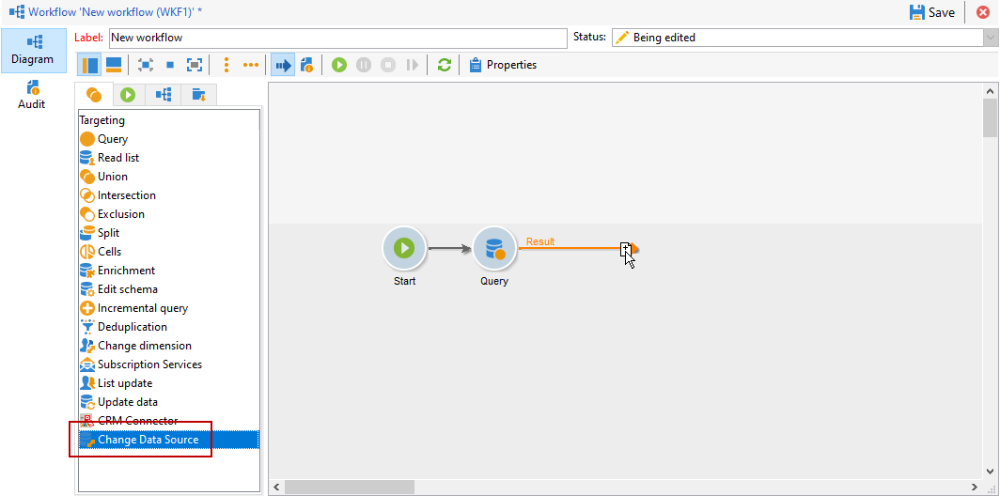
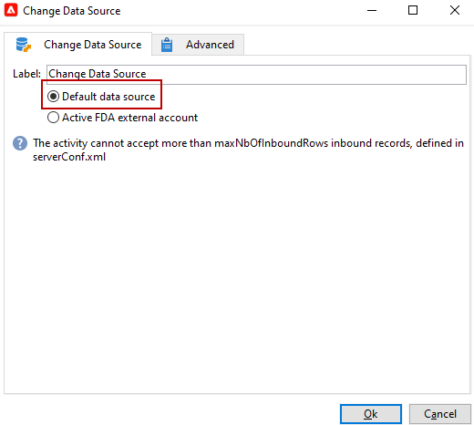
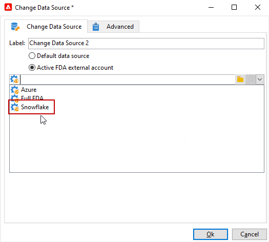

# Datenquelle ändern {#change-data-source}

Verwenden Sie die Aktivität **[!UICONTROL Datenquelle ändern]**, um die Datenquelle einer [Workflow-Arbeitstabelle](use-workflow-data.md#workflow-temporary-work-table) zu ändern. Diese Aktivität bietet mehr Flexibilität bei der Verwaltung von Daten aus verschiedenen Datenquellen, z. B. Federated Data Access (FDA), Campaign-Cloud-Datenbank (FFDA) und lokale Campaign-Datenbank.

Die **[!UICONTROL Workflow-Arbeitstabelle]** wird verwendet, um Daten mit den Workflow-Aktivitäten zu verarbeiten und freizugeben.

Standardmäßig wird die **[!UICONTROL Arbeitstabelle]** in derselben Datenbank erstellt wie die Quelle der Daten, die Sie abfragen möchten.
Wenn Sie zum Beispiel die Tabelle **[!UICONTROL Empfänger]** abfragen, die in der Cloud-Datenbank gespeichert ist, erstellt der Workflow eine **[!UICONTROL Arbeitstabelle]** in derselben Cloud-Datenbank.

Verwenden Sie eine Aktivität **[!UICONTROL Datenquelle ändern]**, um eine andere Datenquelle für Ihre **[!UICONTROL Arbeitstabelle]** zu verwenden.

Beachten Sie, dass Sie bei Verwendung der Aktivität **[!UICONTROL Datenquelle ändern]** zur Cloud-Datenbank zurückkehren müssen, um die Ausführung des Workflows fortzusetzen.

>[!IMPORTANT]
>
>Beachten Sie, dass die Aktivitäten **[!UICONTROL Dimension ändern]** und **[!UICONTROL Datenquelle ändern]** nicht in einer Zeile hinzugefügt werden dürfen. Wenn Sie beide Aktivitäten nacheinander verwenden müssen, muss die Aktivität **[!UICONTROL Anreicherung]** zwischen ihnen enthalten sein. Dadurch wird eine ordnungsgemäße Ausführung sichergestellt und potenzielle Konflikte oder Fehler werden vermieden.

>[!NOTE]
>
>Die Aktivität **Datenquelle ändern** kann maximal eine Million Einträge pro Ausführung verarbeiten. Wenden Sie sich an den Adobe-Support, wenn Sie dieses Limit erhöhen möchten.

So verwenden Sie die Aktivität **[!UICONTROL Datenquelle ändern]**:

1. Erstellen Sie einen Workflow.

1. Fragen Sie Ihre ausgewählten Empfänger mit einer **[!UICONTROL Abfrage]**-Aktivität ab.

   Weitere Informationen zur Aktivität **[!UICONTROL Abfrage]** erhalten Sie auf dieser [Seite](query.md#create-a-query).

1. Fügen Sie die Aktivität **[!UICONTROL Datenquelle ändern]** hinzu.

   

1. Bearbeiten Sie die Aktivität **[!UICONTROL Datenquelle ändern]** und wählen Sie **[!UICONTROL Standarddatenquelle]** aus.

   Die Arbeitstabelle, die das Ergebnis Ihrer Abfrage enthält, wird dann in die standardmäßige lokale Campaign-Datenbank verschoben.

   

1. Fügen Sie eine **[!UICONTROL JavaScript-Code]**-Aktivität hinzu, um Einzeloperationen an der Arbeitstabelle durchzuführen.

   Weitere Informationen über die Aktivität **[!UICONTROL JavaScript-Code]** finden Sie auf [dieser Seite](sql-code-and-javascript-code.md#javascript-code).

1. Fügen Sie eine weitere Aktivität vom Typ **[!UICONTROL Datenquelle ändern]** hinzu, um zur Cloud-Datenbank zurückzukehren.

1. Bearbeiten Sie diese Aktivität und wählen Sie **[!UICONTROL Aktives externes FDA-Konto]** sowie das entsprechende externe Konto **[!UICONTROL Externe Datenbank]**.

   

1. Sie können den Workflow jetzt starten.
