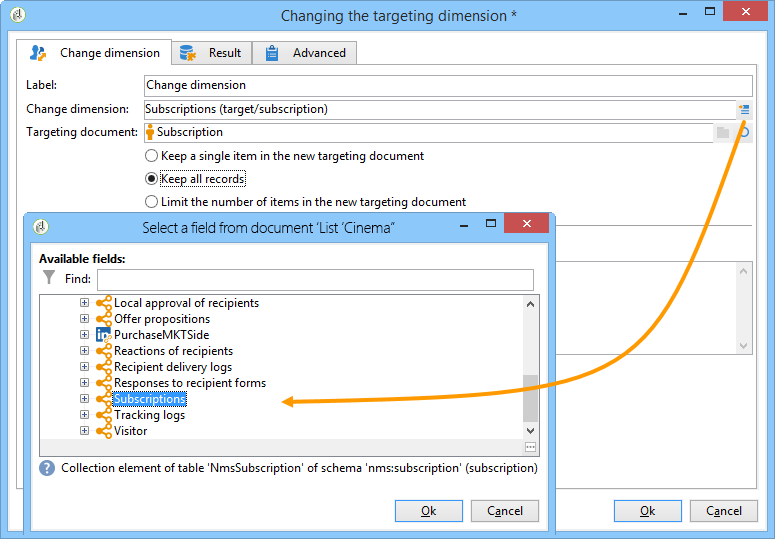
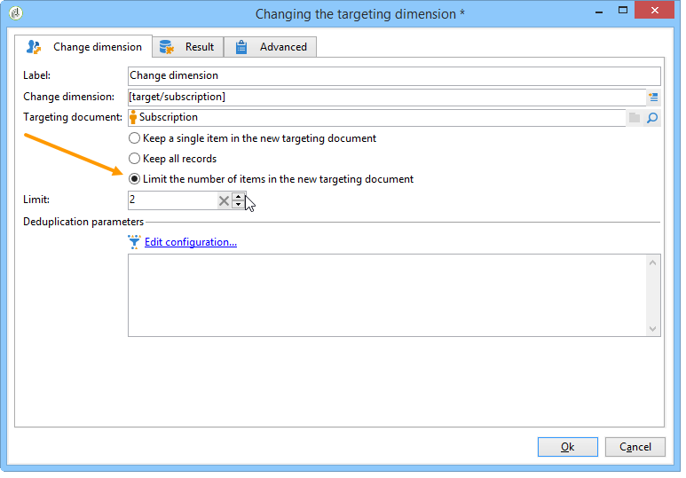
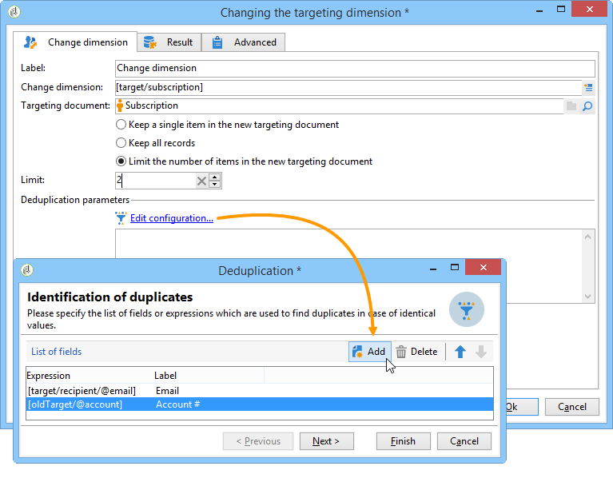
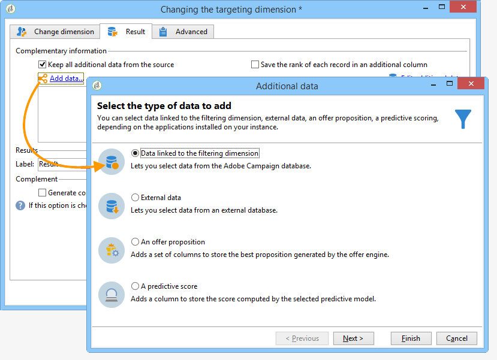
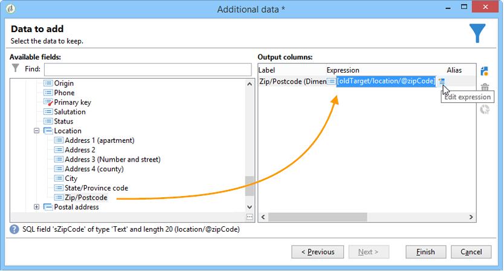
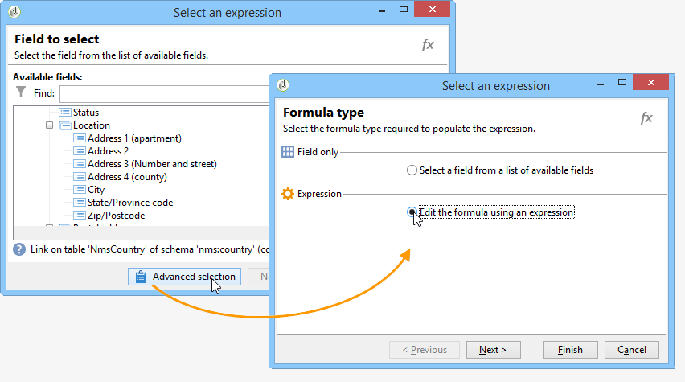
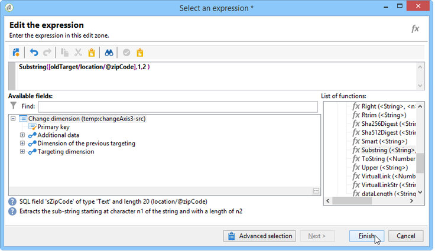
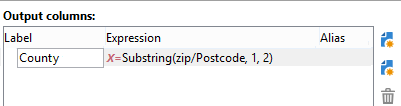
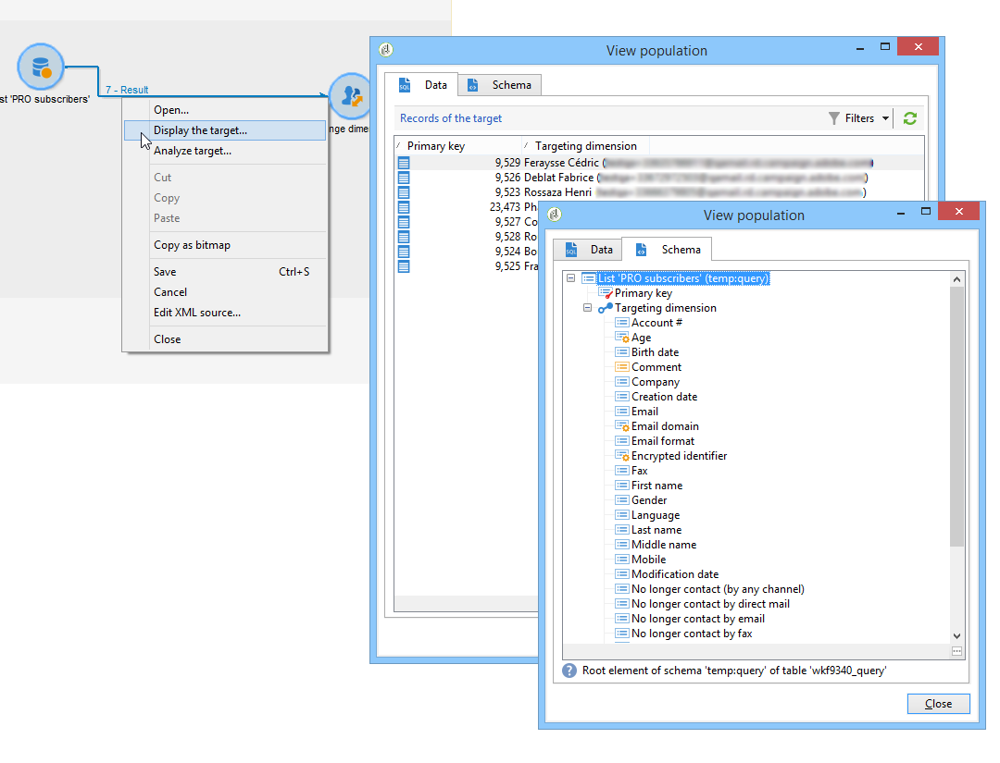
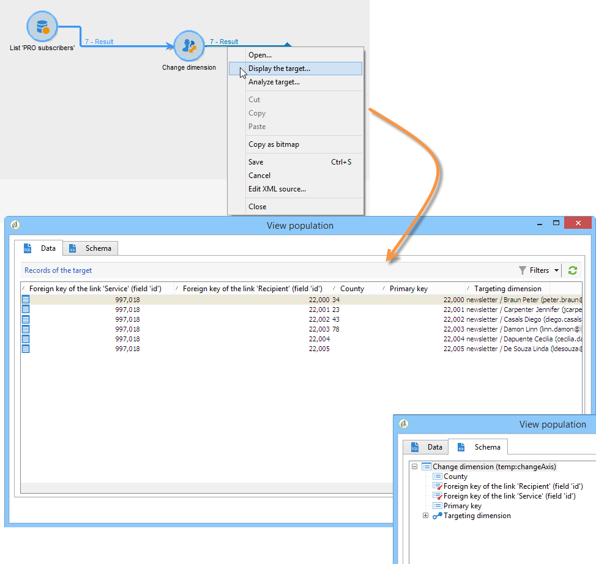

# Dimensionsänderung{#change-dimension}

Verwenden Sie die Aktivität **[!UICONTROL Dimensionsänderung]**, um die Zielgruppendimension beim Erstellen einer Audience zu ändern. Diese Aktivität verschiebt die Achse je nach Datenvorlage und der eingegebenen Dimension. Sie wechseln beispielsweise von der Dimension &quot;Verträge&quot; zur Dimension &quot;Kunden&quot;.

Sie können diese Aktivität auch verwenden, um die zusätzlichen Spalten der neuen Zielgruppe und Kriterien zur Datendeduplizierung zu definieren.

>[!IMPORTANT]
>
>Beachten Sie, dass die Aktivitäten **[!UICONTROL Dimension ändern]** und **[!UICONTROL Datenquelle ändern]** nicht in einer Zeile hinzugefügt werden sollten. Wenn Sie beide Aktivitäten nacheinander verwenden müssen, muss die Aktivität **[!UICONTROL Anreicherung]** zwischen ihnen enthalten sein. Dadurch wird eine ordnungsgemäße Ausführung sichergestellt und potenzielle Konflikte oder Fehler werden vermieden.

Um die Aktivität **[!UICONTROL Dimensionsänderung]** zu konfigurieren, führen Sie die folgenden Schritte aus:

1. Wählen Sie im Feld **[!UICONTROL Dimensionsänderung]** die neue Zielgruppendimension aus.

   

1. Bei der Dimensionsänderung können Sie alle Elemente beibehalten oder die in der Ausgabe beizubehalten Elemente auswählen. Im folgenden Beispiel ist der Wert für „Max. Anzahl der Duplikate“ auf 2 gesetzt.

   

   Wenn Sie nur einen Eintrag beibehalten möchten, wird im Arbeitsschema eine Sammlung angezeigt, die alle Einträge enthält, die nicht im Endergebnis enthalten sind (da nur Eintrag beibehalten wird). Wie alle anderen Sammlungen können Sie mit dieser Sammlung Aggregate berechnen oder Informationen in Spalten abrufen.

   Wenn Sie beispielsweise von der Dimension **[!UICONTROL Kunden]** zur Dimension **[!UICONTROL Empfänger]** wechseln, können Sie die Kunden eines bestimmten Geschäfts unter Angabe der getätigten Käufe abrufen.

1. Wenn Sie nicht alle Datensätze beibehalten, können Sie die Deduplizierungsparameter bestimmen.

   

   Mithilfe der blauen Pfeile lässt sich die Reihenfolge der Duplikatverarbeitung bestimmen.

   Im vorliegenden Beispiel erfolgt die Deduplizierung zunächst über die E-Mail-Adresse und bei Bedarf anschließend über die Kundennummer.

1. Im **[!UICONTROL Ergebnis]**-Tab kann die Hinzufügung von Zusatzinformationen konfiguriert werden.

   Sie können beispielsweise den Bezirk anhand der Postleitzahl wiederherstellen, indem Sie eine **Substring**-Funktion verwenden. Gehen Sie dazu wie folgt vor:

   * Klicken Sie auf den Link **[!UICONTROL Daten hinzufügen...]** und kreuzen Sie die Option **[!UICONTROL Daten in Relation mit der Filterdimension]** an.

     

     >[!NOTE]
     >
     >Weitere Informationen zur Erstellung und Verwendung von Zusatzspalten finden Sie unter [Daten hinzufügen](query.md#add-data).

   * Wählen Sie die ursprüngliche Zielgruppendimension aus (vor der Dimensionsänderung), markieren Sie die **[!UICONTROL Kundennummer]** und klicken Sie auf **[!UICONTROL Ausdruck bearbeiten]****[!UICONTROL .]**

     

   * Klicken Sie auf die Schaltfläche **[!UICONTROL Erweiterte Auswahl]** und kreuzen Sie die Option **[!UICONTROL Formel von einem Ausdruck ausgehend erstellen]** an.

     

   * Verwenden Sie die Funktionsliste, um die Formel zu erstellen.

     

   * Geben Sie abschließend einen Titel für die neu erstellte Spalte an.

     

1. Führen Sie den Workflow aus, um das Ergebnis dieser Konfiguration anzuzeigen. Die folgenden Abbildungen zeigen die Tabellen vor und nach der Dimensionsänderung sowie die Struktur der Workflow-Tabellen:

   

   
