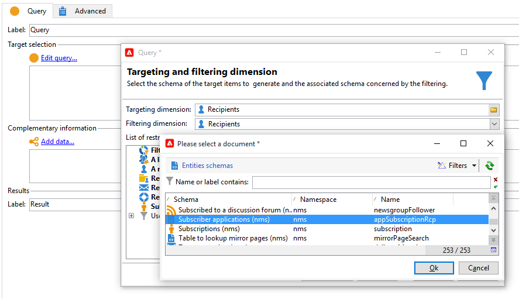
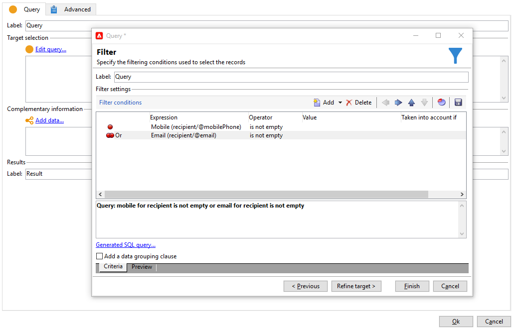
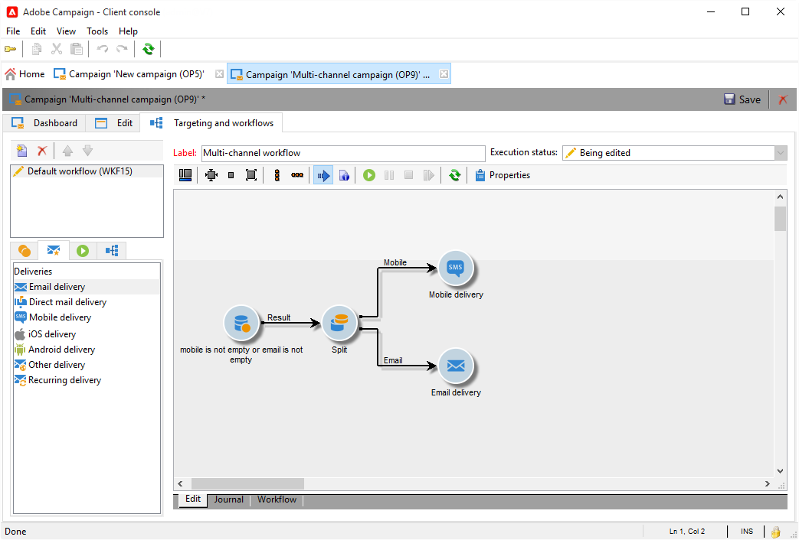
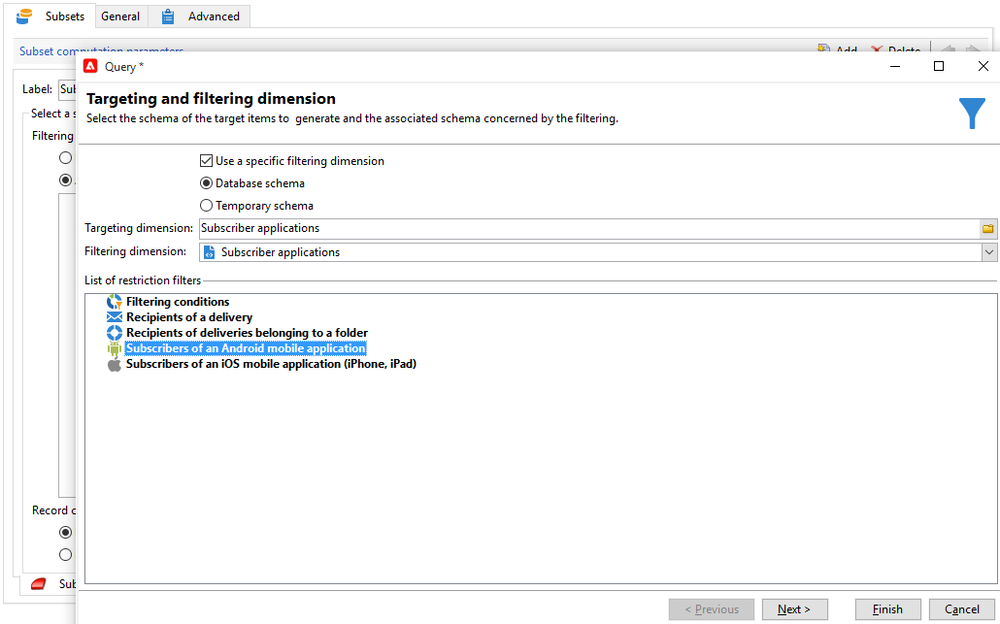
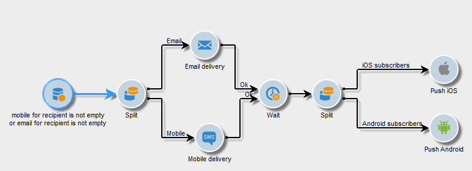

# Kanalübergreifender Versand{#cross-channel-deliveries}

Auf kanalübergreifende Sendungen kann über die Registerkarte **[!UICONTROL Sendungen]** von [Kampagnen-Workflow](campaign-workflows.md)-Aktivitäten zugegriffen werden.

Wählen Sie die Vorlage aus, auf der der Versand basieren soll, und definieren Sie ihre Inhalte.

Die Zielgruppe des Versands kann mithilfe der verschiedenen dedizierten Zielgruppenbestimmungs-Aktivitäten vorab im Workflow definiert werden.

Im folgenden Beispiel erfahren Sie, wie Sie einen Workflow erstellen, um eine E-Mail oder eine SMS für Abonnentinnen und Abonnenten von Push-Benachrichtigungen zu senden und eine Woche später eine weitere Push-Benachrichtigung folgen zu lassen. Gehen Sie dazu wie folgt vor:

1. Erstellen Sie eine Kampagne.
1. Fügen Sie Ihrer Kampagne auf der Registerkarte **[!UICONTROL Zielgruppenbestimmungen und Workflows]** eine **[!UICONTROL Abfrage]**-Aktivität hinzu.
1. Konfigurieren Sie Ihre Abfrage, indem Sie die Personen, die Push-Benachrichtigungen abonniert haben, als Zieldimension auswählen.

   >[!NOTE]
   >
   >Verwenden Sie für Push-Benachrichtigungen die Zieldimension **Abonnierte Anwendungen**.

   

1. Fügen Sie Ihrer Abfrage die Filterbedingungen hinzu. In diesem Fall wählen wir Empfängerinnen und Empfänger aus, die über eine Mobiltelefonnummer oder E-Mail-Adresse verfügen.

   

1. Fügen Sie Ihrem Workflow eine **[!UICONTROL Aufspaltung]** hinzu, um Empfänger in Besitzer einer Mobiltelefonnummer und in Besitzer einer E-Mail-Adresse zu unterteilen.
1. Wählen Sie im Tab **[!UICONTROL Versand]** für jeden Zieldatensatz einen Versand.

   Erstellen Sie Ihren Versand auf dieselbe Weise wie mit dem klassischen Versand-Assistenten, indem Sie die Versandaktivität in Ihrem Workflow per Doppelklick auswählen.

   

1. Fügen Sie eine **[!UICONTROL Warten]**-Aktivität hinzu und konfigurieren Sie sie, damit die Empfänger nicht zu viele Sendungen gleichzeitig erhalten.
1. Fügen Sie eine **[!UICONTROL Aufspaltung]** hinzu, um Abonnenten in Anwender von iOS- und Android-Apps zu unterteilen.

   Wählen Sie für jedes Betriebssystem einen Dienst aus.

   

1. Wählen Sie für jedes Betriebssystem einen Mobile-App-Versand aus und konfigurieren Sie ihn.

   
