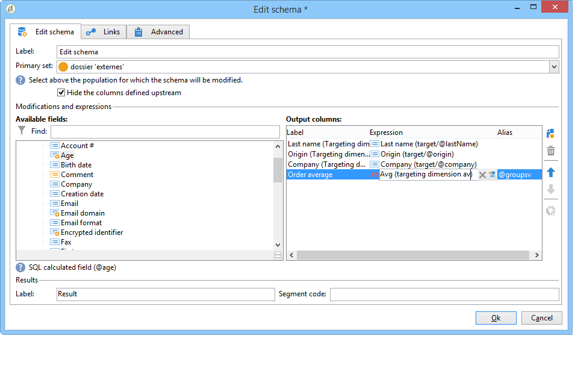
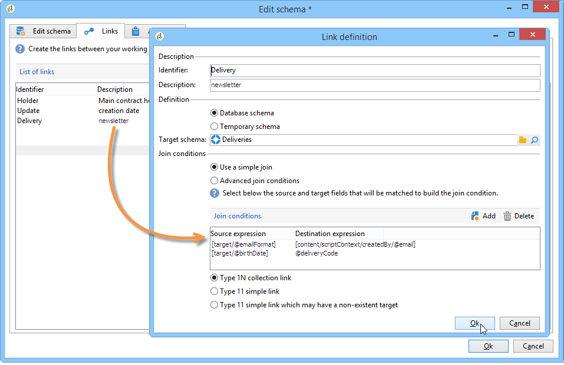

# Schema-Bearbeitung{#edit-schema}

Daten können mit der Aktivität **[!UICONTROL Schema bearbeiten]** im Workflow umgewandelt, normalisiert und bei Bedarf angereichert werden. Dies wird in der Regel zum Normalisieren der Datenstruktur gemacht: Sie können die Ausgabespalten umbenennen oder ihren Inhalt verändern, indem Sie beispielsweise die Durchschnittswerte eines Felds oder Aggregats berechnen.

Diese Aktivität verändert nicht die Daten der Arbeitstabelle, sondern nur ihr Schema, d. h. die logische Darstellung der Daten.

Im Tab **[!UICONTROL Relationen]** können Sie Beziehungen zu anderen Arbeitstabellen herstellen.

Im unteren Bereich werden die Joinbedingungen definiert, d. h. die Kriterien festgelegt, die die Abstimmung zwischen den Tabellendaten ermöglichen.
