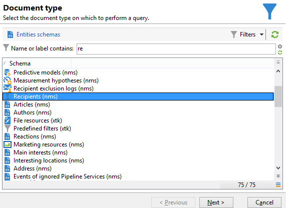
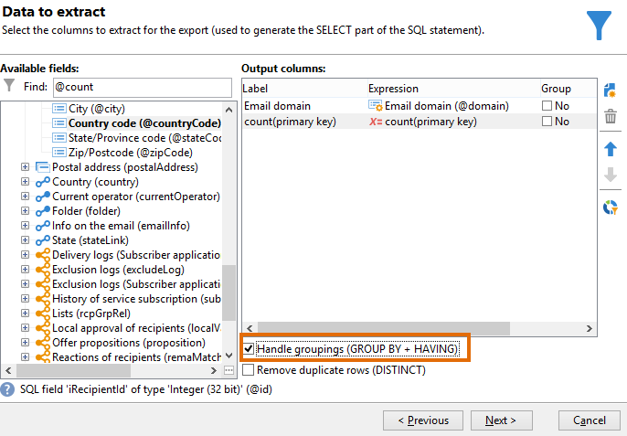
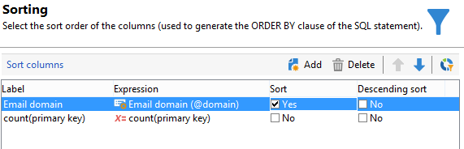
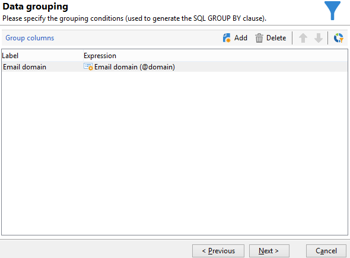
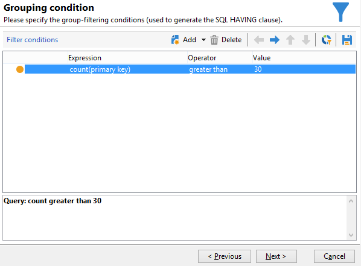
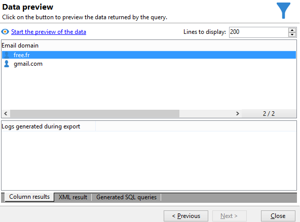

# Abfrage mit Gruppierungsverwaltung {#querying-using-grouping-management}

Im folgenden Beispiel werden die E-Mail-Domains gesucht, die bei früheren Sendungen mehr als 30-mal kontaktiert wurden.

* Welche Tabelle soll ausgewählt werden?

  Die Empfängertabelle (nms:recipient)

* Felder, die als Ausgabespalten verwendet werden sollen?

  E-Mail-Domain und Primärschlüssel (mit Zählung)

* Nach welchen Kriterien werden die Daten gruppiert?

  Nach E-Mail-Domain mit einer Anzahl von über 30 Primärschlüsseln. Dieser Vorgang wird mit der Option **[!UICONTROL Group by + Having]** ausgeführt. **[!UICONTROL Group by + Having]** ermöglicht die Gruppierung von Daten („group by“) und die Auswahl dessen, was gruppiert ist („having“).

Gehen Sie wie folgt vor:

1. Öffnen Sie das **[!UICONTROL generische Abfragetool]** und wählen Sie die Empfängertabelle (**nms:recipient**).

   

1. Im Fenster **[!UICONTROL Zu extrahierende Daten]** wählen Sie die Felder **[!UICONTROL E-Mail-Domain]** und **[!UICONTROL Primärschlüssel]** aus. Führen Sie eine Zählung des Felds **[!UICONTROL Primärschlüssel]** durch.

1. Kreuzen Sie die Option **[!UICONTROL Gruppierungen verwalten (GROUP BY + HAVING)]** an.

   

1. Ordnen Sie im Fenster **[!UICONTROL Sortierung]** die E-Mail-Domains in absteigender Reihenfolge. Kreuzen Sie hierfür in der Spalte **[!UICONTROL Absteigende Sortierung]** die Option **[!UICONTROL Ja]** an. Klicken Sie auf **[!UICONTROL Weiter]**.

   

1. Wählen Sie dann im Fenster **[!UICONTROL Datenfilter]** die Option **[!UICONTROL Filterbedingungen]**. Wechseln Sie zum Fenster **[!UICONTROL Zielelemente]** und klicken Sie auf **[!UICONTROL Weiter]**.
1. Klicken Sie im Fenster **[!UICONTROL Gruppierung der Daten]** auf **[!UICONTROL Hinzufügen]** und wählen Sie das Feld **[!UICONTROL E-Mail-Domain]** aus.

   Die Gruppierung (GROUP BY) erfolgt an dieser Stelle. Das Fenster wird nur angezeigt, wenn die Option **[!UICONTROL Gruppierungen verwalten (GROUP BY + HAVING)]** angekreuzt wurde.

   

1. Geben Sie anschließend im Fenster **[!UICONTROL Gruppierbedingung]** eine Primärschlüsselanzahl von über 30 an. So werden nur die E-Mail-Domains ausgegeben, die mehr als 30-mal kontaktiert wurden.

   Dieses Fenster wird ebenfalls nur angezeigt, wenn die Option **[!UICONTROL Gruppierungen verwalten (GROUP BY + HAVING)]** angekreuzt wurde. Hier erfolgt die Filterung des Ergebnisses der Gruppierung (HAVING).

   

1. Da in unserem Beispiel keine spezielle Formatierung erforderlich ist, können Sie im Fenster **[!UICONTROL Datenformatierung]** direkt auf **[!UICONTROL Weiter]** klicken.
1. Klicken Sie anschließend auf **[!UICONTROL Datenvorschau starten]**. Das Ergebnis zeigt nur eine E-Mail-Domain, die mehr als 30-mal kontaktiert wurde.

   
