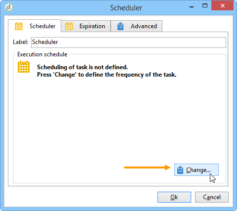
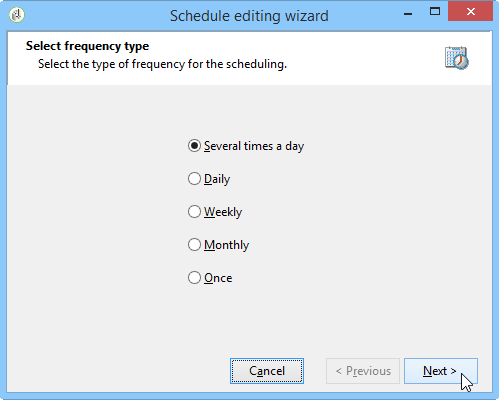
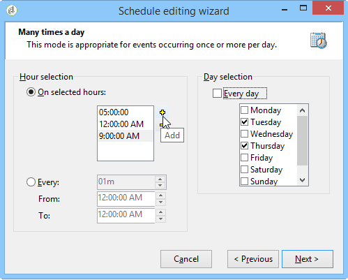
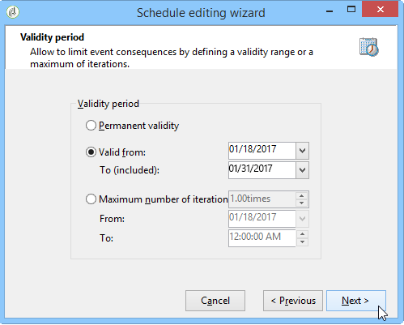
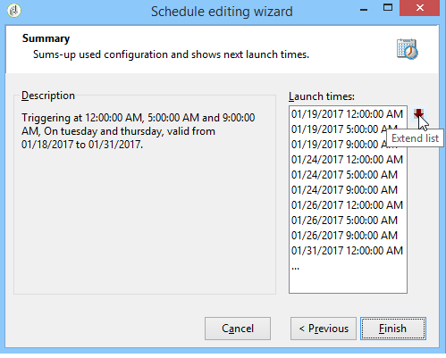

# Planung {#scheduler}

Die **Planung** ist eine persistente Aufgabe, die ihre ausgehende Transition zum konfigurierten Zeitpunkt aktiviert.

Eine **[!UICONTROL Planung]** entspricht einem programmierten Start, daher sind die gleichen Regeln zu beachten wie für die **[!UICONTROL Start]**-Aktivität. So darf die Planung beispielsweise keine eingehende Transition aufweisen.

## Best Practices {#best-practices}

**Workflow nach Änderung der Zeit der Planung neu starten**: Wenn die geplante Zeit der Aktivität **[!UICONTROL Planung]** geändert wird, muss der Workflow neu gestartet werden. Dadurch wird sichergestellt, dass der Workflow zu den aktualisierten Zeiten ausgeführt wird. Ohne Neustart wird der Workflow weiterhin gemäß dem alten Zeitplan ausgeführt.

**Häufigkeit der Planung begrenzen**: Vermeiden Sie es, Workflows so zu planen, dass sie häufiger als alle 15 Minuten ausgeführt werden. Eine häufigere Ausführung kann die Systemleistung beeinträchtigen und zu einer Überlastung der Datenbank führen.

**Eine Planung pro Verzweigung verwenden**: Jede Verzweigung Ihres Workflows sollte nur eine Aktivität vom Typ **[!UICONTROL Planung]** aufweisen. Weitere Informationen zu den Best Practices für die Verwendung von Aktivitäten in Workflows finden Sie auf der Seite [Best Practices bei Workflows](workflow-best-practices.md#using-activities).

**Gleichzeitige Ausführungen von Workflows verhindern**: Wenn ein Workflow von einer Planung ausgelöst wird, sollten Sie beachten, dass mehrere Instanzen des Workflows gleichzeitig ausgeführt werden können. Wenn beispielsweise der Workflow stündlich von einer Planung Trigger wird, die Workflow-Ausführung jedoch länger als eine Stunde dauert, kann es zu Überschneidungen bei den Ausführungen kommen.Um dies zu vermeiden, sollten Sie Prüfungen einrichten, um mehrere gleichzeitige Ausführungen zu verhindern. [Erfahren Sie, wie Sie die gleichzeitige Ausführung mehrerer Workflows verhindern können](monitor-workflow-execution.md#preventing-simultaneous-multiple-executions).

**Konto für verzögerte Transitionen**: Von der Planung ausgelöste Transitionen können verzögert werden, wenn der Workflow lange andauernde Aufgaben ausführt (z. B. Importe) oder wenn das Modul „wfserver“ vorübergehend angehalten wurde. Um dies zu verhindern, beschränken Sie die Aktivierungszeiten der Planung, um sicherzustellen, dass die Aufgaben innerhalb eines festgelegten Zeitfensters ausgeführt werden.

## Konfigurieren der Planungsaktivität {#configuring-scheduler-activity}

Die Planung definiert die Aktivierungsplanung der Transition. Doppelklicken Sie zur Konfiguration auf das grafische Objekt und klicken Sie auf **[!UICONTROL Ändern...]**

Mit einem Assistenten können Sie die Häufigkeit und den Gültigkeitszeitraum der Aktivität definieren. Die Konfiguration stellt sich wie folgt dar:

1. Kreuzen Sie die gewünschte Häufigkeit an und klicken Sie auf **[!UICONTROL Weiter]**.

   

1. Geben Sie die Aktivierungszeiten und -tage an. Die Parameter für diesen Schritt hängen von der im vorherigen Schritt ausgewählten Häufigkeit ab. Wenn Sie die Aktivität mehrmals täglich starten möchten, sind folgende Konfigurationsoptionen verfügbar:

   

1. Definieren Sie im nächsten Schritt die Gültigkeit der Planung oder die maximale Anzahl an Ausführungen.

   

1. Prüfen Sie im letzten Schritt die Konfiguration und klicken Sie auf **[!UICONTROL Beenden]**, um sie zu speichern.

   
