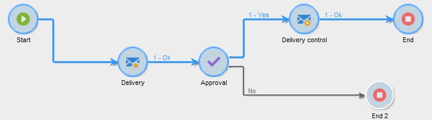
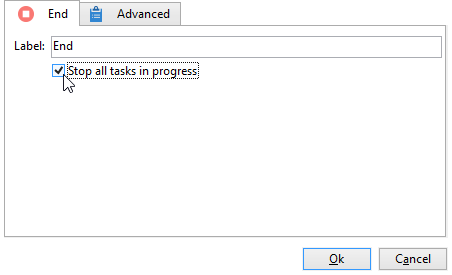
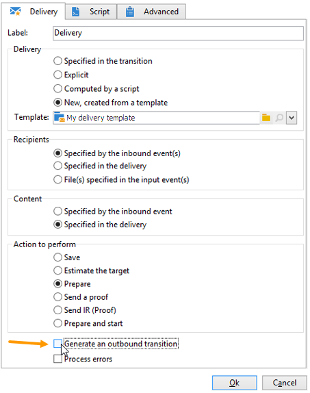

# Start und Ende{#start-and-end}

Die Aktivitäten **[!UICONTROL Start]** und **[!UICONTROL Ende]** markieren grafisch den Start- bzw. Endpunkt eines Workflows. Diese Aktivitäten haben keine funktionalen Auswirkungen und sind daher optional.

* **[!UICONTROL Starten]**

  Die Ausführung eines Workflows beginnt mit Aktivitäten ohne eingehende Transition oder mit einer Beginnaktivität.

  

* **[!UICONTROL Ende]**

  Sie können die Aktivität **[!UICONTROL Ende]** so konfigurieren, dass alle laufenden Aufgaben unterbrochen werden. Doppelklicken Sie hierzu auf die Aktivität, um ihre Eigenschaften anzuzeigen, und aktivieren Sie die entsprechende Option.

  

  Die Daten in der Arbeitstabelle werden automatisch gelöscht, wenn die Aktivität „Ende“ aktiviert ist. Wenn dies nicht erforderlich ist, können Sie zur Vermeidung unnötiger Lasten die Transition bei der letzten Aktivitätsausgabe deaktivieren. Wenn beispielsweise an einer Versandausgabe kein Prozess geplant ist, deaktivieren Sie die entsprechende Option wie unten dargestellt:

  
