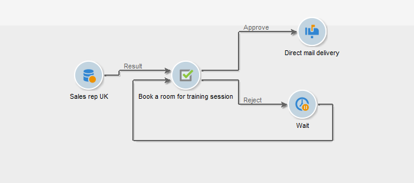
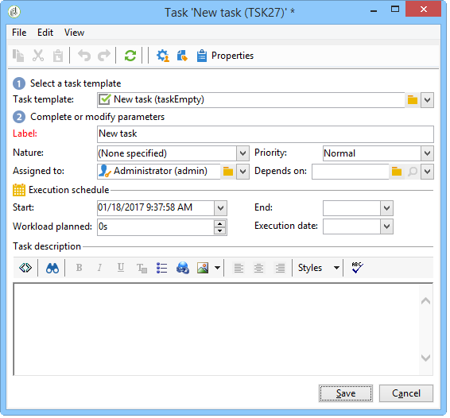

# Aufgabe{#task}

In Kampagnen-Workflows können mithilfe einer **[!UICONTROL Aufgabe]** zwei mögliche Szenarien definiert werden: Das erste kommt zum Tragen, wenn die Aufgabe beendet wurde, das zweite, wenn die Aufgabe nicht beendet wurde. Dies ist beispielsweise der Fall, wenn der Benutzer die Erfüllung abgelehnt hat oder wenn sie überfällig ist.

Mit der Option **[!UICONTROL Ressourcen]** können Sie die verantwortlichen Benutzenden einen Validierungsplan für die Aufgabe definieren. Wenn die genehmigende Person ablehnt, führt dies nicht dazu, dass die Aufgabe selbst abgelehnt wird.
