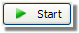

# Schaltfläche

Schaltfläche.

## Eigenschaften

**backColor - Zeichenfolge** Hintergrundfarbe (btnshadow, weiß).

**border - string** Ändert den Stil des Kontrollentwurfs (solid, double, inset, outset, none).

**font-size - integer** Ändert die Schriftgröße.

**img - Zeichenfolge** Zugehöriges Bild.

**label - Zeichenfolge** Schaltflächenbezeichnung.
