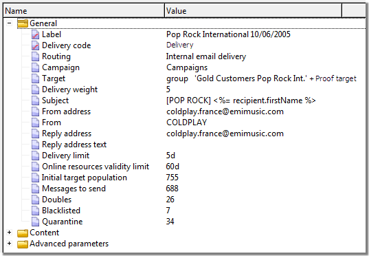

# TreeEdit

Steuerelement zum Anzeigen und Bearbeiten verschiedener Werte, die in verschiedenen Kategorien gruppiert sind.



## Eigenschaften

**backColor - Zeichenfolge** Hintergrundfarbe (btnshadow, weiß).

**border - string** Ändert den Stil des Kontrollentwurfs (solid, double, inset, outset, none).

**bearbeitbar - Zeichenfolge** Autorisiert die Änderung (standardmäßig „true„).

**font-size - integer** Ändert die Schriftgröße.

**label - Zeichenfolge** Zugeordnete Bezeichnung.

**noImage - Zeichenfolge** Blendet die Bilder der Elemente in der Liste aus.

**nolabel - Boolesch** Blendet die zugehörige Beschriftung aus.

**readOnly - boolean** Erzwingt, dass das Steuerelement schreibgeschützt ist.

## Bemerkungen

Eigenschaften der Unterelemente

* visibleIf : Eine XTK-Bedingung zum Anzeigen oder Ausblenden des Elements.
* label: Bezeichnung des Elements.
* exprLabel : Bezeichnung des Elements in Form eines Ausdrucks.
* xpath: XPath des Elements
* img: Bild des Elements.

Eigenschaften der Eingabe-Unterelemente

* Bearbeitbar: Bearbeitbarer Wert. Der Standardwert wird vom Stammelement übernommen.

Eigenschaften der Container-Unterelemente

* collapsed: true\|false Zeigt Unterelemente an oder blendet sie aus.

Beispiel:

```xml
<input nolabel="true" type="treeEdit">
  <container label="Text fields">
    <input xpath="@text1"/>
    <input xpath="@text2"/>
    <input xpath="@text3"/>
    <input xpath="@text4"/>
    <input xpath="@text5"/>
  </container>
  <container label="Boolean fields">
    <input xpath="@boolean1"/>
    <input xpath="@boolean2"/>
    <input xpath="@boolean3"/>
  </container>
</input>
    
```
