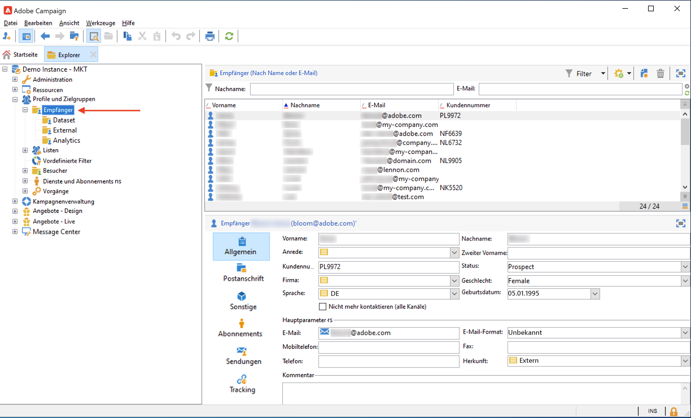
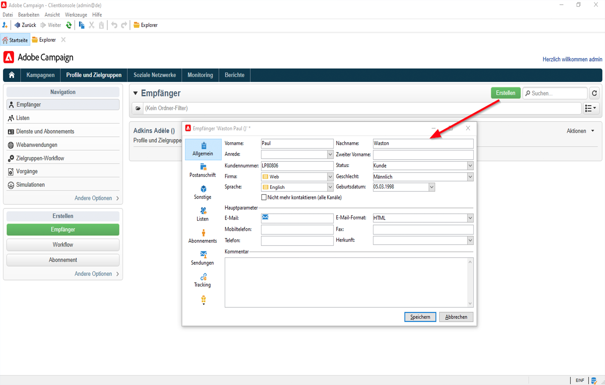

# Erste Schritte mit Profilen und Zielgruppen{#gs-profiles-and-audiences}

Profile sind in der Campaign-Datenbank gespeicherte Kontakte, z. B. Kunden, Abonnenten eines Services oder potenzielle Kunden. Die Akquise von Profilen und die Datenbankerstellung können auf viele verschiedene Weisen erfolgen: Online-Akquise über Web-Formulare, manueller oder automatisierter Import von Textdateien, Replikation von bereits existierenden Datenbanken oder Informationssystemen des Unternehmens. Mit Adobe Campaign können Sie Marketing-Verlauf, Kaufinformationen, Voreinstellungen, CRM-Daten und alle relevanten PI-Daten in eine konsolidierte Ansicht integrieren, um sie zu analysieren und Maßnahmen zu ergreifen. Profile enthalten alle Informationen, die für Zielgruppenbestimmung, Qualifizierung und Tracking von Personen erforderlich sind.

Ein Profil ist ein Datensatz in der Tabelle **nmsRecipient** oder einer externen Tabelle, in der alle Profilattribute wie Vorname, Nachname, E-Mail-Adresse, Cookie-ID, Kunden-ID, Mobilgerät-Kennung oder andere für einen bestimmten Kanal relevante Informationen gespeichert werden. Andere mit der Empfängertabelle verknüpfte Tabellen enthalten profilbezogene Daten, z. B. die Tabelle &quot;Versand-Logs&quot;, die die Datensätze aller an Empfänger gesendeten Sendungen enthält. Weitere Informationen über integrierte Profile und Empfängertabellen finden Sie unter [Integrierte Profiltabelle](../dev/datamodel.md#ootb-profiles).

In Adobe Campaign sind die Standardprofile für Sendungen (E-Mails, SMS usw.) die **Empfänger**.

Die in der Datenbank gespeicherten Empfängerdaten ermöglichen es Ihnen, die Zielgruppe zu filtern, die einen bestimmten Versand erhält, und Personalisierungsdaten in Ihren Versandinhalten hinzuzufügen. In der Datenbank gibt es noch andere Arten von Profilen. Sie sind für unterschiedliche Zwecke gedacht. So werden beispielsweise Testprofile erstellt, um Ihre Sendungen zu testen, bevor sie an die endgültige Zielgruppe gesendet werden.

Um Profildaten zu Adobe Campaign hinzuzufügen, haben Sie folgende Möglichkeiten:

* [Importieren von Datendateien](../start/import.md) aus einer externen Datenquelle, z. B. einem CRM-System oder einer flachen Datei
* [Erstellen von Web-Formularen](../dev/webapps.md), damit Kunden selbst Informationen eingeben und ihr eigenes Profil erstellen können
* [Zuordnen zu einer externen Datenbank](../connect/fda.md), in der Profile gespeichert werden
* Manuelles Eingeben von Profilen über die Client-Konsole, wie unten beschrieben:

Nach dem Import können Sie Zielgruppen erstellen, um Ihre Nachrichten zu versenden. [In diesem Abschnitt](create-audiences.md) erfahren Sie, wie Sie Zielgruppen erstellen.