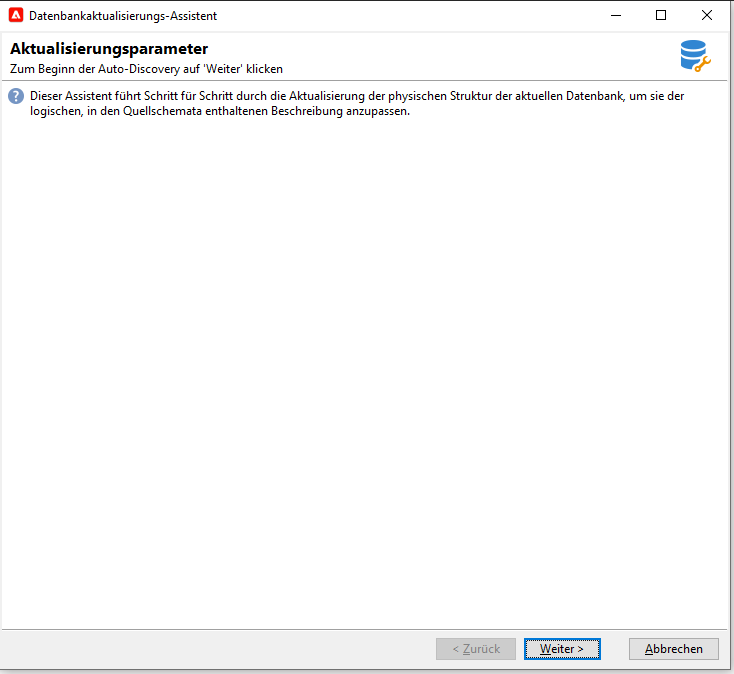
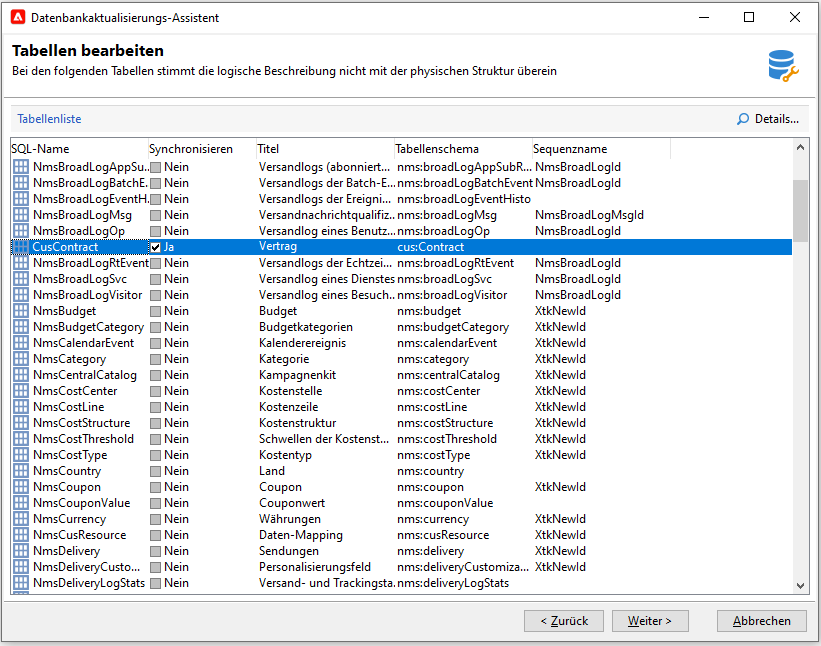
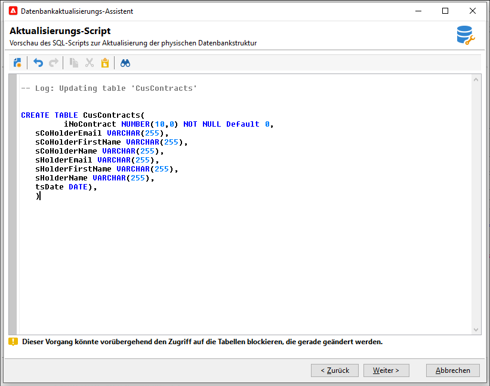
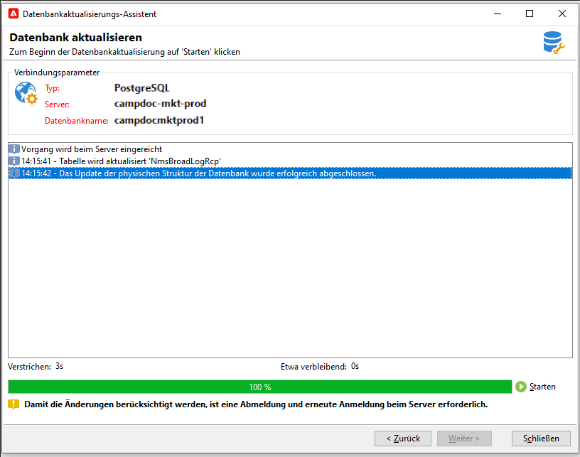

# Datenbankstruktur aktualisieren {#updating-the-database-structure}

Um die an den Schemata vorgenommenen Änderungen anzuwenden, starten Sie den Datenbankaktualisierungs-Assistenten. Auf diesen Assistenten kann über **[!UICONTROL Tools > Erweitert > Datenbankstruktur aktualisieren]** zugegriffen werden. Er prüft, ob die physische Struktur der Datenbank mit ihrer logischen Beschreibung übereinstimmt, und führt die SQL-Aktualisierungs-Scripts aus.

Die Module in der Datenbank werden automatisch ausgefüllt und aktiviert.

Führen Sie die Schritte aus und sehen Sie sich das SQL-Script für Datenbank-Update an:

>[!NOTE]
>
>Es befindet sich in einem Bearbeitungsfeld und kann geändert werden, indem SQL-Code gelöscht oder hinzugefügt wird.

Starten Sie anschließend das Datenbank-Update:

