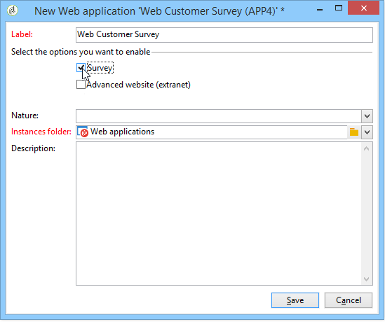

# Erste Schritte mit Web-Anwendungen{#about-web-applications}

>[!NOTE]
>
>Für die meisten gängigen Anwendungsfälle sollten Sie Ihre Landingpages in der Web-Benutzeroberfläche von Campaign erstellen, wo Sie sie einfach entwerfen und veröffentlichen können. In der Client-Konsole erstellte Landingpages bieten, wie in diesem Abschnitt beschrieben, mehr Einstellungen und erweiterte Anwendungsfälle.
>
>[Erfahren Sie mehr über Landingpages in der Web-Benutzeroberfläche von Campaign](https://experienceleague.adobe.com/de/docs/campaign-web/v8/landing-pages/get-started-lp){target="_blank"}

Adobe Campaign ermöglicht Ihnen, mit Daten aus der Datenbank dynamische und interaktive Webanwendungen zu erstellen und zu veröffentlichen, wobei die Inhalte auf die jeweiligen Benutzerrechte abgestimmt sind.

Sie können Seiten erstellen, wie ein Bearbeitungsformular für ein Extranet oder Benachrichtigungsformulare mit Daten aus der Datenbank mit Tabellen, Diagrammen, Eingabeformularen usw. Diese Funktionalität ermöglicht Ihnen das Entwerfen und Posten von Web-Seiten, auf denen Benutzende Informationen suchen oder eingeben können.

Dabei kann es sich um ein Anmeldeformular handeln, dessen Felder wie unten dargestellt mit Daten aus der Adobe Campaign-Datenbank vorausgefüllt wurden:

Dieses Kapitel bietet einen Überblick über die Verwaltung von Webanwendungen.

>[!NOTE]
>
>Informationen zur Optimierung der Sicherheit von Webanwendungen finden Sie in der [Checkliste für Sicherheit und Datenschutz](https://helpx.adobe.com/de/campaign/kb/acc-security.html).

>[!CAUTION]
>
>Aus Datenschutzgründen empfehlen wir die Verwendung von HTTPS für alle externen Ressourcen.

## Web-Anwendungsbereich {#web-application-scope}

Web-Anwendungen in Adobe Campaign bieten folgende Funktionen:

* Erstellung eines Formulars mit mehreren Seiten. Weiterführende Informationen hierzu finden Sie auf dieser [Seite](about-web-forms.md).
* Mehrsprachige Umfrageverwaltung mit einem integrierten Übersetzungs-Tool. Weiterführende Informationen hierzu finden Sie auf dieser [Seite](translating-a-web-application.md).
* Grafische Benutzeroberfläche zur Seitenverwaltung, mehrspaltiges Seiten-Layout. Weiterführende Informationen hierzu finden Sie auf dieser [Seite](designing-a-web-application.md).
* Personalisierte Darstellung und Feldposition. Weiterführende Informationen hierzu finden Sie auf dieser [Seite](editing-content.md#adding-personalization-content).
* Anzeige von Umfragefeldern entsprechend den Antworten. Weiterführende Informationen hierzu finden Sie auf dieser [Seite](form-rendering.md#defining-fields-conditional-display).
* Zufällige Anzeige von Fragen. Weitere Informationen hierzu finden Sie auf dieser [Seite](https://experienceleague.adobe.com/de/docs/campaign/campaign-v8/content/surveys/building-a-survey#adding-questions){target="_blank"} (Dokumentation zu Campaign v8).
* Bedingte Anzeige von Seiten. Weiterführende Informationen hierzu finden Sie auf dieser [Seite](defining-web-forms-page-sequencing.md#conditional-page-display).
* Informationsüberprüfung vor der Validierung abhängig vom erwarteten Datentyp (Zahl, E-Mail-Adresse, Datum usw.) und von den Pflichtfeldern. Weiterführende Informationen hierzu finden Sie auf dieser [Seite](form-rendering.md#defining-control-settings).
* Einladungen oder Benachrichtigungen per E-Mail. Weiterführende Informationen hierzu finden Sie auf dieser [Seite](publishing-a-web-form.md#delivering-a-form-via-email).
* Personalisierung von Fehler- und Beendigungsnachrichten. Weiterführende Informationen hierzu finden Sie auf dieser [Seite](defining-web-forms-properties.md#setting-up-an-error-page).
* Verwendung von Bildern, Videos, Hypertext-Links, Captcha usw. Weiterführende Informationen hierzu finden Sie auf dieser [Seite](editing-content.md).
* Überwachung der Antworten in Echtzeit Weitere Informationen hierzu finden Sie auf dieser [Seite](https://experienceleague.adobe.com/de/docs/campaign/campaign-v8/content/surveys/publish-track-and-use-collected-data#response-tracking){target="_blank"} (Dokumentation zu Campaign v8).

Das optionale Modul zur Umfrageerstellung (**Umfrage**) bietet die folgenden zusätzlichen Funktionen:

* Dynamische Erweiterung der Datenbank: Erstellung von Antworten, die nicht in der ursprünglichen Datenvorlage enthalten sind. Weitere Informationen hierzu finden Sie auf dieser [Seite](https://experienceleague.adobe.com/de/docs/campaign/campaign-v8/content/surveys/managing-answers#storing-collected-answers){target="_blank"} (Dokumentation zu Campaign v8).
* Erstellung spezieller Berichte Weitere Informationen hierzu finden Sie auf dieser [Seite](https://experienceleague.adobe.com/de/docs/campaign/campaign-v8/content/surveys/publish-track-and-use-collected-data#reports-on-surveys){target="_blank"} (Dokumentation zu Campaign v8).

Gegenüber Webanwendungen verfügen Umfragen über eine vereinfachte grafische Benutzeroberfläche mit weniger Steuerelementen zur Bearbeitung.

>[!NOTE]
>
>Umfragen werden in [&#x200B; Abschnitt beschrieben (](https://experienceleague.adobe.com/de/docs/campaign/campaign-v8/content/surveys/about-surveys){target="_blank"} Dokumentation zu Campaign v8).
>
>Die allgemeinen Funktionen von Webformularen in Adobe Campaign werden in [diesem Abschnitt](about-web-forms.md) beschrieben.

## Implementierung von Web-Anwendungen {#web-application-implementation}

Gehen Sie wie folgt vor, um eine Webanwendung zu erstellen und zu veröffentlichen:

1. Erstellen Sie den Inhalt (Felder, Listen, Tabellen, Diagramme etc.).

   Sehen Sie sich dazu auch den Abschnitt zu den Feldern an, die für Formulare zur Verfügung stehen. Alle diese Felder sind auch für Web-Anwendungen verfügbar. Diese Informationen finden Sie auf [dieser Seite](adding-fields-to-a-web-form.md).

1. Sie können nach Bedarf die Schritte zum Vorausfüllen, Testen und Speichern hinzufügen und das Zugriffskontrollsystem konfigurieren (hauptsächlich für Extranet-Veröffentlichungen).
1. Veröffentlichen Sie die Webanwendung, um sie im Extranet oder in Adobe Campaign verfügbar zu machen.

## Erstkonfiguration von Web-Anwendungen {#web-application-initial-configuration}

Die Erstellung von Webanwendungen erfolgt über den Link **[!UICONTROL Webanwendungen]** in den Tabs **[!UICONTROL Kampagnen]** und **[!UICONTROL Profile und Zielgruppen]**.

Web-Anwendungen werden im Knoten **[!UICONTROL Ressourcen > Online > Web-Anwendungen]** der Adobe Campaign-Struktur gespeichert. Konfigurationen sind in die folgenden Ordner unterteilt:

* **[!UICONTROL Administration > Konfiguration > Formular-Renderings]**: Enthält die Rendering-Vorlagen für die Darstellung von Web-Formularen (Anwendungen und Umfragen). Mit der Vorlage können Sie das Formular generieren. Außerdem wird ein CSS-Stylesheet verwendet. Dieses Stylesheet kann auf Vorlagenebene überladen werden. Weitere Informationen hierzu finden Sie auf [dieser Seite](form-rendering.md#selecting-the-form-rendering-template).
* **[!UICONTROL Ressourcen > Vorlagen > Web-Anwendungsvorlagen]**: Enthält Formularvorlagen. Ein Formular oder eine Web-Anwendung muss auf Grundlage einer Vorlage erstellt werden.

## Web-Anwendungsvorlagen {#web-application-templates}

Standardmäßig bietet Adobe Campaign für jede verfügbare Webanwendung eine Vorlage.

>[!NOTE]
>
>Sie können eine vorhandene Web-Anwendung in eine Vorlage konvertieren. Wählen Sie dazu das Formular aus und klicken Sie mit der rechten Maustaste darauf. Wählen Sie **[!UICONTROL Aktionen > Als Vorlage speichern…]** aus.

Sie können neue Vorlagen über den Knoten **[!UICONTROL Ressourcen > Vorlagen > Web-Anwendungsvorlagen]** im Adobe Campaign-Baum erstellen.

Im Erstellungsassistenten können Sie wie unten dargestellt die zu aktivierenden Optionen auswählen.

>[!CAUTION]
>
>Die verfügbaren Anwendungen hängen von Ihren Optionen und Modulen ab. Prüfen Sie diesbezüglich Ihren Lizenzvertrag.
