# Hinzufügen von Feldern zu einem Web-Formular{#adding-fields-to-a-web-form}

Über Felder in einem Web-Formular können Benutzende Informationen eingeben und Optionen auswählen. Web-Formulare können Eingabefelder, Auswahlfelder sowie statische und erweiterte Inhalte (Captchas, Abonnements usw.) enthalten.

Wenn Sie über den Assistenten Felder hinzufügen, wird der Feldtyp automatisch auf der Basis des ausgewählten Felds oder der Speichervariablen erkannt. Den Feldtyp können Sie im Tab **[!UICONTROL Allgemein]** über das Dropdown-Feld **[!UICONTROL Typ]** bearbeiten.

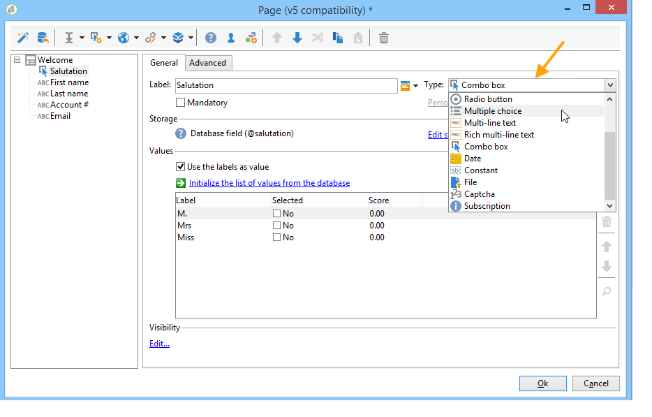

Wenn Sie die Schaltflächen in der Symbolleiste verwenden, wählen Sie den Typ des Felds aus, das Sie hinzufügen möchten.

Folgende Feldtypen sind verfügbar:

* Text-/Zahleneingabe. Siehe [Eingabefelder hinzufügen](#adding-input-fields).
* Auswahl per Dropdown-Liste. Siehe [Dropdown-Listen hinzufügen](#adding-drop-down-lists).
* Multiple Choice über Checkboxes. Siehe [Checkboxes hinzufügen &#x200B;](#adding-checkboxes).
* Auswahl über Radiobuttons. Siehe [Radiobuttons hinzufügen](#adding-radio-buttons).
* Abstimmungsoptionen in einer Tabelle. Siehe [Tabellen hinzufügen](#adding-grids).
* Zahlen und Daten. Siehe [Datum und Zahlen hinzufügen](#adding-dates-and-numbers).
* Anmeldung/Abmeldung für einen Informationsdienst. Siehe [Abonnement-Checkboxes](#subscription-checkboxes).
* Captcha-Prüfung. Siehe [Captcha einfügen](#inserting-a-captcha).
* Schaltfläche „Herunterladen“. [Datei hochladen](#uploading-a-file).
* Ausgeblendete Konstante. Siehe [Ausgeblendete Konstante einfügen](#inserting-a-hidden-constant).

Spezifizieren Sie den Speichermodus für Antworten: ein Feld in der Datenbank aktualisieren (nur der zuletzt gespeicherte Wert wird behalten) oder in einer Variablen speichern (die Antwort wird nicht aufbewahrt). Weiterführende Informationen finden Sie im Abschnitt [Speicherfelder für Antworten](web-forms-answers.md#response-storage-fields).

>[!NOTE]
>
>Standardmäßig wird das Feld unten im aktuellen Baum eingefügt. Mit den Pfeilen in der Symbolleiste kann es nach oben oder unten bewegt werden.

## Assistent zur Felderstellung {#field-creation-assistant}

Über die erste Schaltfläche der Symbolleiste können Sie Felder in jede Formularseite einfügen. Gehen Sie dazu zum Menü **[!UICONTROL Mithilfe des Assistenten hinzufügen]**.

Wählen Sie den Typ des zu erstellenden Felds aus: Sie können ein Feld der Datenbank oder eine Variable hinzufügen oder eine Feldergruppe importieren, die in einem anderen Formular erstellt wurde und in einem Container zusammengefasst ist.

Wählen Sie **[!UICONTROL Weiter]** und danach das Speicherfeld, die Variable oder den zu importierenden Container aus.

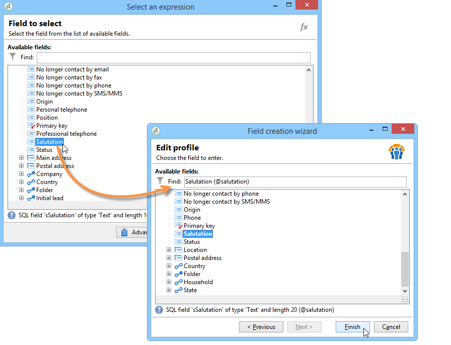

Wählen Sie **[!UICONTROL Beenden]** aus, um das ausgewählte Feld in die Seite einzufügen.

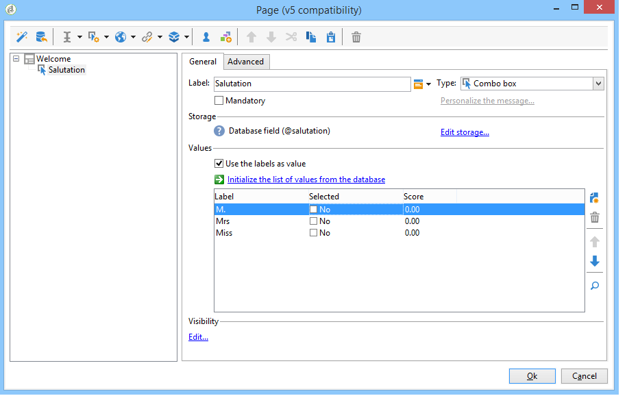

## Eingabefelder hinzufügen {#adding-input-fields}

Um ein Eingabefeld hinzuzufügen, wählen Sie die Schaltfläche **[!UICONTROL Eingabedialog]** und danach den hinzuzufügenden Feldtyp aus.

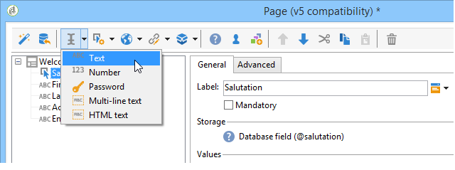

### Typen von Eingabefeldern {#types-of-input-fields}

Auf einer Formularseite können fünf Typen von Textfeldern eingefügt werden:

* **Text**: ermöglicht die Eingabe von Text in einer Zeile.

  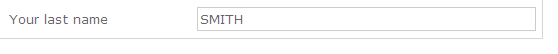

* **Zahl**: ermöglicht dem Benutzer die Zahleneingabe in einer einzigen Zeile. Weitere Informationen hierzu finden Sie unter [&#x200B; von Zahlen](#adding-numbers).

  Bei der Validierung der Seite wird der Feldinhalt geprüft, um sicherzugehen, dass der eingegebene Wert mit dem Feld kompatibel ist. Weiterführende Informationen finden Sie unter [Kontrolleinstellungen definieren](form-rendering.md#defining-control-settings).

* **Passwort**: ermöglicht der Benutzerin bzw. dem Benutzer Text in einer einzigen Zeile einzugeben. Während der Texteingabe werden die Zeichen durch Punkte ersetzt:

  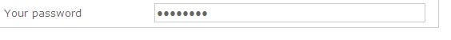

  >[!CAUTION]
  >
  >Passwörter werden unverschlüsselt in der Datenbank gespeichert.

* **Mehrzeiliger Text**: ermöglicht dem Benutzer die Texteingabe in mehreren Zeilen.

  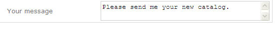

  >[!CAUTION]
  >
  >Mehrzeilige Textfelder sind spezifische Felder, die Zeilenumbrüche enthalten können. Ihr Speicherplatz muss mit einem Feld verknüpft sein, das einem XML-Element, nicht einem XML-Attribut, zugeordnet ist.
  >   

* **Angereicherter mehrzeiliger Text**: ermöglicht dem Benutzer die Eingabe von Text mit einem Layout, das im HTML-Format gespeichert wird.

  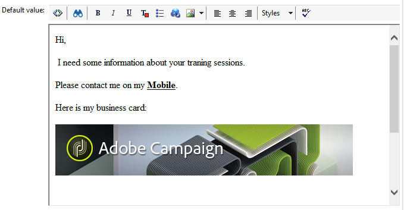

  Sie können den Typ des Editors auswählen, der den Benutzern bereitgestellt wird. Verwenden Sie dazu im Tab **[!UICONTROL Erweitert]** die Dropdown-Liste des Felds **[!UICONTROL HTML-Editor]**.

  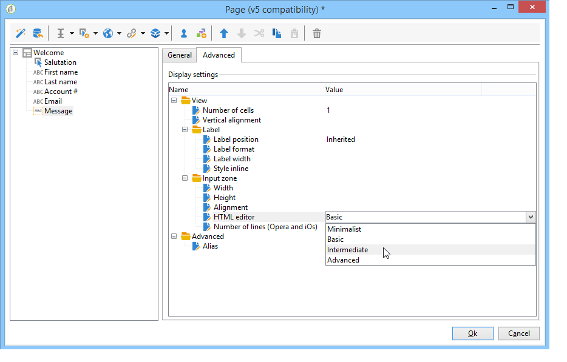

  Die Anzahl der angezeigten Symbole variiert je nach Editor-Typ. Bei einem Editor des Typs **[!UICONTROL Erweitert]** sieht das Rendering wie folgt aus:

  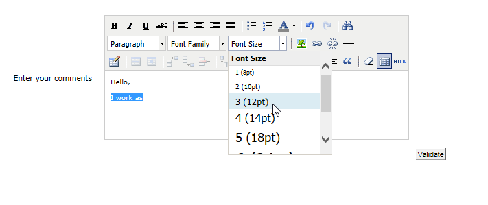

### Eingabefelder konfigurieren {#configure-input-fields}

Eingabefelder werden auf der Basis desselben Modus unter Verwendung der folgenden Optionen konfiguriert:

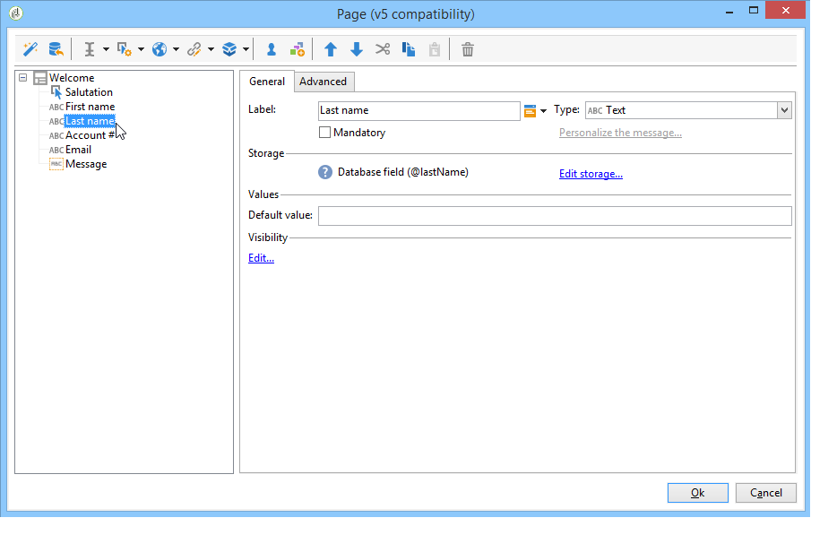

Im Tab **[!UICONTROL Allgemein]** können Sie den Namen des Felds eingeben und bei Bedarf einen Standardwert zuweisen.

Der Speichermodus der Antwort kann über den Link **[!UICONTROL Speicherinformationen bearbeiten…]** geändert werden. Werte können in einem vorhandenen Feld der Datenbank gespeichert werden. Sie können sich jedoch auch dazu entscheiden, Informationen nicht in der Datenbank zu speichern (eine lokale Variable verwenden).

>[!NOTE]
>
>Speichermodi werden unter [Speicherfelder für Antworten](web-forms-answers.md#response-storage-fields) detailliert beschrieben.

Im Tab **[!UICONTROL Erweitert]** können Sie Anzeigeparameter für das Feld definieren (Position der Titel, Ausrichtung etc.). Siehe [Layout eines Webformulars definieren](defining-web-forms-layout.md).

## Dropdown-Listen hinzufügen {#adding-drop-down-lists}

Sie können eine Dropdown-Liste in eine Umfrageseite einfügen. So können Benutzende einen Wert einfügen, der in einem Dropdown-Menü verfügbar ist.

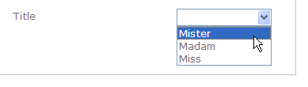

Um eine Dropdown-Liste in eine Formularseite einzufügen, wählen Sie in der Symbolleiste des Seiteneditors die Schaltfläche **[!UICONTROL Auswahldialog > Dropdown-Liste]** aus.

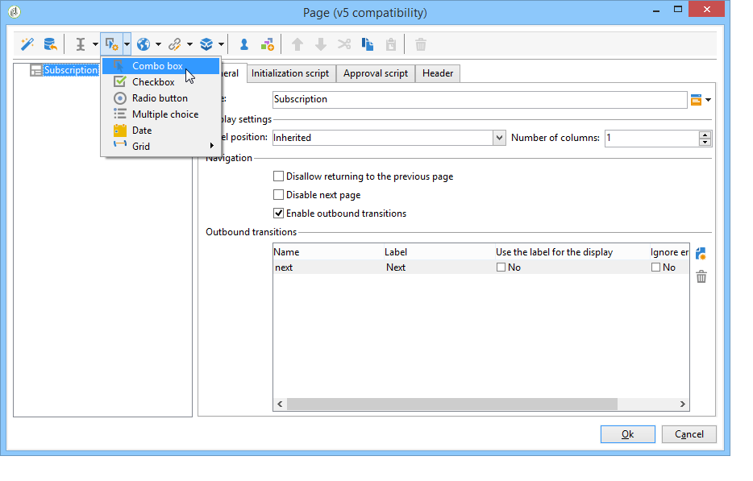

Wählen Sie den Speichermodus für die Antworten aus und bestätigen Sie Ihre Auswahl.

Definieren Sie die Titel und Werte der Liste im unteren Bereich der Registerkarte **[!UICONTROL Allgemein]**. Wenn die Informationen in einem vorhandenen Feld der Datenbank gespeichert werden und es sich um ein Aufzählungsfeld handelt, können Sie die Werte automatisch ausfüllen lassen, indem Sie wie unten gezeigt **[!UICONTROL Werteliste aus der Datenbank übernehmen]** auswählen:

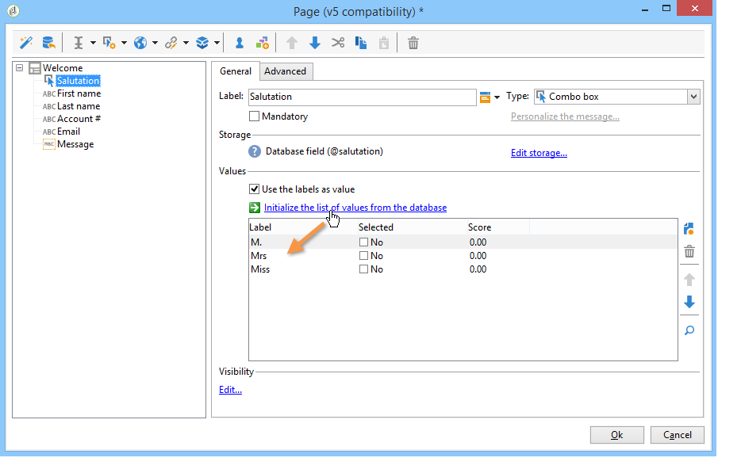

>[!NOTE]
>
>Die Reihenfolge der Werte können Sie mit den Pfeilen rechts neben der Liste ändern.

Wenn die Daten in einer verknüpften Tabelle gespeichert sind, können Sie das Feld auswählen, in dem die in der Liste vorgeschlagenen Werte gespeichert werden. Wenn Sie beispielsweise die Tabelle der Länder auswählen, wählen Sie zuerst **[!UICONTROL Werteliste aus der Datenbank übernehmen…]** und danach das gewünschte Feld aus.

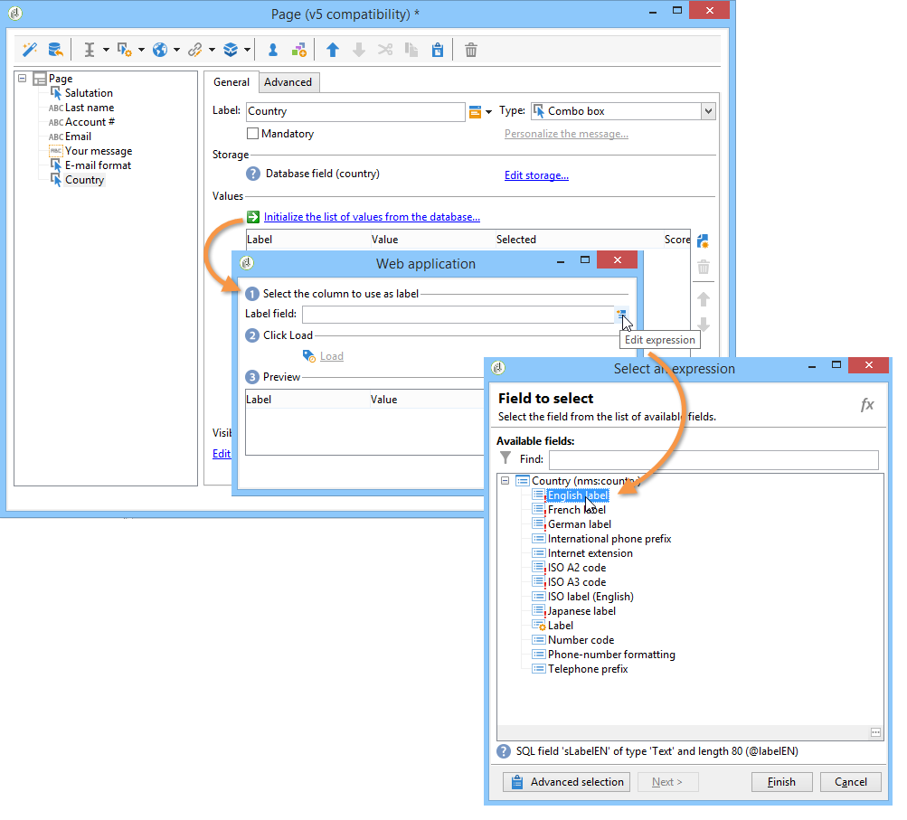

Wählen Sie danach den Link **[!UICONTROL Laden]** aus, um die Werte abzurufen:

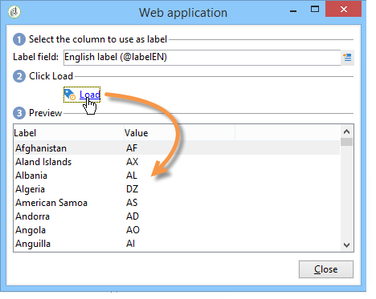

>[!CAUTION]
>
>Wiederholen Sie diesen Vorgang bei jeder Änderung der Liste, um die angebotenen Werte zu aktualisieren.

## Checkboxes hinzufügen {#adding-checkboxes}

Mit Checkboxes stellen Sie Benutzern eine Auswahlmöglichkeit für Optionen zur Verfügung.

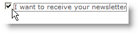

Um eine Checkbox in ein Formular einzufügen, wählen Sie in der Symbolleiste des Seiteneditors die Schaltfläche **[!UICONTROL Auswahldialog > Checkbox]** aus.

Wählen Sie den Speichermodus für die Antworten aus und bestätigen Sie Ihre Auswahl.

Geben Sie im Tab **[!UICONTROL Allgemein]** im Feld **[!UICONTROL Titel]** den Titel der Checkbox ein.

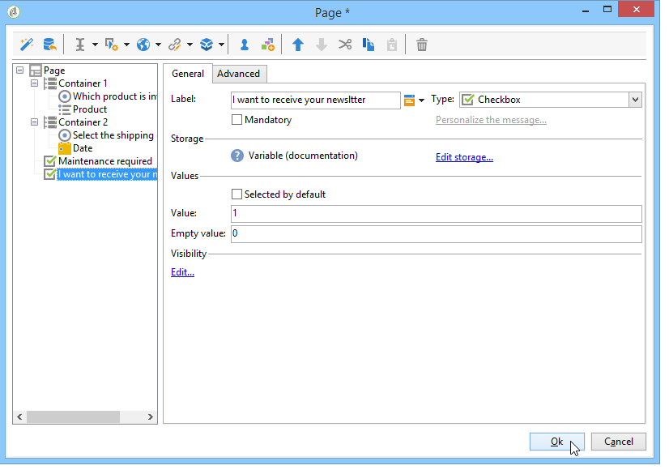

Mit einer Checkbox können Sie dem Speicherfeld (oder Wert) einen Wert zuweisen, je nachdem ob das Kästchen markiert ist oder nicht. Im Bereich **[!UICONTROL Werte]** können Sie einen Wert eingeben, der zugewiesen wird, wenn das Kästchen markiert wird (im Feld **[!UICONTROL Wert]**), und einen Wert, der zugewiesen wird, wenn das Kästchen nicht markiert wird (im Feld **[!UICONTROL Leerer Wert]**). Diese Werte hängen vom Datenspeicherungsformat ab.

Wenn das Speicherfeld (oder die Variable) boolesch ist, wird der zuzuweisende Wert automatisch abgezogen, wenn das Kästchen nicht markiert wird. In diesem Fall wird nur das Feld **[!UICONTROL Wert, wenn angekreuzt]** angeboten, wie unten gezeigt:

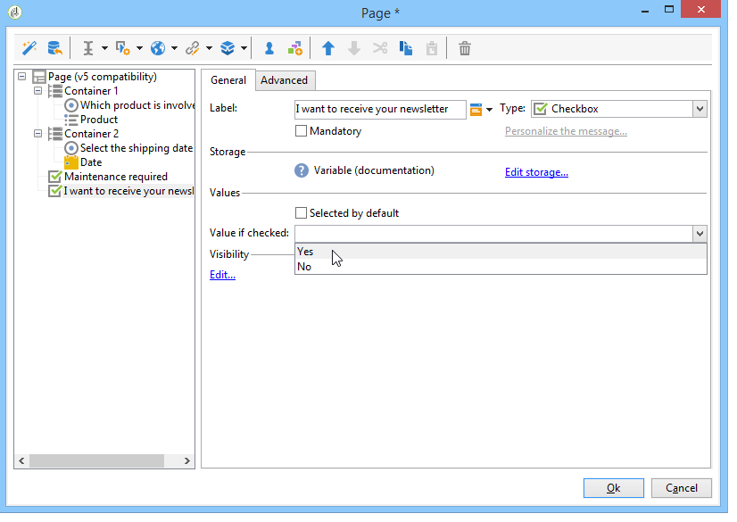

## Beispiel: Wert einem Feld zuweisen, wenn eine Checkbox markiert wird {#example--assign-a-value-to-a-field-if-a-box-is-checked}

Eine Checkbox soll in ein Formular eingefügt werden, damit wie unten gezeigt ein Wartungsantrag gesendet wird.

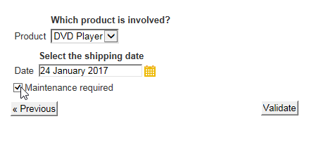

Diese Informationen werden in die Datenbank und ein vorhandenes Feld hochgeladen (in diesem Fall das Feld **[!UICONTROL Kommentar]**):

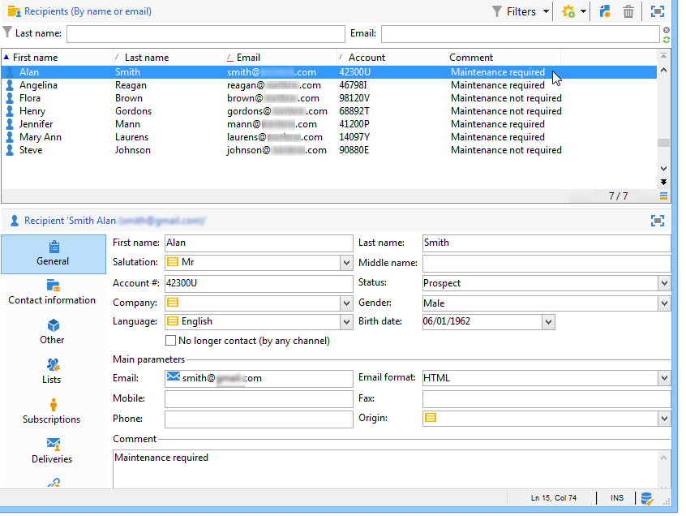

Wenn das Kontrollkästchen „Wartung erforderlich“ aktiviert ist, wird in der Spalte **[!UICONTROL Kommentar]** der Text „Wartung erforderlich“ angezeigt. Wenn das Kontrollkästchen nicht aktiviert ist, wird in der Spalte „Wartung nicht erforderlich“ angezeigt. Um dieses Ergebnis zu erhalten, wenden Sie die folgende Konfiguration auf das Kontrollkästchen auf der Formularseite an:

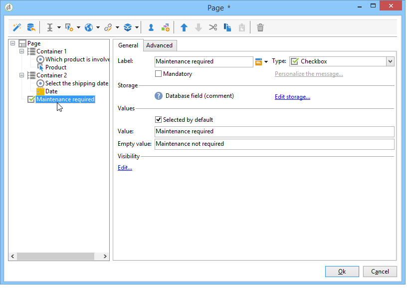

## Radiobuttons hinzufügen {#adding-radio-buttons}

Mit Optionsfeldern können Sie Benutzenden eine Reihe von exklusiven Optionen zur Auswahl anbieten. Dies sind unterschiedliche Werte für dasselbe Feld.

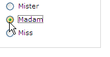

Sie können Radiobuttons einzeln erstellen (Einzel-Schaltflächen) oder über eine Multiple-Choice-Liste. Aber weil der Zweck von Radiobuttons die Auswahl einer Option ist, werden immer zumindest zwei Radiobuttons erstellt, und nie nur ein einzelner.

>[!CAUTION]
>
>Um die Auswahl obligatorisch zu machen, müssen Sie eine Multiple-Choice-Liste erstellen.

### Einzelne Schaltflächen hinzufügen {#add-single-buttons}

Um einen Radiobutton zu einer Formularseite hinzuzufügen, gehen Sie in der Symbolleiste des Seiteneditors zum Menü **[!UICONTROL Auswahldialog > Radiobutton]** und wählen Sie einen Speichermodus aus.

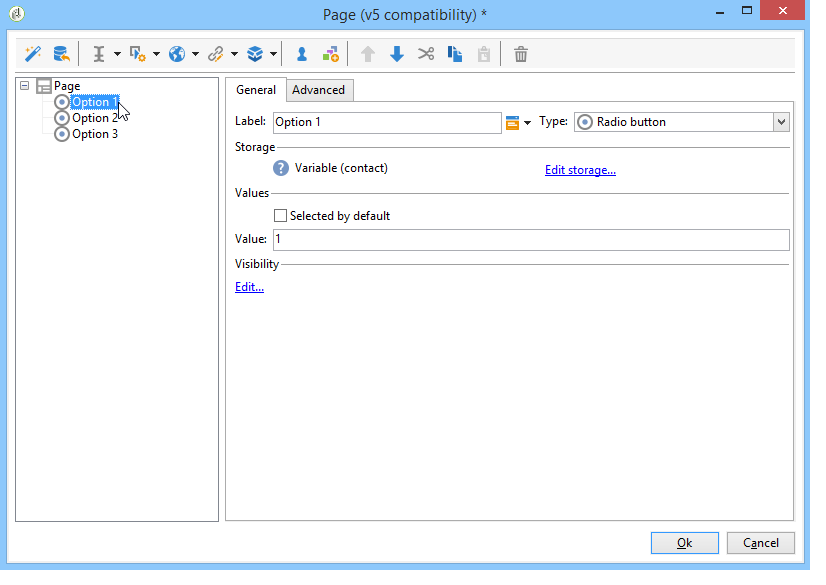

Radiobuttons werden ähnlich konfiguriert wie Checkboxes (siehe [Checkboxes hinzufügen](#adding-checkboxes)). Wenn die Option nicht ausgewählt ist, wird jedoch kein Wert zugewiesen. Damit mehrere Schaltflächen voneinander abhängen, d. h. die Auswahl einer Schaltfläche automatisch die Auswahl der anderen deaktiviert, müssen sie im selben Feld gespeichert werden. Wenn sie nicht in der Datenbank gespeichert sind, muss dieselbe lokale Variable für die temporäre Speicherung verwendet werden. Siehe [Speicherfelder für Antworten](web-forms-answers.md#response-storage-fields).

### Liste mit Schaltflächen hinzufügen {#add-a-list-of-buttons}

Um Radiobuttons über eine Liste hinzuzufügen, gehen Sie in der Symbolleiste des Seiteneditors zum Menü **[!UICONTROL Auswahldialog > Multiple Choice]**.

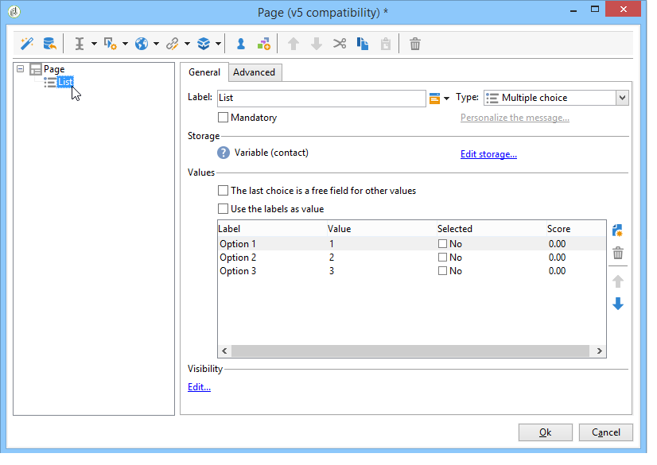

Fügen Sie so viele Optionsfelder wie Titel hinzu. Der Vorteil dieser Funktion besteht darin, dass Sie Werte aus einem vorhandenen Feld importieren können (bei Einzelfeldern) und es dem Benutzer ermöglichen, eine Option auszuwählen. Das Layout der Felder ist jedoch weniger flexibel.

>[!NOTE]
>
>Sie können die Mehrfachauswahl in einer Web-Anwendung nicht aktivieren.
>Es ist jedoch möglich, ein Feld vom Typ **[!UICONTROL Multiple Choice]** in eine Web-Anwendung einzufügen. Dies ermöglicht dem Benutzer jedoch nicht, mehrere Werte auszuwählen.

## Tabellen hinzufügen {#adding-grids}

Raster werden zum Entwerfen von Abstimmungsseiten in Web-Anwendungen verwendet. Dadurch können Sie wie unten gezeigt Listen mit Optionsfeldern zum Beantworten von Umfragen oder Web-Formulare zur Abgabe von Bewertungen anbieten.

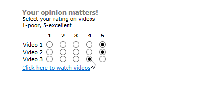

Um diesen Elementtyp in einem Formular zu verwenden, erstellen Sie eine einfache Tabelle und fügen Sie für jedes zu bewertende Element eine Zeile hinzu.

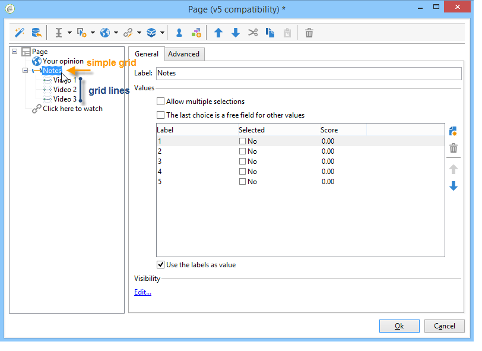

Die Anzahl der Radiobuttons in jeder Zeile der Tabelle entspricht der Anzahl der in der einfachen Tabelle definierten Werte.

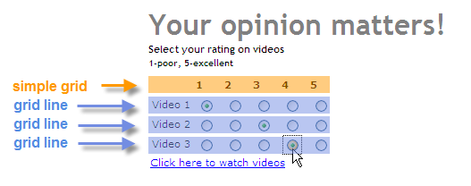

Pro Tabellenzeile kann nur eine Option ausgewählt werden.

>[!NOTE]
>
>In unserem Beispiel ist der Titel der Tabelle ausgeblendet. Gehen Sie dazu zur Registerkarte **[!UICONTROL Erweitert]**. Die Anzeige **[!UICONTROL Titelposition]** ist als **[!UICONTROL Ausgeblendet]** definiert. Siehe [Die Position von Titeln definieren](defining-web-forms-layout.md#defining-the-position-of-labels).

## Datum und Zahlen hinzufügen {#adding-dates-and-numbers}

Der Inhalt eines Formularfeldes kann entsprechend den in der Datenbank gespeicherten Daten oder einer bestimmten Anforderung formatiert werden. Sie können geeignete Felder für die Eingabe von Zahlen und Datumsangaben erstellen.

### Datum hinzufügen {#adding-dates}

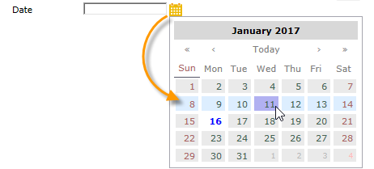

Um dem Benutzer die Eingabe eines Datums auf einer Formularseite zu ermöglichen, fügen Sie ein Eingabefeld hinzu und wählen Sie den Typ **[!UICONTROL Datum...]** aus.

Geben Sie einen Titel für das Feld ein und konfigurieren Sie den Datenspeichermodus.

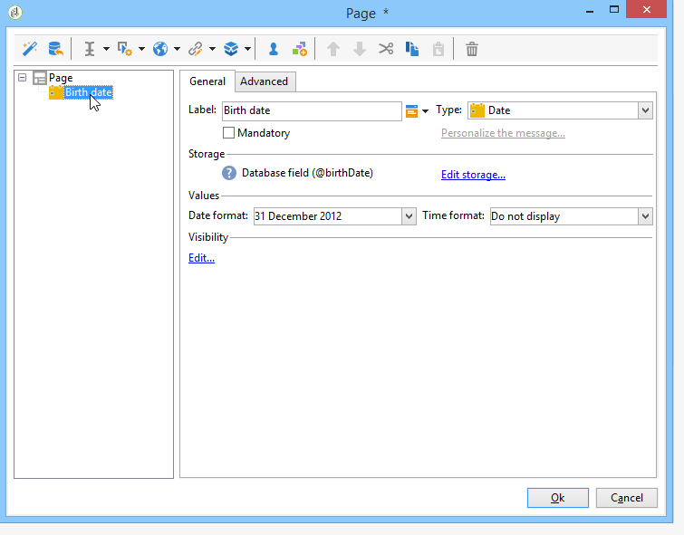

Im unteren Bereich des Fensters können Sie die Formate für Datum und Uhrzeit für die in diesem Feld gespeicherten Werte auswählen.

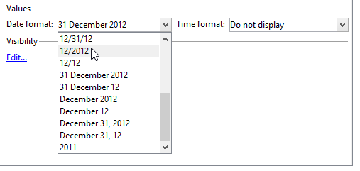

Das Datum (oder die Uhrzeit) kann angezeigt oder ausgeblendet werden.

Datumsangaben können über einen Kalender oder Dropdown-Felder ausgewählt werden. Sie können auch direkt in das Feld eingegeben werden, die Eingabe muss jedoch dem oben am Bildschirm angegebenen Format entsprechen.

>[!NOTE]
>
>Standardmäßig werden in Formularen verwendete Datumsangaben über einen Kalender eingegeben. Achten Sie bei mehrsprachigen Formularen darauf, dass die Kalender in allen verwendeten Sprachen verfügbar sind. Siehe [Webformular übersetzen](translating-a-web-form.md).

In manchen Fällen kann es aber einfacher sein, Dropdown-Listen zu verwenden, z. B. zur Eingabe des Geburtsdatums.

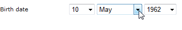

Wählen Sie dazu den Tab **[!UICONTROL Erweitert]** und danach den Eingabemodus **[!UICONTROL Dropdown-Liste]** aus.

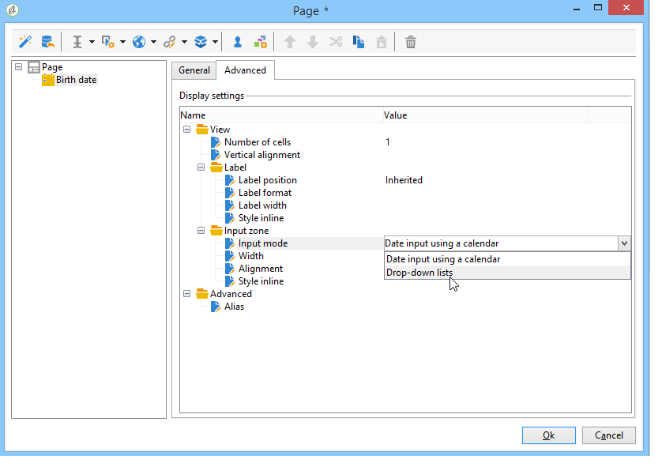

Sie können dann die in der Liste angebotenen Werte einschränken.

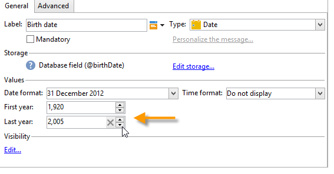

### Zahlen hinzufügen {#adding-numbers}

Sie können Felder für die Eingabe von Zahlen erstellen.

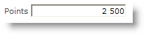

In einem numerischen Feld können Benutzende nur Zahlen eingeben. Die Eingabekontrolle erfolgt automatisch bei der Validierung der Seite.

Abhängig vom Feld, in dem Daten in der Datenbank gespeichert werden, können spezielle Formatierungen oder bestimmte Einschränkungen angewendet werden. Sie können auch Mindest- und Höchstwerte angeben. Dieser Feldtyp wird wie folgt konfiguriert:

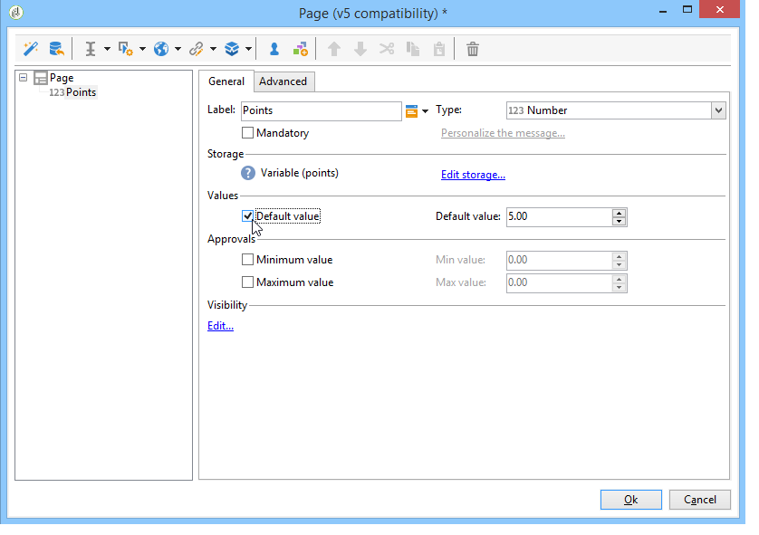

Der Standardwert ist der Wert, der bei der Veröffentlichung des Formulars im Feld angezeigt wird. Er kann von der Benutzerin bzw. dem Benutzer korrigiert werden.

Sie können zum numerischen Feld über den Tab **[!UICONTROL Erweitert]** wie unten gezeigt ein Präfix und/oder Suffix hinzufügen:

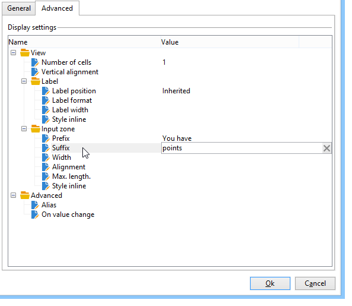

Im Formular sieht das Rendering folgendermaßen aus:

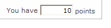

## Abonnement-Checkboxes {#subscription-checkboxes}

Sie können Steuerelemente hinzufügen, über die sich Benutzende für einen oder mehrere Informationsdienste anmelden oder von diesen abmelden können (Newsletter, Warnungen, Echtzeitbenachrichtigungen usw.). Um sich anzumelden, aktivieren Benutzende den entsprechenden Dienst.

Wählen Sie zum Erstellen einer Abonnement-Checkbox **[!UICONTROL Erweiterte Steuerelemente > Abonnement]** aus.

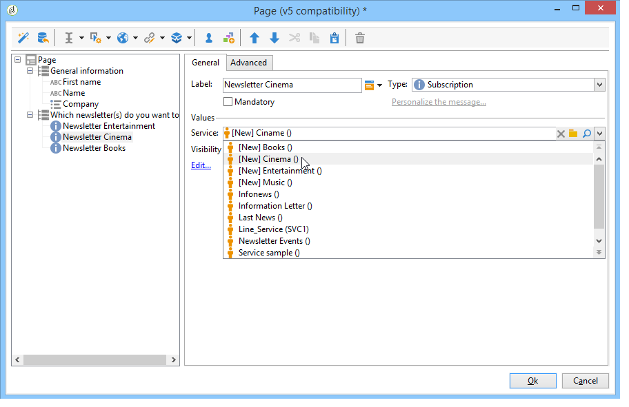

Definieren Sie den Titel für die Checkbox und wählen Sie den entsprechenden Informationsdienst im Dropdown-Menü **[!UICONTROL Dienst]** aus.

>[!NOTE]
>
>Informationsdienste werden auf [dieser Seite](https://experienceleague.adobe.com/de/docs/campaign-classic/using/sending-messages/subscriptions-and-referrals/managing-subscriptions){target="_blank"} beschrieben.

Der Benutzer meldet sich zu diesem Dienst an, indem er die entsprechende Option markiert.

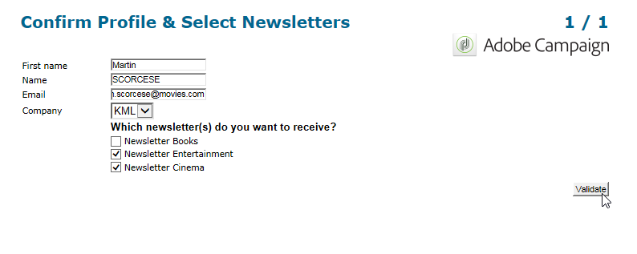

>[!CAUTION]
>
>Wenn der Benutzer bereits zu einem Informationsdienst angemeldet ist und das mit diesem Dienst verknüpfte Kästchen bei der Validierung des Formulars nicht markiert ist, wird er abgemeldet.

## Captcha einfügen {#inserting-a-captcha}

Mit **Captcha**-Tests können Sie verhindern, dass Ihre Webformulare missbräuchlich verwendet werden.

>[!CAUTION]
>
>Wenn Ihr Formular mehrere Seiten umfasst, muss das Captcha immer auf der letzten Seite unmittelbar vor der Komponente &quot;Speicherung&quot; platziert werden, um eine Umgehung der Sicherheitsmaßnahmen zu verhindern.

Um ein Captcha in ein Formular einzufügen, klicken Sie auf die erste Schaltfläche in der Symbolleiste und wählen Sie **[!UICONTROL Erweiterte Einstellungen > Captcha]** aus.

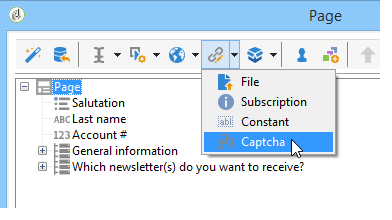

Geben Sie den Titel des Felds ein. Dieser Titel wird vor dem Captcha-Anzeigebereich angezeigt. Sie können die Position dieses Titels im Tab **[!UICONTROL Erweitert]** ändern.

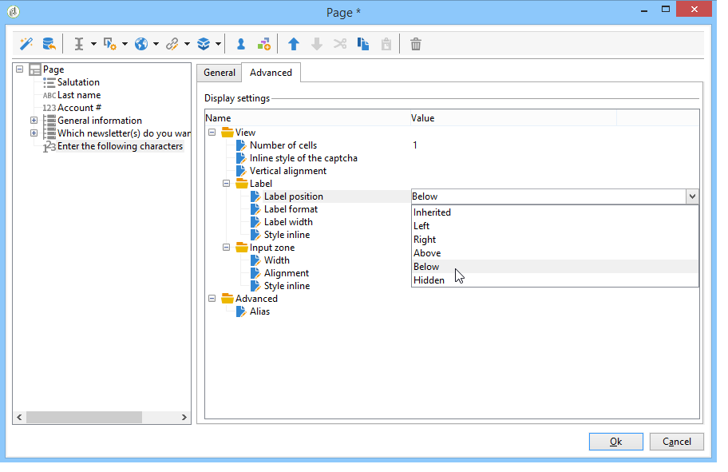

>[!NOTE]
>
>Für Steuerelemente vom Typ **[!UICONTROL Captcha]** muss weder ein Speicherfeld noch eine Variable angegeben werden.

Das Captcha wird mit einem Eingabefeld unter dem visuellen Element in die Seite eingefügt. Diese beiden Elemente sind nicht trennbar und werden in Bezug auf das Seiten-Layout als ein einziges Objekt betrachtet (sie belegen eine einzige Zelle).

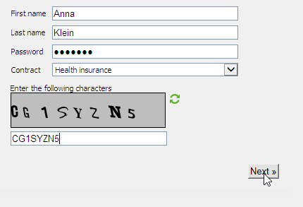

Wenn der Inhalt des Captcha falsch eingegeben wurde, verfärbt sich das Eingabefeld bei der Validierung der Seite rot.

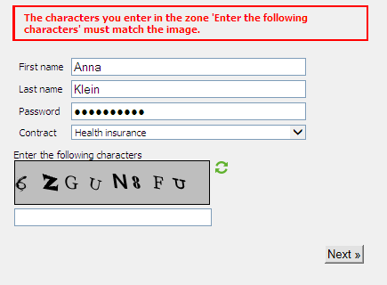

Sie können eine Fehlermeldung zur Anzeige erstellen. Verwenden Sie dazu den Link **[!UICONTROL Nachricht personalisieren]** auf der Registerkarte **[!UICONTROL Allgemein]**.

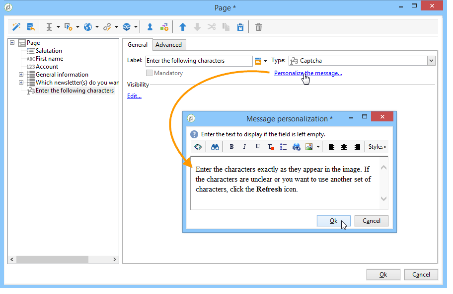

>[!NOTE]
>
>Captchas sind immer 8 Zeichen lang. Dieser Wert kann nicht geändert werden.

## Datei hochladen {#uploading-a-file}

Sie können einer Seite ein Feld zum Hochladen von Inhalten hinzufügen. Diese Funktion kann beispielsweise zur Dateifreigabe im Intranet nützlich sein.

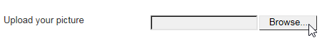

Um ein Upload-Feld in eine Formularseite einzufügen, wählen Sie in der Symbolleiste des Seiteneditors die Schaltfläche **[!UICONTROL Erweiterte Steuerelemente > Datei...]** aus.

Standardmäßig werden die hochgeladenen Dateien in Ressourcendateien gespeichert, auf die über das Menü **[!UICONTROL Ressourcen > Online > Öffentliche Ressourcen]** zugegriffen werden kann. Sie können ein Skript verwenden, um dieses Verhalten zu ändern. Dieses Script kann die in der [Campaign JSAPI-Dokumentation](https://experienceleague.adobe.com/de/tools/campaign-api) definierten Funktionen verwenden, einschließlich derjenigen zur Dateibearbeitung.

Sie können den Link zu diesen Dateien in einer lokalen Variable oder in einem Datenbankfeld speichern. Beispielsweise können Sie das Empfängerschema erweitern und einen Link zu dateibasierten Ressourcen hinzufügen.

>[!CAUTION]
>
>* Dieser Dateityp muss für Formulare mit sicherem Zugriff (über Anmeldedaten) reserviert werden.
>* Adobe Campaign kontrolliert nicht die Größe oder den Typ der hochgeladenen Ressource. Deshalb empfehlen wir dringend, Upload-Felder ausschließlich für sichere Intranet-Sites zu verwenden.
>* Wenn mehrere Server mit der Instanz verbunden sind (Architektur mit Lastausgleich), müssen Sie darauf achten, dass Abfragen zum Webformular auf demselben Server erfolgen.
>* Diese Implementierungen erfordern die Hilfe des Adobe Campaign-Teams.
>

## Ausgeblendete Konstante einfügen {#inserting-a-hidden-constant}

Wenn der Benutzer eine der Seiten des Formulars validiert, können Sie einen bestimmten Wert in einem Feld seines Profils oder in einer Variable setzen.

Dieses Feld ist nicht sichtbar für den Benutzer, kann aber für die Anreicherung der Daten im Benutzerprofil verwendet werden.

Fügen Sie dazu eine **Konstante** auf der Seite hinzu und geben Sie den Wert und den Speicherort an.

Im folgenden Beispiel wird das Feld **Herkunft** des Empfängerprofils automatisch ausgefüllt, sobald ein Benutzer diese Seite genehmigt. Die Konstante wird auf der Seite nicht angezeigt.

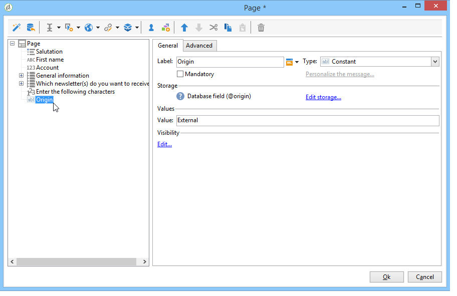
