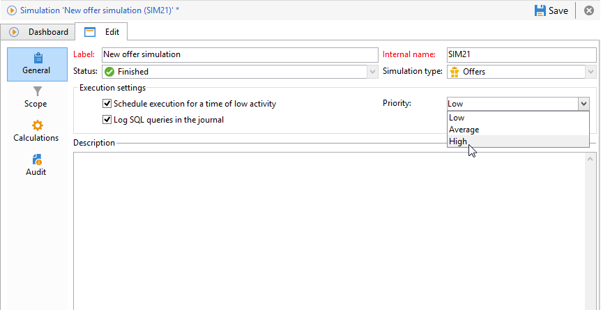

# Ausführungsparameter{#execution-settings}

Beim Erstellen einer Simulation können Sie bei Bedarf Ausführungseinstellungen festlegen. Auf diese Weise können Sie die Ausführung der Simulation in Abhängigkeit von ihrer Prioritätsstufe auf einen Zeitpunkt mit geringer Auslastung verschieben und die SQL-Abfragen im Protokoll speichern. Diese Stufe ist optional.

Eine Änderung dieser Parameter ist im späteren Verlauf im Tab **[!UICONTROL Allgemein]** des Simulationsfensters möglich.

* **[!UICONTROL Ausführung auf einen Zeitpunkt mit geringer Aktivität planen]** : dient der Planung der Simulation auf der Grundlage der ausgewählten Priorität (niedrig, Durchschnitt oder hoch), um die Leistung von Adobe Campaign zu optimieren.
* **[!UICONTROL Priorität]**: auf die Simulation angewendete Dringlichkeit, die den Ausführungsbeginn entsprechend verschiebt. Wenn die Option **[!UICONTROL Ausführung auf einen Zeitpunkt mit geringer Auslastung verschieben]** aktiviert wurde, wählt der Workflow der Kampagnenvorgänge einen Zeitpunkt mit geringer Aktivität, um die Simulation zu starten.
* **[!UICONTROL SQL-Abfragen im Protokoll speichern]**: Diese Funktion ist erfahrenen Benutzenden vorbehalten. Bei Aktivierung wird dem Protokoll eine Registerkarte hinzugefügt, in der die SQL-Abfragen angezeigt werden. Dies erleichtert die Fehlerbehebung, wenn die Simulation fehlschlägt.
