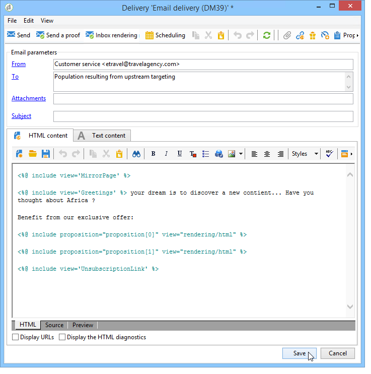
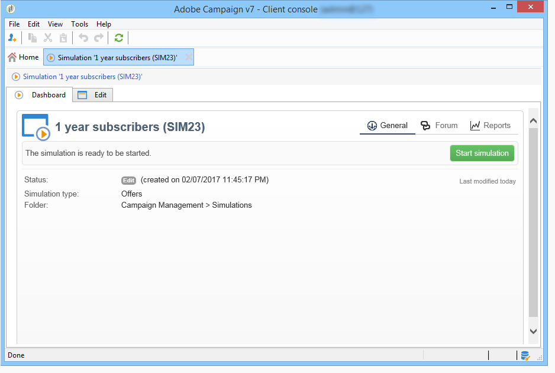
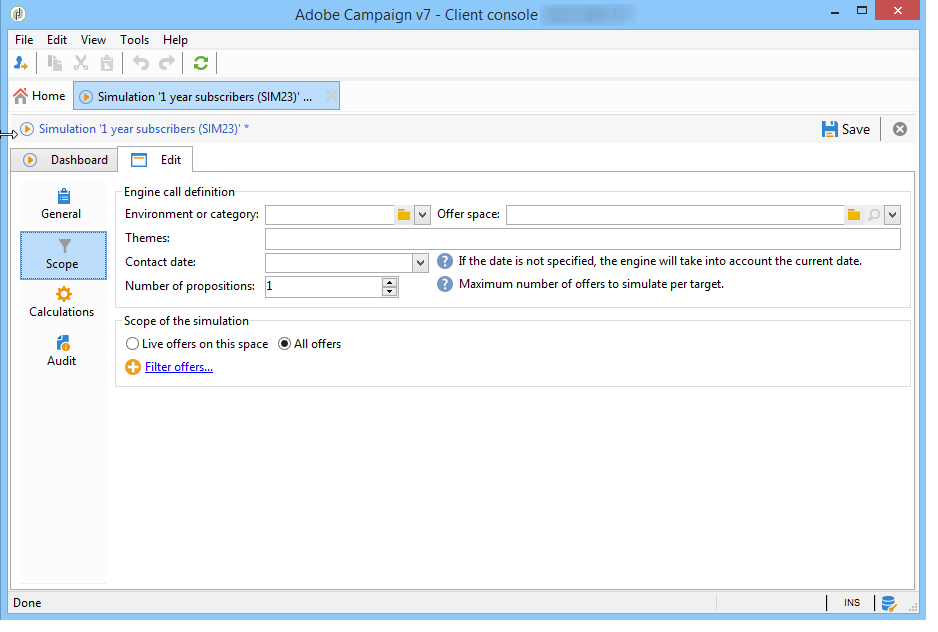
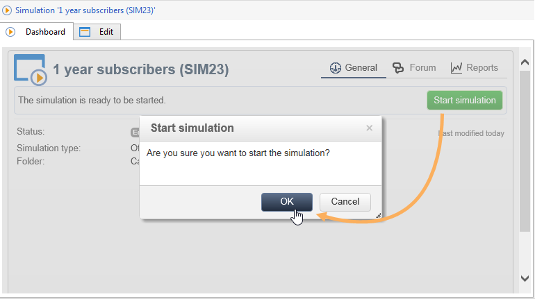

# Angebote auf einem Outbound-Kanal{#offers-on-an-outbound-channel}

## Angebote per E-Mail versenden {#email-offer-delivery}

In unserer Datenbank gibt es eine Kategorie von Reiseangeboten nach Afrika. Die Eignung, der Kontext und die Darstellungen jedes Angebots wurden konfiguriert. Wir möchten nun eine Kampagne erstellen, um unsere Angebote per E-Mail zu präsentieren.

1. Erstellen Sie Ihre Kampagne und den Workflow zur Bestimmung der Zielgruppe.

   

1. Öffnen Sie die Versand-Aktivität und klicken Sie auf das Symbol **[!UICONTROL Angebote]**.

   

1. Wählen Sie die E-Mail-Platzierung der Live-Umgebung aus, die die Reiseangebote enthält.

   

1. Wählen Sie die Kategorie mit den Angeboten für Afrikareisen aus.

   

1. Geben Sie an, dass pro E-Mail jeweils zwei Angebote unterbreitet werden sollen.

   

1. Schließen Sie das Fenster für die Angebotsverwaltung und erstellen Sie den Inhalt Ihres Versands.

   

1. Fügen Sie nun mithilfe der Personalisierungsfelder den ersten Angebotsvorschlag in den Versandinhalt ein und wählen Sie die HTML-Rendering-Funktion.

   

1. Fügen Sie auf die gleiche Weise den zweiten Angebotsvorschlag ein.

   

1. Klicken Sie auf **[!UICONTROL Vorschau]** und wählen Sie einen Empfänger aus, um Nachricht und Angebote so anzeigen zu lassen, wie der Empfänger sie erhalten wird.

   

1. Speichern Sie den Versand und starten Sie den Zielgruppen-Workflow.
1. Öffnen Sie den Versand und gehen Sie in den Tab **[!UICONTROL Verfolgung]**: Sie können feststellen, dass das Angebotsmodul die zu unterbreitenden Vorschläge aus den verschiedenen, in der Kategorie verfügbaren Angeboten ausgewählt hat.

   

## Durchführen einer Angebotssimulation {#perform-an-offer-simulation}

1. Klicken Sie im Tab **[!UICONTROL Profile und Zielgruppen]** auf die Schaltfläche **[!UICONTROL Simulationen]** und anschließend auf **[!UICONTROL Erstellen]**.

   

1. Benennen Sie die Simulation und geben Sie gegebenenfalls Ausführungsparameter an.

   

1. Speichern Sie die Simulation. Sie wird anschließend in einem neuen Tab geöffnet.

   

1. Gehen Sie in den Tab **[!UICONTROL Bearbeiten]** > **[!UICONTROL Perimeter]**.

   

1. Wählen Sie die Kategorie aus, für die Sie die Angebotssimulation durchführen möchten.

   

1. Wählen Sie die Platzierung für die Simulation aus.

   

1. Geben Sie Gültigkeitsdaten ein. Sie müssen mindestens ein Startdatum eingeben. Dies ermöglicht es dem Angebotsmodul, Angebote zu filtern und nur jene zu berücksichtigen, die zum angegebenen Zeitpunkt tatsächlich verfügbar sind.
1. Geben Sie bei Bedarf Themen an, um die Anzahl der Angebote zu begrenzen.

   Im vorliegenden Beispiel enthält die Kategorie **Finanzdienstleistungen** zwei Unterkategorien mit je einem unterschiedlichen Thema. Die Simulation soll sich nur auf die Kategorie mit dem Anwendungsthema **Kunden > 1 Jahr** beziehen.

   

1. Definieren Sie die Zielgruppe.

   

1. Geben Sie die Anzahl an Angeboten an, die Sie jedem Empfänger unterbreiten möchten.

   Im vorliegenden Beispiel soll das Angebotsmodul für jeden Empfänger die drei Angebote auswählen, die die höchste Gewichtung aufweisen.

   

1. Speichern Sie die Konfiguration und klicken Sie im **[!UICONTROL Dashboard]** auf **[!UICONTROL Simulation starten]**.

   

1. Nach Abschluss der Simulation können Sie im Tab **[!UICONTROL Ergebnisse]** die Aufschlüsselung der Vorschläge pro Angebot ansehen.

   Im vorliegenden Beispiel beruht die Aufschlüsselung wie konfiguriert auf drei Vorschlägen.

   

1. Rufen Sie den Bericht **[!UICONTROL Angebotsaufschlüsselung nach Rang]** auf, um die Reihenfolge der durch das Angebotsmodul ausgewählten Angebote im Detail anzusehen.

   

1. Ändern Sie bei Bedarf den Perimeter Ihrer Simulation und klicken Sie erneut auf **[!UICONTROL Simulation starten]**, bis das Ergebnis Ihren Erwartungen entspricht.

   

1. Sie haben mithilfe der Verlaufs- und Exportfunktionen des Berichts die Möglichkeit, die Simulationsdaten zu speichern.

   
