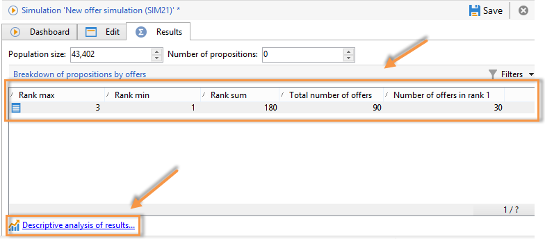
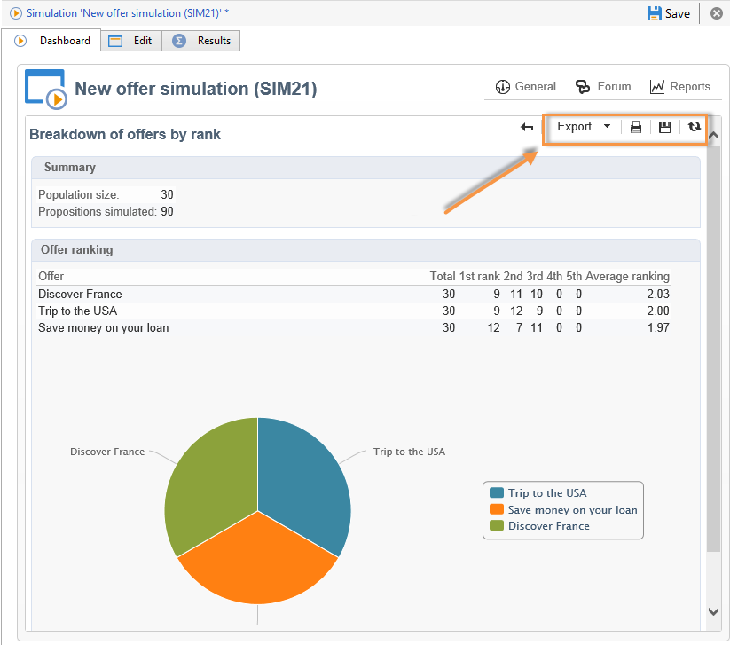

# Simulationsverfolgung{#simulation-tracking}

Sobald die Simulation abgeschlossen ist, können Sie das Ergebnis über die Registerkarte **[!UICONTROL Ergebnisse]** analysieren, die zum Simulationsfenster hinzugefügt wird, und den Bericht **[!UICONTROL Aufschlüsselung der Angebote nach Rang]** , der über das Simulations-Dashboard verfügbar ist.

Das Simulationsergebnis zeigt die Aufschlüsselung der Vorschläge nach Rang und Zielgruppe. Berichtsachsen werden ebenfalls berücksichtigt und in dieser Registerkarte angezeigt.

Sie haben die Möglichkeit, die Ergebnisse zu speichern und sie in Form einer deskriptiven Analyse zu exportieren. Klicken Sie hierzu auf den entsprechenden Link im Ergebnisfenster.

Weitere Informationen zur deskriptiven Analyse finden Sie in [diesem Abschnitt](https://experienceleague.adobe.com/en/docs/campaign-classic/using/reporting/analyzing-populations/about-descriptive-analysis){target="_blank"}.

Eine Pivot-Tabelle bietet eine schnelle Ansicht der Angebotsaufschlüsselungen pro Ranking. Wie alle Berichte in Adobe Campaign kann auch dieser exportiert, gedruckt, archiviert oder in einem Webbrowser angezeigt werden.

Weiterführende Informationen hierzu finden Sie in [diesem Abschnitt](https://experienceleague.adobe.com/en/docs/campaign-classic/using/reporting/creating-new-reports/actions-on-reports){target="_blank"}.

