# Erstellen von Cubes{#create-a-cube}

## Arbeitsbereich Cube {#cube-workspace}

Um auf Cubes zuzugreifen, navigieren Sie vom Campaign-Explorer aus zu **[!UICONTROL Administration > Konfiguration > Cubes]**.

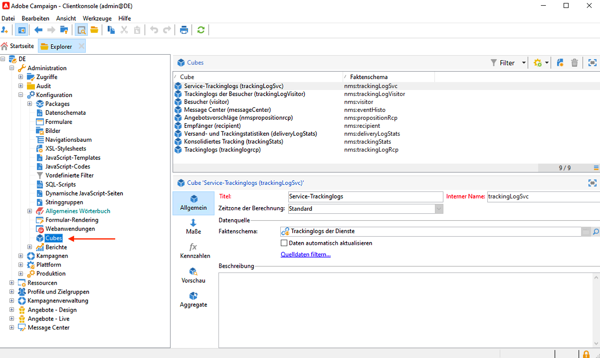

Cubes ermöglichen Ihnen Folgendes:

* Exportieren Sie Daten direkt in einen Bericht, der auf der Registerkarte **[!UICONTROL Berichte]** der Adobe Campaign-Plattform erstellt wurde.

  Erstellen Sie hierzu einen neuen Bericht und wählen Sie den zu verwendenden Cube.

  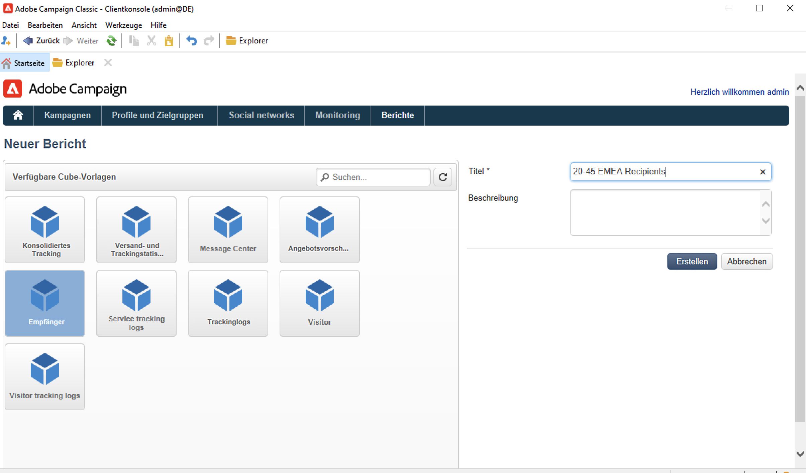

  Cubes sehen aus wie Vorlagen, auf deren Grundlage Berichte erstellt werden. Nachdem Sie eine Vorlage ausgewählt haben, klicken Sie auf **[!UICONTROL Erstellen]** um den neuen Bericht zu konfigurieren und anzuzeigen.

  Sie können die Kennzahlen anpassen, den Anzeigemodus ändern oder eine Tabelle konfigurieren und dann den Bericht über die zentrale Schaltfläche erzeugen.

  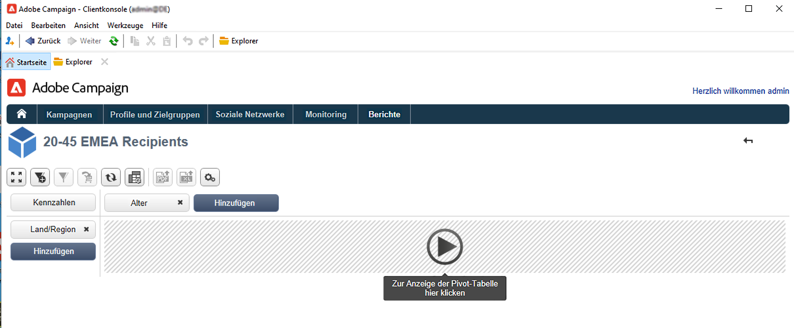

* Referenzieren Sie einen Cube in der **[!UICONTROL Abfrage]**-Box eines Berichts, um seine Indikatoren zu benutzen, wie unten gezeigt:

  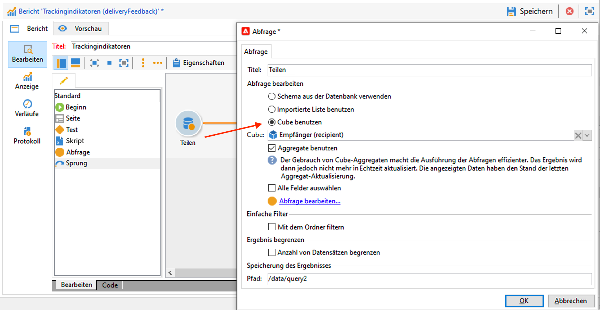

* Fügen Sie eine auf einem Cube basierende Pivot-Tabelle in eine beliebige Seite eines Berichts ein. Referenzieren Sie dazu den Cube, damit er auf der Registerkarte **[!UICONTROL Daten]** der Pivot-Tabelle auf der entsprechenden Seite verwendet wird.

  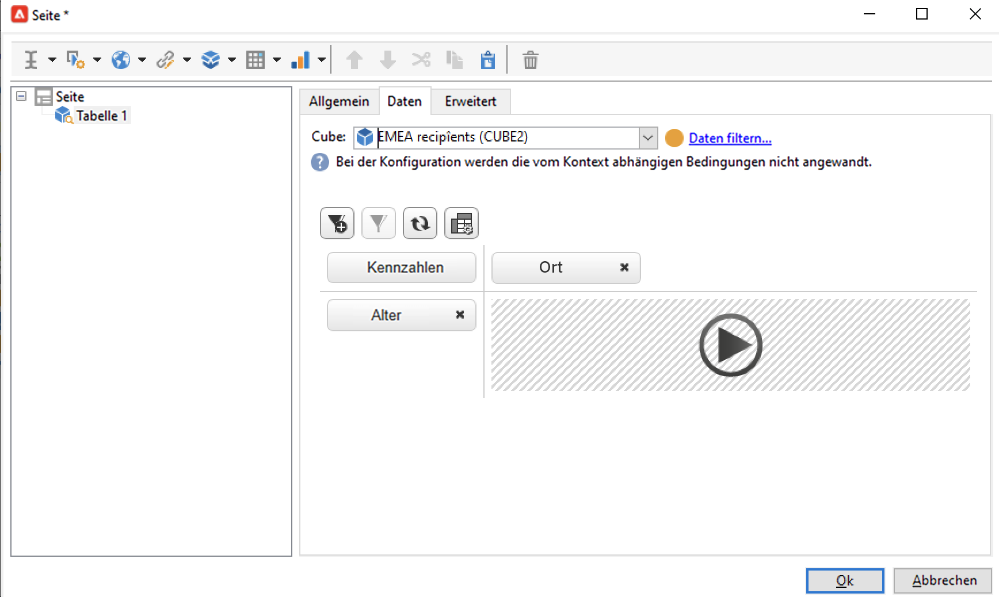

  Weitere Informationen hierzu finden Sie unter [Erkunden der Daten in einem Bericht](cube-tables.md#explore-the-data-in-a-report).

>[!CAUTION]
>
>Zum Erstellen von Cubes sind Administratorberechtigungen erforderlich.
>

## Aufbauen eines Cubes{#cube-create}

Bevor Sie einen Cube-Bericht erstellen, identifizieren Sie die relevanten Dimensionen und Kennzahlen und erstellen Sie diese im Cube.

Ein Cube wird in folgenden Schritten erstellt:

1. Wählen Sie die Arbeitstabelle aus. [Weitere Informationen](#select-the-work-table).
1. Definieren von Dimensionen. [Weitere Informationen](#define-dimensions).
1. Definieren von Kennzahlen. [Weitere Informationen](#build-indicators).
1. Erstellen von Aggregaten (optional). [Weitere Informationen](customize-cubes.md#calculate-and-use-aggregates).

Das nachstehende Beispiel zeigt, wie ein einfacher Cube schnell in einem Bericht zum Kennzahlenexport erstellt wird.

### Wählen der Arbeitstabelle {#select-the-work-table}

Gehen Sie wie folgt vor, um einen Cube zu erstellen:

1. Klicken Sie auf die Schaltfläche **[!UICONTROL Neu]** oberhalb der Cube-Liste.

   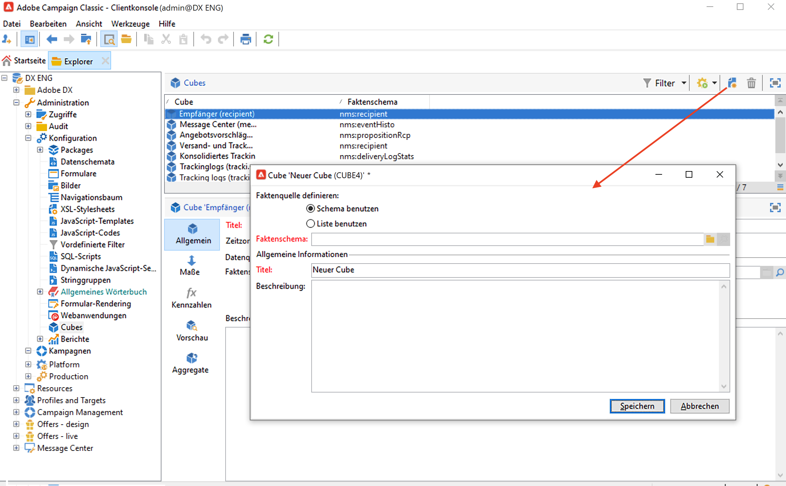

1. Wählen Sie das Schema aus, das die Elemente enthält, die Sie untersuchen möchten (auch als „Faktenschema“ bezeichnet). Wählen Sie in diesem Beispiel die Standard-**Empfänger**-Tabelle.
1. Klicken Sie auf **[!UICONTROL Speichern]**, um den Cube zu erstellen. Er wird der Liste der Cubes hinzugefügt. Jetzt können Sie die Registerkarten verwenden, um ihn zu konfigurieren.

1. Klicken Sie auf den Link **[!UICONTROL Quelldaten filtern...]**, um die Berechnungen des Cubes auf Daten in der Datenbank anzuwenden.

   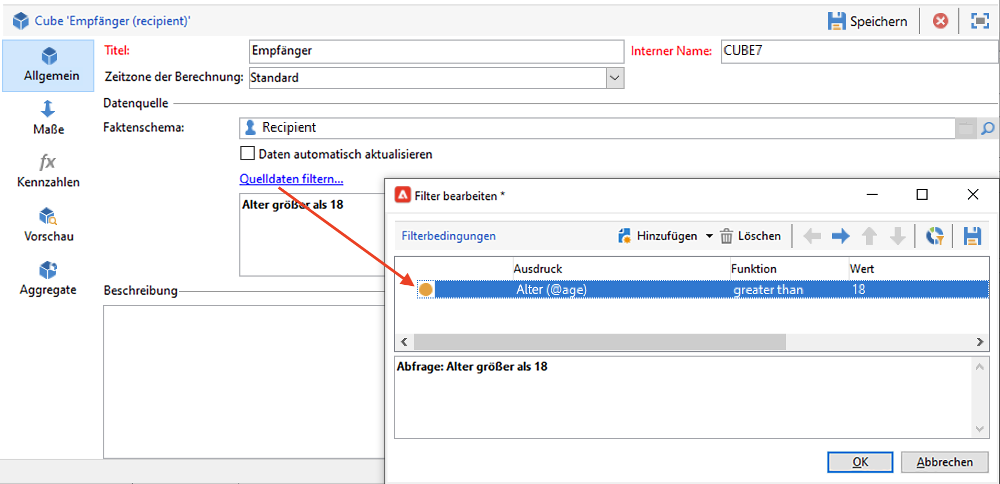

### Definieren von Dimensionen {#define-dimensions}

Definieren Sie nach der Erstellung des Cubes dessen Dimensionen. Dimensionen sind die Analyseachsen, die für jeden Cube auf der Grundlage seines zugehörigen Faktenschemas definiert werden. Dabei handelt es sich um die in der Analyse untersuchten Dimensionen, wie beispielsweise Zeit (Jahr, Monat, Datum), eine Klassifizierung von Produkten oder Verträgen (Familie, Referenz usw.), ein Populations-Segment (nach Stadt, Altersgruppe, Status usw.).

Gehen Sie zur Erstellung von Dimensionen wie folgt vor:

1. Navigieren Sie zur Registerkarte **[!UICONTROL Dimension]** des Cubes und klicken Sie auf die Schaltfläche **[!UICONTROL Hinzufügen]**, um eine neue Dimension zu erstellen.
1. Klicken Sie im **[!UICONTROL Ausdrucksfeld]** auf das Symbol **[!UICONTROL Ausdruck bearbeiten]**, um das Feld auszuwählen, das die betreffenden Daten enthält.

   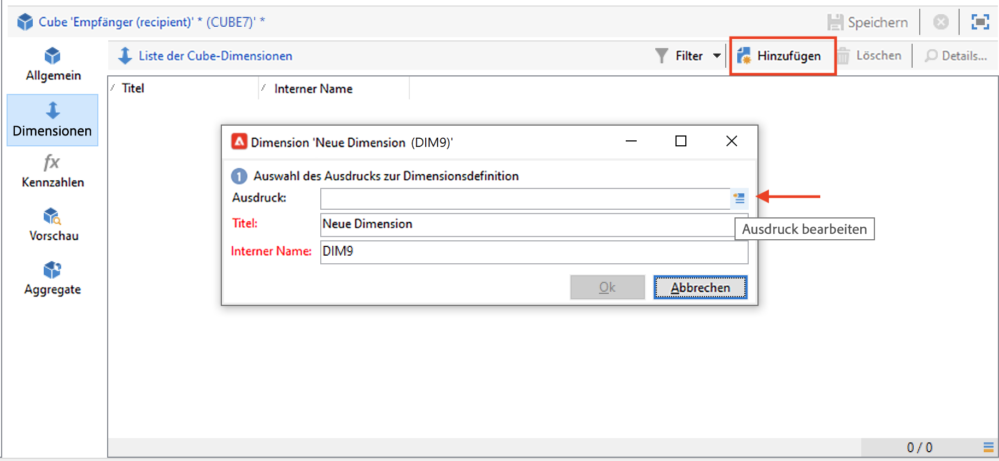

1. In diesem Beispiel wählen wir das **Alter** des Empfängers aus. Für dieses Feld können Sie eine Klassierung definieren, um Altersgruppen zu gruppieren und dadurch die Lesbarkeit der Informationen zu vereinfachen. Es wird empfohlen, die Klassierung immer dann zu verwenden, wenn die Wahrscheinlichkeit mehrerer separater Werte besteht.

Kreuzen Sie hierzu die Option **[!UICONTROL Klassierung aktivieren]** an. [Weitere Informationen](customize-cubes.md#data-binning).

1. Fügen Sie eine Dimension vom Typ **Datum** hinzu. Hier sollen die Erstellungsdaten der Empfängerprofile angezeigt werden. Klicken Sie hierzu auf **[!UICONTROL Hinzufügen]** und wählen Sie das Feld **[!UICONTROL Erstellungsdatum]** in der Empfängertabelle aus.
Sie können den Anzeigemodus für das Datum anpassen. Wählen Sie dazu die zu verwendende Hierarchie und die zu erzeugenden Ebenen aus:

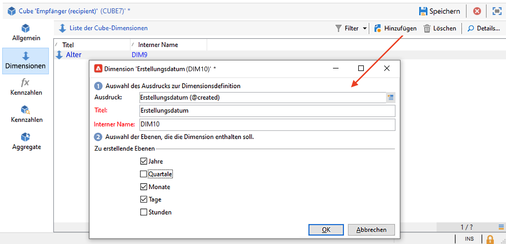

Im Beispiel sollen nur Jahre, Monate und Tage angezeigt werden. Beachten Sie, dass Sie nicht gleichzeitig mit Wochen und Semestern/Monaten arbeiten können, denn diese Ebenen sind nicht kompatibel.

1. Erstellen Sie eine weitere Dimension, um Daten relativ zur Stadt des Empfängers zu analysieren. Fügen Sie hierzu eine neue Dimension hinzu und wählen Sie im Knoten **[!UICONTROL Geografische Lokalisierung]** des Empfängerschemas das Feld Ort aus.

Sie können die Klassierung aktivieren, um das Lesen von Informationen zu vereinfachen, und die Werte mit einer [Auflistung“ ](../config/enumerations.md).

Wählen Sie die Aufzählung in der Dropdown-Liste aus. Beachten Sie, dass diese Aufzählung als **[!UICONTROL Reserviert für Klassierung]** definiert werden muss.

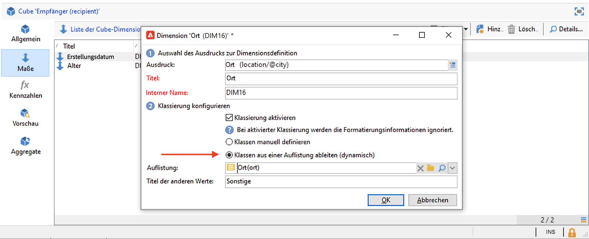

Nur die in der Aufzählung vorhandenen Werte werden angezeigt. Alle anderen werden unter einem Titel zusammengefasst, den Sie im Feld **[!UICONTROL Titel der anderen Werte]** definieren können.

Weitere Informationen hierzu finden Sie unter [Klassen dynamisch verwalten](customize-cubes.md#dynamically-manage-bins).

### Erstellen von Indikatoren {#build-indicators}

Nachdem die Dimensionen definiert wurden, legen Sie einen Berechnungsmodus für die Werte fest, die in den Zellen angezeigt werden sollen.

Erstellen Sie dazu die Indikatoren auf der Registerkarte **[!UICONTROL Kennzahlen]**. Erstellen Sie so viele Kennzahlen, wie es Spalten gibt, die in den auf diesem Cube basierenden Berichten angezeigt werden sollen.

Um Indikatoren aufzubauen, gehen Sie wie folgt vor:

1. Navigieren Sie zur Registerkarte **[!UICONTROL Kennzahlen]** und klicken Sie auf die Schaltfläche **[!UICONTROL Hinzufügen]**.
1. Wählen Sie den Kennzahlentyp und die anzuwendende Formel aus. In diesem Beispiel zählen wir die Anzahl der Frauen unter den Empfängern. Die Kennzahl basiert auf dem Faktenschema und verwendet den Operator **[!UICONTROL Zählung]**.

   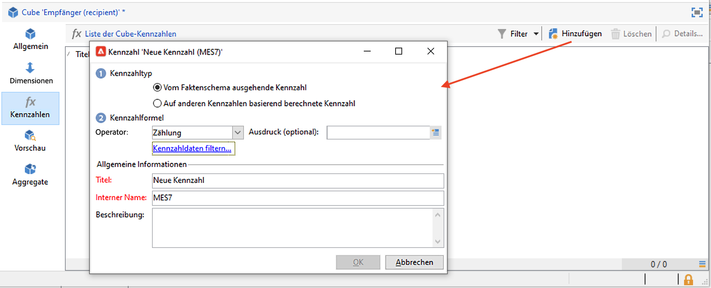

   Verwenden Sie den Link **[!UICONTROL Kennzahldaten filtern...]**, um nur Frauen auszuwählen. [Weitere Informationen](customize-cubes.md#define-measures).

   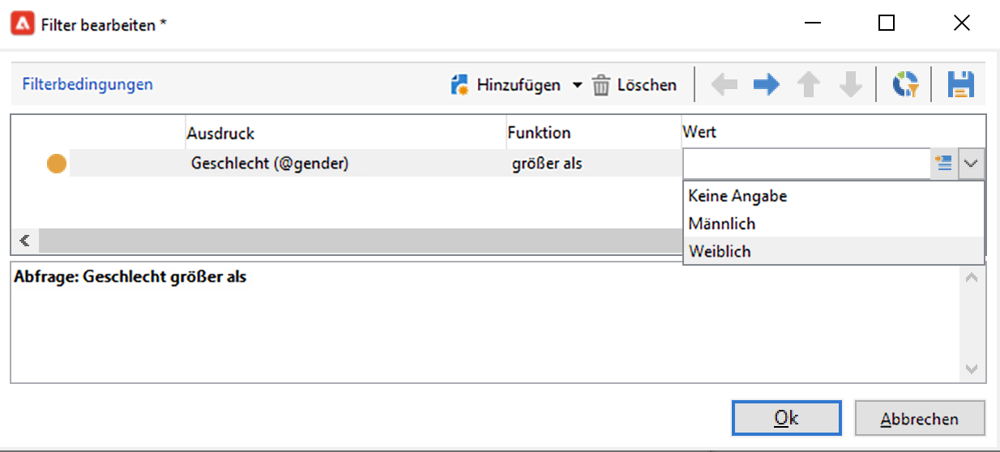

1. Geben Sie den Titel der Kennzahl an und speichern Sie sie.

   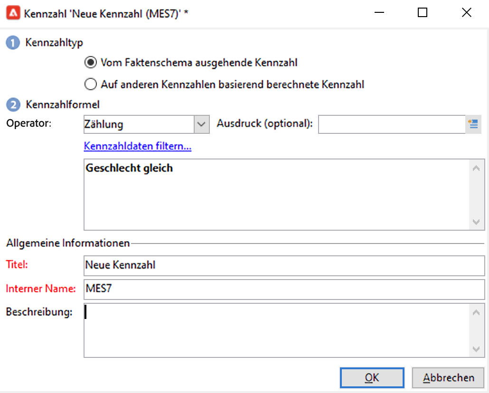

1. Speichern Sie den Cube.

Jetzt können Sie einen auf diesem Cube basierenden Bericht erstellen. [Weitere Informationen](cube-tables.md).
