# Anpassen von Cubes{#cube-custom}

## Daten klassieren {#data-binning}

Nutzen Sie die Datenklassierung, um die Anzeige der Daten zu vereinfachen, indem Sie Werte nach Kriterien gruppieren. Je nach den verfügbaren Informationen können Sie Altersgruppen definieren, E-Mail-Domains gruppieren, auf aufgezählte Werte beschränken, die anzuzeigenden Daten explizit einschränken und alle anderen Daten in einer eigenen Zeile oder Spalte zusammenfassen usw.

Insgesamt sind drei Klassierungstypen möglich:

1. Verwenden manuell definierter Wertebereiche. Beispielsweise Alter, durchschnittlicher Warenkorb, Anzahl der geöffneten Sendungen usw. Weiterführende Informationen hierzu finden Sie unter [Klassen definieren](#defining-each-bin).
1. Dynamisch, abhängig von den Werten einer [Auflistung](../config/enumerations.md): Nur die in der Auflistung enthaltenen Werte anzeigen, alle anderen Werte werden in „Sonstige“ gruppiert. Weitere Informationen hierzu finden Sie unter [Klassen dynamisch verwalten](#dynamically-managing-bins).
1. Verwenden von Wertebereichen, wobei alle anderen gruppiert werden. Beispielsweise 18- bis 25-Jährige, 26- bis 59-Jährige und andere. Weitere Informationen hierzu finden Sie unter [Wertebereiche anzeigen](#creating-value-ranges).

Um die Klassierung zu aktivieren, kreuzen Sie die entsprechende Option bei der Erstellung der Dimension an.

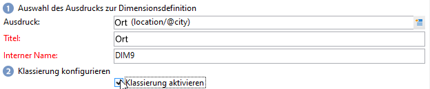

Sie können Klassen entweder manuell erstellen oder sie mit einer vorhandenen [Auflistung“ ](../config/enumerations.md).

Adobe Campaign bietet zudem einen Assistenten, um die Klassen automatisch zu erzeugen: Die Werte können in n Klassen verteilt oder nach den am häufigsten in der Datenbank vertretenen Werten gruppiert werden.

### Definieren der einzelnen Klassen {#define-each-bin}

Um jede Klasse einzeln zu erstellen, aktivieren Sie die Option **[!UICONTROL Klassen manuell definieren]** und nutzen Sie die Tabelle, um die verschiedenen Klassen zu bestimmen.

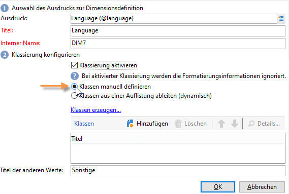

Klicken Sie auf die Schaltfläche **[!UICONTROL Hinzufügen]**, um eine neue Klasse zu erstellen, und listen Sie die in der Klasse zusammenzufassenden Werte auf.

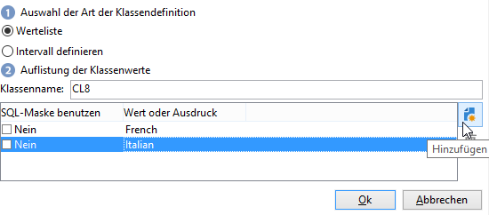

Im unten stehenden Beispiel werden Sprachen in drei Gruppen verteilt: Englisch-Deutsch-Niederländisch, Französisch-Italienisch-Spanisch und Sonstige.

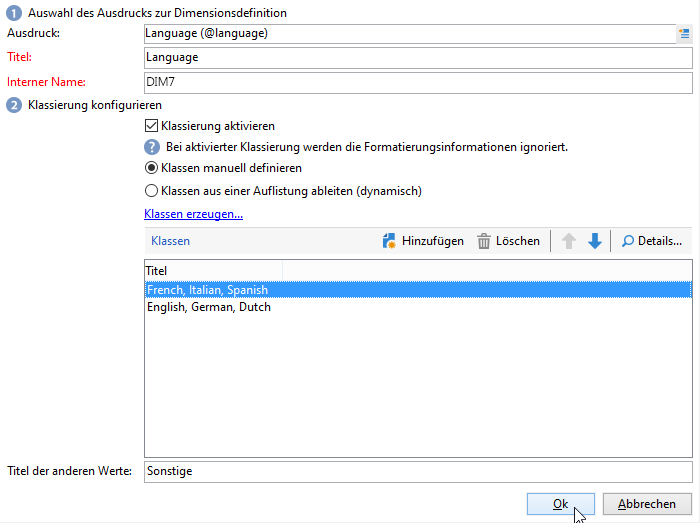

Sie können eine SQL-Maske nutzen, um mehrere Werte nach einem Filter zu gruppieren. Aktivieren Sie hierzu die Option **[!UICONTROL Ja]** in der Spalte **[!UICONTROL SQL-Maske benutzen]** und geben Sie den anzuwendenden SQL-Filter in der Spalte **[!UICONTROL Werte oder Ausdruck]** an.

<!--In the example below, all email domains that start with **yahoo** (yahoo.fr, yahoo.com, yahoo.be, etc.), or with **ymail** (ymail.com, ymail.eu, etc.) will be grouped under the label **YAHOO!**, as well as addresses with the **rocketmail.com** domain.-->

### Dynamisches Verwalten der Klassen {#dynamically-manage-bins}

Werte können über Auflistungen dynamisch verwaltet werden. Dies bedeutet, dass nur die in der Auflistung vorhandenen Werte angezeigt werden. Bei Änderung der Auflistungswerte wird der Cube-Inhalt automatisch angepasst.

Gehen Sie wie folgt vor, um diesen Klassierungstyp zu erstellen:

1. Erstellen Sie eine neue Dimension und aktivieren Sie die Klassierung.
1. Aktivieren Sie die Option **[!UICONTROL Klassen aus einer Aufzählung ableiten (dynamisch)]** und wählen Sie die entsprechende Aufzählung aus.

   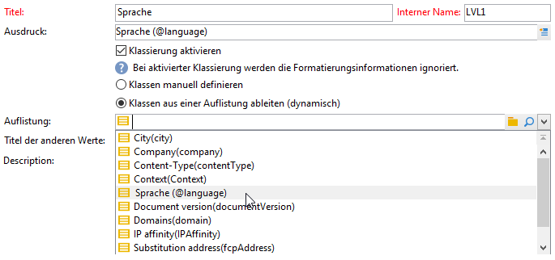

   Bei Aktualisierung der Aufzählungswerte werden die Klassen automatisch angepasst, ohne benutzerseitige Intervention.

   Weitere Informationen zu Auflistungen finden Sie unter [Verwalten von Auflistungen](../config/enumerations.md).

### Erstellen von Wertebereichen {#create-value-ranges}

Sie können die Werte nach benutzerdefinierten Intervallen gruppieren.

Um die Intervalle manuell zu bestimmen, klicken Sie auf die Schaltfläche **[!UICONTROL Hinzufügen]** und aktivieren Sie die Option **[!UICONTROL Intervall definieren]**:

Geben Sie anschließend die oberen und unteren Grenzwerte an und klicken Sie zur Bestätigung auf **[!UICONTROL OK]**.

### Automatisches Erzeugen von Klassen {#generate-bins-automatically}

Es besteht auch die Möglichkeit, die Klassen automatisch zu erzeugen. Klicken Sie hierzu auf den Link **[!UICONTROL Klassen erzeugen...]**.

Sie haben folgende Möglichkeiten:

* **[!UICONTROL Auffinden der am häufigsten verwendeten Werte]**

  Wenn Sie vier Klassen erstellen, werden die vier am häufigsten verwendeten Klassen angezeigt, während die anderen gezählt und in der Kategorie „Sonstige“ zusammengefasst werden.

* **[!UICONTROL Erzeugen von Klassen in Form von Slots]**

  Für das gleiche Beispiel erstellt Adobe Campaign automatisch vier Slots von gleicher Größe, um die Werte in der Datenbank anzuzeigen.

In diesem Fall wird der im Faktenschema gewählte Filter ignoriert.

### Aufzählungen {#enumerations}

Zur Erhöhung der Lesbarkeit und Relevanz von Berichten bietet Adobe Campaign die Möglichkeit, spezifische Auflistungen zu erstellen, um unterschiedliche Werte in ein und derselben Klasse zu gruppieren. Auf diese für die Klassierung reservierten Auflistungen wird in den Cubes verwiesen, die dann in den Berichten angezeigt werden.

Auf diese Weise bietet Adobe Campaign eine Aufzählung von Domains, mithilfe derer sich die Liste der nach ISP gruppierten E-Mail-Domains von allen Datenbankkontakten wie im unten stehenden Beispiel anzeigen lässt:

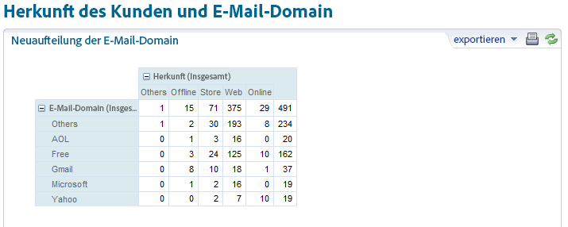

Es wird anhand der folgenden Vorlage erstellt:

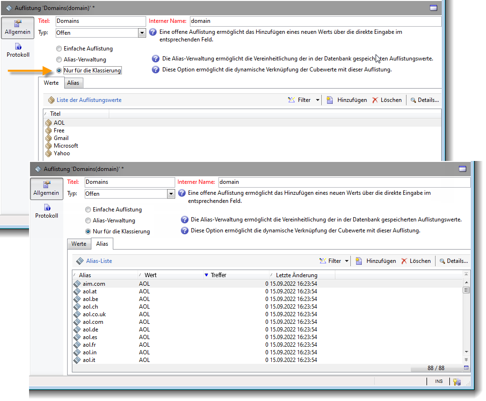

Um einen diese Auflistung verwendenden Bericht zu erstellen, müssen Sie zunächst einen die Dimension **[!UICONTROL E-Mail-Domain]** verwendenden Cube erstellen. Wählen Sie die Option **[!UICONTROL Klassierung aktivieren]** und dann **[!UICONTROL Klassen aus einer Aufzählung ableiten (dynamisch)]**. Wählen Sie anschließend die oben dargestellte Aufzählung **Domains (domain)** aus. Alle Werte, für die kein Alias definiert worden ist, werden unter dem Titel **Sonstige** gruppiert.

Erstellen Sie anschließend einen auf diesem Cube basierenden Bericht, um die Werte anzuzeigen.

Dabei genügt es, die Aufzählung abzuändern, um den entsprechenden Bericht zu aktualisieren. Erstellen Sie beispielsweise den Wert **Adobe** und fügen Sie auf Aufzählungsniveau den Alias **adobe.com** hinzu: Der Bericht wird automatisch mit dem Wert „Adobe“ aktualisiert.

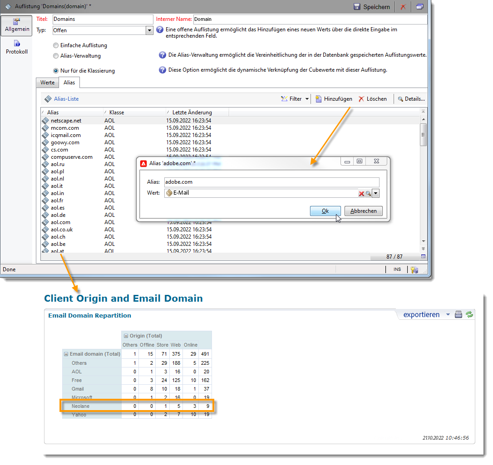

Die Auflistung **[!UICONTROL Domains]** wird zur Erstellung nativer Berichte verwendet, in denen die Domain-Liste angezeigt wird. Um den Inhalt dieser Berichte anzupassen, können Sie diese Liste bearbeiten.

Sie können weitere, der Klassierung vorbehaltene Aufzählungen erstellen und diese in anderen Cubes verwenden: Alle Alias-Werte werden in den im ersten Tab der Aufzählung definierten Klassen gruppiert.

Weitere Informationen zu Auflistungen finden Sie unter [Einstellungen der Campaign-Benutzeroberfläche](../../v8/config/ui-settings.md).

## Aggregate in Cubes {#calculate-and-use-aggregates}

Cubes bieten die Möglichkeit, Daten vor der eigentlichen Verwendung zu aggregieren.

Aggregate sind bei der Bearbeitung großer Datenmengen nützlich. Sie werden automatisch auf der Grundlage der im entsprechenden Workflow-Feld definierten Einstellungen aktualisiert, um die zuletzt erfassten Daten in die Indikatoren zu integrieren

Aggregate werden im entsprechenden Tab des Cubes definiert.

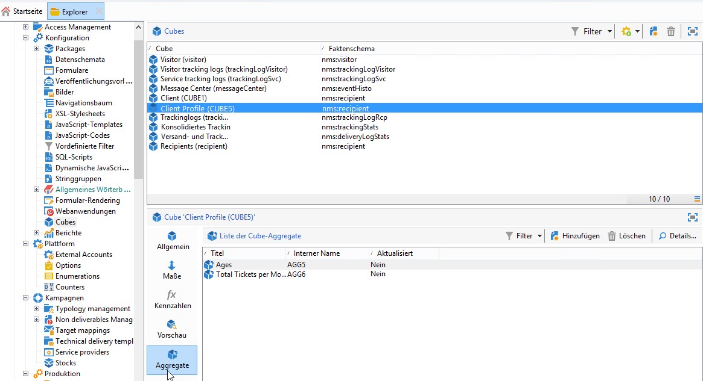

>[!NOTE]
>
>Der Workflow zur Aggregat-Aktualisierung kann im Aggregat selbst konfiguriert werden. Es besteht jedoch auch die Möglichkeit, das Aggregat über einen externen Workflow zu aktualisieren, in welchem der entsprechende Cube referenziert wird.

Gehen Sie wie folgt vor, um ein neues Aggregat zu erstellen:

1. Gehen Sie in den Tab **[!UICONTROL Aggregate]** des Cubes und klicken Sie auf die Schaltfläche **[!UICONTROL Hinzufügen]**.
1. Benennen Sie das Aggregat und fügen Sie die zu berechnenden Dimensionen hinzu.
1. Wählen Sie eine Dimension und eine Ebene aus. Wiederholen Sie diesen Vorgang für alle zu berechnenden Dimensionen und Ebenen.
1. Gehen Sie in den Tab **[!UICONTROL Workflow]**, um den Aggregations-Workflow zu erstellen.

   * Die Aktivität **[!UICONTROL Planung]** ermöglicht es, die Aktualisierungshäufigkeit der Berechnungen zu bestimmen. Der Planer wird im Abschnitt [Konfigurieren der Planungsaktivität](../../automation/workflow/scheduler.md#configuring-scheduler-activity) beschrieben.
   * Über die Aktivität **[!UICONTROL Aggregat-Update]** wird der anzuwendende Aktualisierungsmodus ausgewählt: vollständig oder teilweise.

     Standardmäßig wird bei jeder Berechnung eine vollständige Aktualisierung ausgeführt. Um eine partielle Aktualisierung zu aktivieren, wählen Sie die entsprechende Option aus und definieren Sie die Aktualisierungsbedingungen.

## Definieren von Kennzahlen {#define-measures}

Die zu berechnenden Kennzahlentypen werden in der Registerkarte **[!UICONTROL Kennzahlen]** des Cubes festgelegt. Sie können Summen, Durchschnittswerte, Abweichungen usw. berechnen.

Es können so viele Kennzahlen wie nötig erstellt werden. Wählen Sie anschließend aus, welche Kennzahl Sie in der Tabelle anzeigen oder ausblenden möchten. Weiterführende Informationen hierzu finden Sie in [diesem Abschnitt](#displaying-measures).

Gehen Sie wie folgt vor, um eine neue Kennzahl zu definieren:

1. Klicken Sie auf die oberhalb der Kennzahlenliste gelegene Schaltfläche **[!UICONTROL Hinzufügen]** und wählen Sie den Kennzahlentyp und die Formel zur Berechnung der Kennzahl aus.

   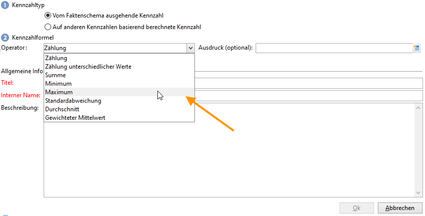

1. Wählen Sie je nach gewählter Funktion den Operator aus, auf den sich die Berechnung bezieht.

   Über die Schaltfläche **[!UICONTROL Erweiterte Auswahl]** können komplexe Formeln erstellt werden. Weitere Informationen hierzu finden Sie unter [Abfrage](../../automation/workflow/query.md).

1. Der Link **[!UICONTROL Kennzahldaten filtern...]** ermöglicht es, das Berechnungsfeld auf bestimmte Daten zu beschränken.

   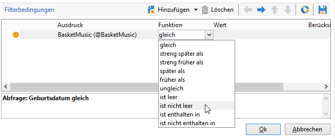

1. Geben Sie den Titel der Kennzahl an und fügen Sie eine Beschreibung hinzu. Klicken Sie dann auf **[!UICONTROL Beenden]**, um die Erstellung abzuschließen.

## Anpassen von Kennzahlen {#display-measures}

Die Anzeige der Kennzahlen in der Tabelle kann nach Bedarf konfiguriert werden. Folgende Parameter sind verfügbar:

* Anzeigereihenfolge der Kennzahlen. [Weitere Informationen](#display-sequence)
* Die Informationen, die im Bericht angezeigt/ausgeblendet werden sollen. [Weitere Informationen](#configuring-the-display)
* die anzuzeigenden Kennzahlen: Prozentsatz, Gesamtbetrag, Anzahl der Dezimalstellen usw. [Weitere Informationen](#changing-the-type-of-measure-displayed)

### Anzeigereihenfolge {#display-sequence}

Die im Cube berechneten Kennzahlen werden über die Schaltfläche **[!UICONTROL Kennzahlen]** konfiguriert.

Verschieben Sie die Zeilen, um die Anzeigereihenfolge zu ändern. Im nachstehenden Beispiel werden die auf Frankreich bezogenen Daten nach unten verschoben: Sie werden nun in der letzten Spalte angezeigt.

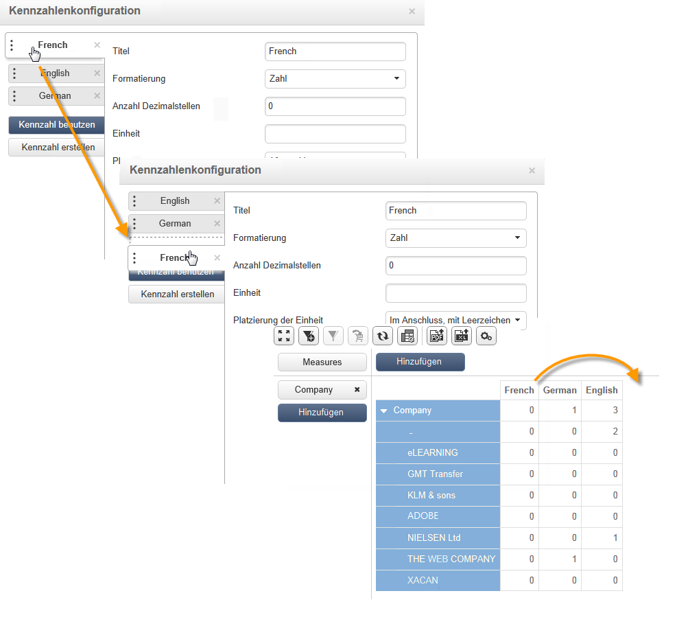

### Konfigurieren der Anzeige {#configuring-the-display}

Die Konfiguration der angezeigten Kennzahlen, Zeilen und Spalten kann für jede Kennzahl einzeln oder global durchgeführt werden. Mit einem speziellen Symbol können Sie auf das Fenster zur Auswahl des Anzeigemodus zugreifen.

* Klicken Sie auf das Symbol **[!UICONTROL Konfiguration der Pivot-Tabelle bearbeiten]**, um auf das Konfigurationsfenster für alle Kennzahlen zuzugreifen.

  Sie können bestimmen, ob die Kennzahlen in Zeilen oder Spalten angezeigt und ob ihre Titel ein- oder ausgeblendet werden sollen.

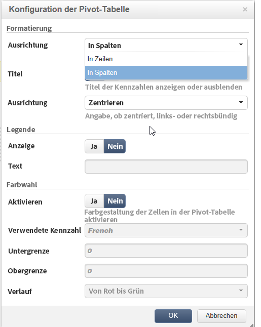

Mithilfe der Farbwahl können die wichtigsten Werte visuell hervorgehoben werden, um die Lesbarkeit der Daten zu verbessern.

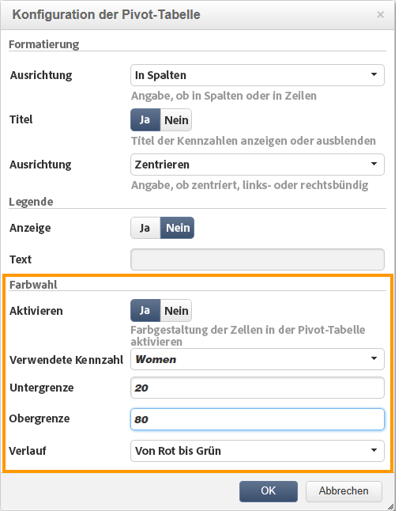

### Ändern des angezeigten Kennzahlentyps {#changing-the-type-of-measure-displayed}

Sie können für jede Kennzahl die anzuwendende Einheit und Formatierung festlegen.

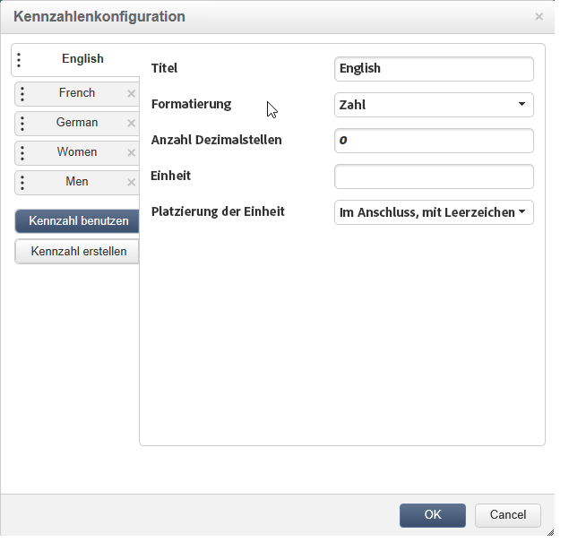

## Freigeben des Berichts {#share-a-report}

Nach der Konfiguration des Berichts können Sie diesen beibehalten und gegebenenfalls mit anderen Benutzern teilen.

Klicken Sie hierzu auf das Symbol **[!UICONTROL Berichteigenschaften anzeigen]** und aktivieren Sie die Option **[!UICONTROL Bericht freigeben]**.

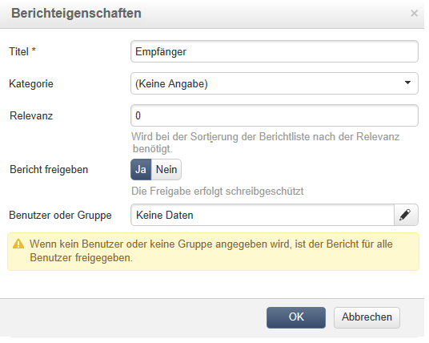

Geben Sie die Kategorie, zu der der Bericht gehört, sowie seine Relevanz an. <!--For more on this, refer in [this page](../../reporting/using/configuring-access-to-the-report.md#report-display-context) to the **Display sequence** and **Defining the filtering options** sections.-->

Um die Änderungen zu bestätigen, muss der Bericht gespeichert werden.

## Erstellen von Filtern {#create-filters}

Sie können Filter erstellen, um nur einen Teil der Daten anzuzeigen.

Gehen Sie dazu wie folgt vor:

1. Klicken Sie auf das Symbol **[!UICONTROL Filter hinzufügen]**.

   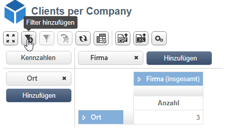

1. Wählen Sie die Dimension, auf die sich der Filter bezieht.

1. Wählen Sie den anzuwendenden Filtertyp und geben Sie seine Genauigkeit an.

   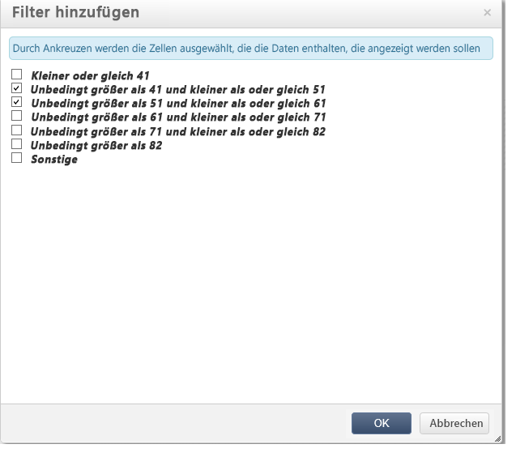

1. Nach seiner Erstellung steht der Filter oberhalb des Berichts zur Verfügung.

   Klicken Sie auf den Filter, um ihn zu bearbeiten. Klicken Sie auf das Kreuz, um den Filter zu löschen.

   Alle Filter werden nebeneinander angezeigt. Ihre Anzahl ist unbegrenzt.

   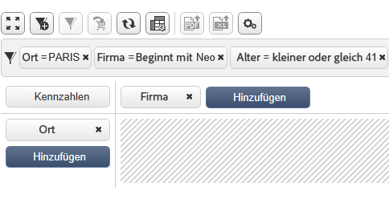

Bei jeder Änderung (Hinzufügen, Entfernen, Ändern) eines Filters muss der Bericht neu berechnet werden.

Filter können auch basierend auf einer Auswahl erstellt werden. Wählen Sie hierzu die Quellzellen, -zeilen und -spalten und klicken Sie auf das Symbol **[!UICONTROL Filter hinzufügen]**.

Um eine Zeile, Spalte oder Zelle auszuwählen, klicken Sie darauf. Um die Auswahl aufzuheben, klicken Sie erneut.

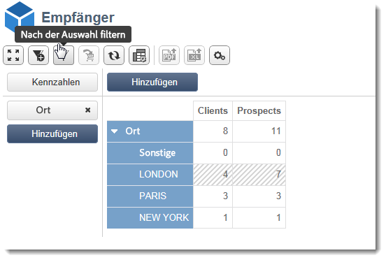

Der Filter wird automatisch angewendet und in der Filterzone oberhalb des Berichts hinzugefügt.

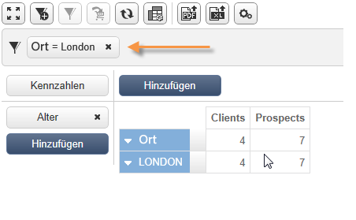
