# Allgemeine Berichte {#global-reports}

Diese Berichte beziehen sich auf Aktivitäten im Zusammenhang mit Daten der gesamten Datenbank. Um das Berichts-Dashboard anzuzeigen, navigieren Sie zur Registerkarte **[!UICONTROL Berichte]**.

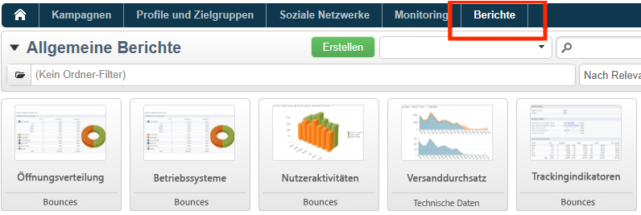

Um Berichte anzuzeigen, klicken Sie auf ihren Namen. Standardmäßig sind die folgenden Berichte verfügbar:

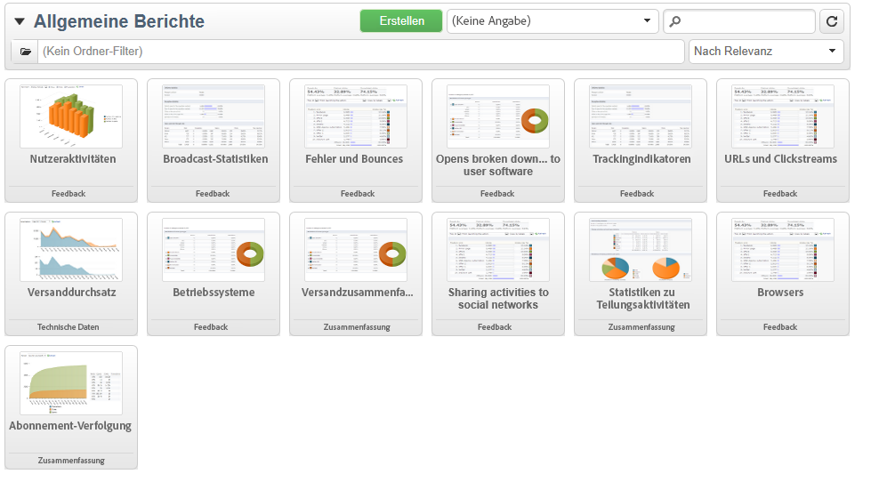

>[!NOTE]
>
>Dieser Abschnitt behandelt nur versandbezogene Berichte.

* **[!UICONTROL Versanddurchsatz]**: Siehe [Versanddurchsatz](#delivery-throughput).
* **[!UICONTROL Browser]**: Siehe [Browser](#browsers).
* **[!UICONTROL Teilen über soziale Netzwerke]**: Siehe [Teilen über soziale Netzwerke](#sharing-to-social-networks).
* **[!UICONTROL Statistiken zu Teilungsaktivitäten]**: Siehe [Statistiken zu Teilungsaktivitäten](#statistics-on-sharing-activities).
* **[!UICONTROL Betriebssysteme]**: Siehe [Betriebssysteme](#operating-systems).
* **[!UICONTROL URLs und Clickstreams]**: Siehe [URLs und Clickstreams](delivery-reports.md#urls-and-click-streams).
* **[!UICONTROL Tracking-Indikatoren]**: Siehe [Tracking-Indikatoren](delivery-reports.md#tracking-indicators).
* **[!UICONTROL Unzustellbare Nachrichten und Bounces]**: Siehe [Unzustellbare Nachrichten und Bounces](#non-deliverables-and-bounces).
* **[!UICONTROL Nutzeraktivitäten]**: Siehe [Nutzeraktivitäten](#user-activities).
* **[!UICONTROL Abonnement-Verfolgung]**: Siehe [Abonnement-Verfolgung](#subscription-tracking).
* **[!UICONTROL Versandzusammenfassung]**: Siehe [Versandzusammenfassung](delivery-reports.md#delivery-summary).
* **[!UICONTROL Versandstatistiken]**: Siehe [Versandstatistiken](#delivery-statistics).
* **[!UICONTROL Aufschlüsselung der Öffnungen]**: Siehe [Aufschlüsselung der Öffnungen](#breakdown-of-opens).

## Versanddurchsatz {#delivery-throughput}

Dieser Bericht enthält Informationen zum Versanddurchsatz der gesamten Plattform für einen bestimmten Zeitraum. Die Kriterien zur Messung der Versandgeschwindigkeit von Nachrichten sind die Anzahl der pro Stunde gesendeten Nachrichten und die Größe der Nachrichten (in Bits pro Sekunde). Im folgenden Beispiel zeigt das erste Diagramm die erfolgreichen Sendungen in Blau und die Anzahl der fehlerhaften Sendungen in Orange an.

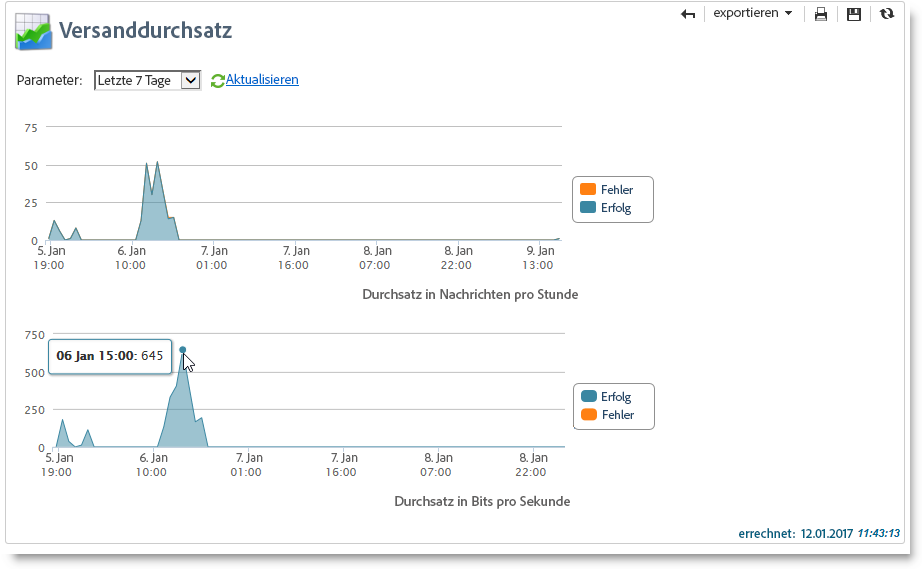

Sie können die angezeigten Werte konfigurieren, indem Sie die Zeitskala ändern: 1-Stunden-Ansicht, 3-Stunden-Ansicht, 24-Stunden-Ansicht usw. Klicken Sie auf **[!UICONTROL Aktualisieren]**, um Ihre Auswahl zu bestätigen.

>[!NOTE]
>
>Sie können die Anzahl der pro Stunde gesendeten Sendungen auch mithilfe des [Control Panel](https://experienceleague.adobe.com/docs/control-panel/using/sftp-management/sftp-storage-management.html?lang=de){target="_blank"} überwachen.
>
>Das Control Panel steht allen Administratoren zur Verfügung. Die Schritte, um einem Benutzer Administratorzugriff zu gewähren, finden Sie auf [dieser Seite](https://experienceleague.adobe.com/docs/control-panel/using/discover-control-panel/managing-permissions.html?lang=de#discover-control-panel){target="_blank"}.
>

## Nutzer-Aktivitäten {#user-activities}

Dieser Bericht zeigt Öffnungen, Klicks und Transaktionen in Form eines Diagramms (Aufschlüsselung nach Tagen, Stunden oder halben Stunden).

Folgende Optionen stehen zur Verfügung:

* **[!UICONTROL Öffnungen]**: Gesamtzahl der geöffneten Nachrichten. E-Mails im Textformat werden nicht berücksichtigt. [Weitere Informationen](metrics-calculation.md#tracking-opens-).
* **[!UICONTROL Klicks]**: Gesamtzahl der Klicks auf Links in Sendungen. Klicks auf Abmeldungs-Links und Mirrorseiten werden nicht berücksichtigt.
<!--
* **[!UICONTROL Transactions]**: Total number of transactions after a message is received. In order for a transaction to be taken into account, a transaction type webtracking tag must be inserted into the matching web page. Webtracking configuration is presented in [this section](../../configuration/using/about-web-tracking.md).
-->

## Unzustellbare Nachrichten und Bounces {#non-deliverables-and-bounces}

Dieser Bericht zeigt die Aufschlüsselung der unzustellbaren Nachrichten nach Typ und nach Domain.

Die **[!UICONTROL Anzahl verarbeiteter Nachrichten]** stellt die Gesamtzahl der vom Versand-Server verarbeiteten Nachrichten dar. Wenn einige Sendungen gestoppt oder pausiert wurden (bevor sie vom Server verarbeitet wurden), ist dieser Wert niedriger als die Anzahl der zu sendenden Nachrichten.

**[!UICONTROL Aufschlüsselung der Fehler nach Typ]**

>[!NOTE]
>
>Die in diesem Bericht angezeigten Fehler lösen einen Quarantäneprozess aus. Weiterführende Informationen zur Quarantäneverwaltung finden Sie im Abschnitt [Quarantäneverwaltung](../send/quarantines.md).

Der erste Teil des Berichts zeigt die Aufschlüsselung der unzustellbaren Nachrichten nach Typ in Form einer Tabelle und eines Diagramms.

Zu jedem Fehlertyp erscheint:

* die Anzahl der fehlerhaften Nachrichten diesen Typs,
* der prozentuale Anteil der fehlerhaften Nachrichten diesen Typs in Bezug auf die Gesamtzahl der fehlerhaften Nachrichten,
* der prozentuale Anteil der fehlerhaften Nachrichten diesen Typs in Bezug auf die Gesamtzahl der verarbeiteten Nachrichten.

Folgende Indikatoren werden angezeigt:

* **[!UICONTROL Unbekannter Nutzer]**: Fehlertyp, der während des Versands erzeugt wird, um anzuzeigen, dass die E-Mail-Adresse ungültig ist.
* **[!UICONTROL Ungültige Domain]**: Fehlertyp, der beim Senden eines Versands erzeugt wird, um anzuzeigen, dass die Domain der E-Mail-Adresse falsch ist oder nicht existiert.
* **[!UICONTROL Postfach voll]**: Fehlertyp, der nach fünf fehlgeschlagenen Versandversuchen erzeugt wird, wenn das Postfach der Empfängerin bzw. des Empfängers zu viele Nachrichten enthält.
* **[!UICONTROL Account deaktiviert]**: Fehlertyp, der beim Senden eines Versands erzeugt wird, um anzuzeigen, dass die Adresse nicht mehr existiert.
* **[!UICONTROL Abgelehnt]**: Fehler, wenn eine Adresse von einem ISP (Internet Service Provider) z. B. infolge der Anwendung einer Sicherheitsregel (Anti-Spam-Software) zurückgewiesen wird.
* **[!UICONTROL Unerreichbar]**: Fehlertyp, der in der Nachrichtenverteilungs-Zeichenfolge auftritt: Vorfall im SMTP-Relais, Domain vorübergehend unerreichbar usw.
* **[!UICONTROL Nicht angemeldet]**: Fehlertyp, wenn das Mobiltelefon der Empfängerin bzw. des Empfängers zum Zeitpunkt des Versands ausgeschaltet war oder über keinen Netzempfang verfügte.

  >[!NOTE]
  >
  >Dieser Indikator bezieht sich nur auf Sendungen auf [mobilen Kanälen](../send/send.md).

  Sie können jede Zeile der Wertetabelle öffnen, indem Sie auf das Symbol `[+]` klicken. Damit kann für jeden Fehlertyp die Aufschlüsselung der fehlerhaften Nachrichten nach Domain angezeigt werden.

**[!UICONTROL Aufschlüsselung der Fehler nach Domain]**

Der zweite Teil des Berichts zeigt die Aufschlüsselung der fehlgeschlagenen Nachrichten nach Domains in Form einer Tabelle und eines Diagramms.

Zu jeder Domain erscheint:

* die Anzahl der fehlerhaften Nachrichten dieser Domain,
* der prozentuale Anteil der fehlerhaften Nachrichten für diese Domain in Bezug auf die Gesamtzahl der verarbeiteten Nachrichten dieser Domain,
* der prozentuale Anteil der fehlerhaften Nachrichten für diese Domain in Bezug auf die Gesamtzahl der fehlerhaften Nachrichten.

Sie können jede Zeile der Wertetabelle öffnen, indem Sie auf das Symbol [+] klicken. Damit kann für jeden Domain-Typ die Aufschlüsselung der fehlerhaften Nachrichten nach Fehlertyp angezeigt werden.

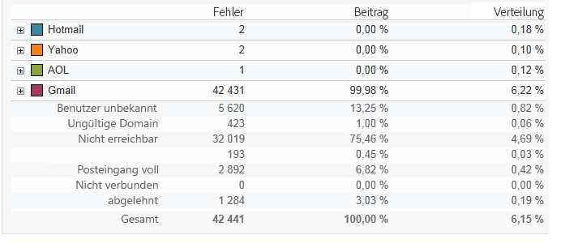

>[!NOTE]
>
>Die in diesem Bericht angezeigten Domain-Namen werden auf Cube-Ebene definiert. Um diese Werte zu ändern, bearbeiten Sie den Cube **[!UICONTROL Versandlogs (broadlogrcp)]**. Weiterführende Informationen hierzu finden Sie in [diesem Abschnitt](gs-cubes.md). Die Kategorie **[!UICONTROL Sonstige]** enthält Domain-Namen, die nicht zu einer bestimmten Klasse gehören.

## Browser {#browsers}

Dieser Bericht enthält die Aufschlüsselung der Browser, die von den Versandempfängern im ausgewählten Zeitraum verwendet wurden.

>[!NOTE]
>
>Bei den Werten handelt es sich um Schätzungen, da nur die Versandempfänger berücksichtigt werden, die in eine Nachricht geklickt haben.

**Allgemeine Statistiken**

Die allgemeinen Statistiken zur Browserverwendung werden als Tabelle und Diagramm dargestellt.

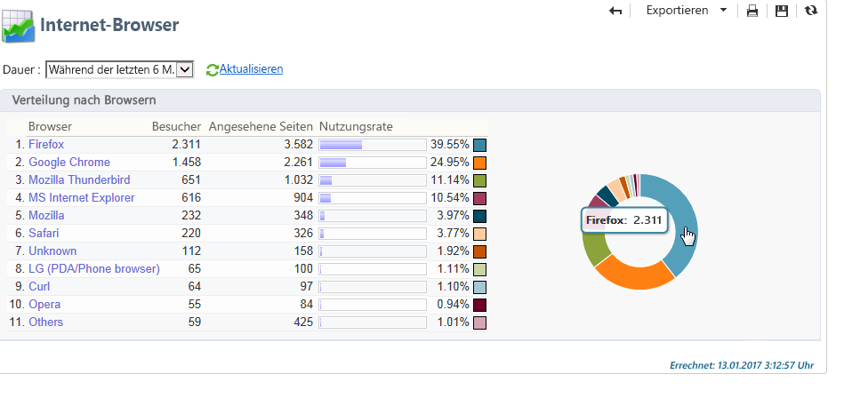

Folgende Indikatoren werden angezeigt:

* **[!UICONTROL Besucher]**: Gesamtzahl der angesprochenen Empfängerinnen und Empfänger (nach Internet-Browser), die mindestens einmal in einem Versand geklickt haben.
* **[!UICONTROL Angesehene Seiten]**: Gesamtzahl der Klicks auf Links in einem Versand (nach Internet-Browser) für alle Sendungen.
* **[!UICONTROL Nutzungsrate]**: Diese Rate stellt die Aufschlüsselung der Besucherinnen und Besucher (nach Internet-Browser) im Verhältnis zur Gesamt-Besucherzahl dar.

**Statistiken nach Browsern**

In der Tabelle der allgemeinen Statistiken können Sie auf die Browser-Namen klicken, um für jeden Browser die Verwendungsstatistiken anzuzeigen.

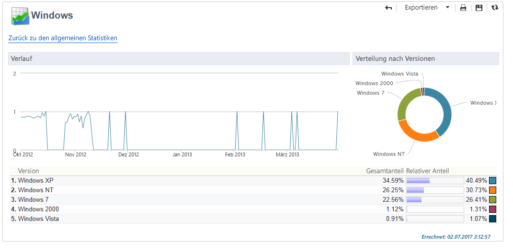

Die Statistiken werden in Form von Kurven, Diagrammen und Tabellen dargestellt.

Die Kurve **[!UICONTROL Verlauf]** stellt die Anwesenheitsrate dieses Browsers pro Tag dar. Bei der Rate handelt es sich um das Verhältnis der Anzahl an Besuchenden pro Tag (über diesen Browser) im Vergleich zur Anzahl an Besuchenden gemessen am Tag mit der höchsten Anwesenheitsrate.

Die **[!UICONTROL Aufschlüsselung nach Versionen]** zeigt den prozentualen Anteil der Besucher je Version in Bezug auf die Gesamt-Besucherzahl für den gewählten Browser.

In der Tabelle werden folgende Indikatoren dargestellt:

* **[!UICONTROL Gesamtanteil]**: Diese Rate stellt die Aufschlüsselung der Besucherinnen und Besucher nach Version im Vergleich zur Gesamt-Besucherzahl (auf allen Browsern) dar.
* **[!UICONTROL Relativer Anteil]**: Diese Rate stellt die Aufschlüsselung der Besucherinnen und Besucher nach Version im Vergleich zur Gesamt-Besucherzahl (auf dem betreffenden Browser) dar.

<!--
### Sharing to social networks {#sharing-to-social-networks}

Viral marketing lets delivery recipients share information with their contact network: they can add a link to their profile (Facebook, Twitter, etc.) or send a message to a friend. Each share and each access to shared information is tracked within the delivery. For more information on viral marketing, refer to [this section](../../delivery/using/viral-and-social-marketing.md).

This report shows the breakdown of shared and opened messages per social network (Facebook, Twitter, etc.) and/or per email.

**[!UICONTROL Email delivery statistics]**

In the email delivery statistics, two values are displayed:

* **[!UICONTROL Number of messages to be delivered]**: Total number of messages processed during delivery analysis.
* **[!UICONTROL Number of successful deliveries]**: Number of messages processed successfully.

**[!UICONTROL Sharing activities and mail open statistics]**

The central table shows the statistics on email shares and opens.

In the **[!UICONTROL Shares]** column, we have the following indicators:

* **[!UICONTROL No. of sharing activities]**: Total number of messages shared on each social network. This value equals the total number of clicks on the icon of the matching **[!UICONTROL Links for sharing to social networks]** personalization block.
* **[!UICONTROL Breakdown]**: This rate represents the breakdown of shares per social network, in relation to the total number of shares.
* **[!UICONTROL Sharing rate]**: This rate represents the breakdown of shares per social network, in relation to the number of messages to be delivered.

In the **[!UICONTROL Opens]** column, we have the following indicators:

* **[!UICONTROL No. of opens]**: Total number of messages opened by people whom the message was forwarded to (via the **[!UICONTROL Links for sharing to social networks]** personalization block). This value equals the number of times the mirror page was displayed. Opens by delivery recipients are not taken into account.
* **[!UICONTROL Breakdown]**: This rate represents the breakdown of opens per social network, in relation to the total number of opens.
* **[!UICONTROL Rate of opens]**: This rate represents the breakdown of opens per social network, in relation to the total number of shares.

**[!UICONTROL Breakdown of sharing activities and opens]**

This section includes two charts which represent the breakdown of sharing activities and opens per social network.

## Statistics on sharing activities {#statistics-on-sharing-activities}

This report shows the evolution of shares to social media in time.

For more information on viral marketing, refer to [this section](../../delivery/using/viral-and-social-marketing.md).

Statistics are presented in the form of a table of values and a chart.

The following indicators are used:

* **[!UICONTROL New contacts]**: Number of new subscriptions following the reception of a message shared via email. This value matches the number of people who received a message shared via email, clicked the **[!UICONTROL Subscription link]** and filled in the subscription form.
* **[!UICONTROL Opens]**: Total number of messages opened by people whom the message was transferred to (via the **[!UICONTROL Link for sharing to social networks]** personalization block). This value equals the number of times the mirror page was displayed. Opens by delivery recipients are not taken into account.
* **[!UICONTROL Sharing activities]**: Total number of messages shared via social networks. This value matches the total number of clicks on the icon of the **[!UICONTROL Links for sharing to social networks]** personalization block.
-->

## Betriebssysteme {#operating-systems}

Dieser Bericht enthält die Aufschlüsselung der Betriebssysteme, die von den Versandempfängern im ausgewählten Zeitraum verwendet wurden.

>[!NOTE]
>
>Bei den Werten handelt es sich um Schätzungen, da nur die Versandempfänger berücksichtigt werden, die in eine Nachricht geklickt haben.

**Allgemeine Statistiken**

Die allgemeinen Statistiken bezüglich der verwendeten Betriebssysteme werden in Form von Diagrammen und Tabellen dargestellt.

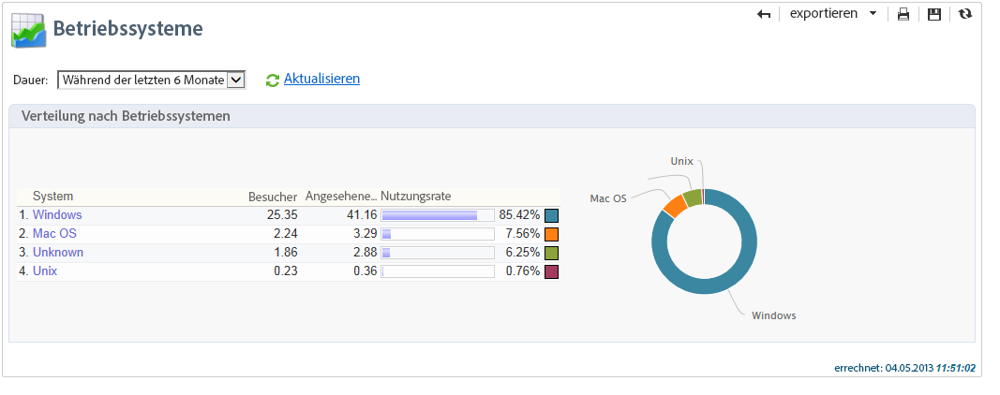

Folgende Indikatoren werden angezeigt:

* **[!UICONTROL Besucher]**: Tagesdurchschnitt der Gesamtzahl der angesprochenen Empfängerinnen und Empfänger (nach Betriebssystem), die mindestens einmal in einem Versand geklickt haben.
* **[!UICONTROL Angesehene Seiten]**: Tagesdurchschnitt der Gesamtzahl der Klicks auf Links in einem Versand (nach Betriebssystem) für alle Sendungen.
* **[!UICONTROL Nutzungsrate]**: Diese Rate stellt die Aufschlüsselung der Besucherinnen und Besucher (nach Betriebssystem) im Verhältnis zur Gesamt-Besucherzahl dar.

**Statistiken nach Betriebssystem**

In der Tabelle der allgemeinen Statistiken können Sie auf die Namen der einzelnen Betriebssysteme klicken, um die jeweiligen Verwendungsstatistiken anzuzeigen.

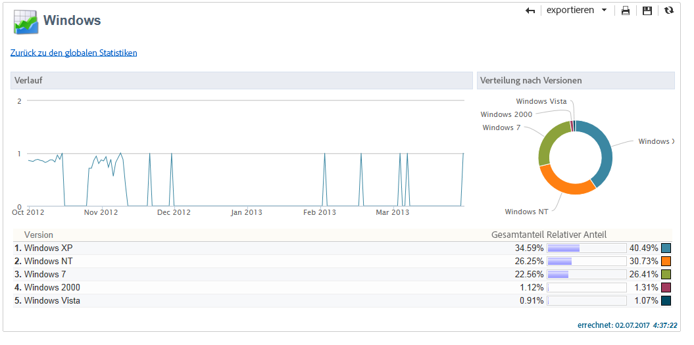

Die Statistiken werden in Form von Kurven, Diagrammen und Tabellen dargestellt.

Die Kurve **[!UICONTROL Verlauf]** stellt die Nutzungsrate dieses Betriebssystems pro Tag dar. Bei der Rate handelt es sich um das Verhältnis der Anzahl an Besuchenden pro Tag (unter diesem Betriebssystem) im Vergleich zur Anzahl an Besuchenden gemessen am Tag mit der höchsten Anwesenheit.

Die **[!UICONTROL Aufschlüsselung nach Versionen]** zeigt den prozentualen Anteil der Besucher je Version in Bezug auf die Gesamt-Besucherzahl für das gewählte Betriebssystem.

In der Tabelle werden folgende Indikatoren dargestellt:

* **[!UICONTROL Gesamtanteil]**: Diese Rate stellt die Aufschlüsselung der Besucherinnen und Besucher (nach Version) im Verhältnis zur Gesamt-Besucherzahl über alle Betriebssysteme hinweg dar.
* **[!UICONTROL Relativer Anteil]**: Diese Rate stellt die Aufschlüsselung der Besucherinnen und Besucher (nach Version) im Verhältnis zur Gesamt-Besucherzahl für das betreffende Betriebssystem dar.

## Abonnement-Verfolgung {#subscription-tracking}

Mit diesem Bericht können Sie die Abonnements für Informationsdienste überwachen. Es werden An- und Abmeldungen angezeigt.

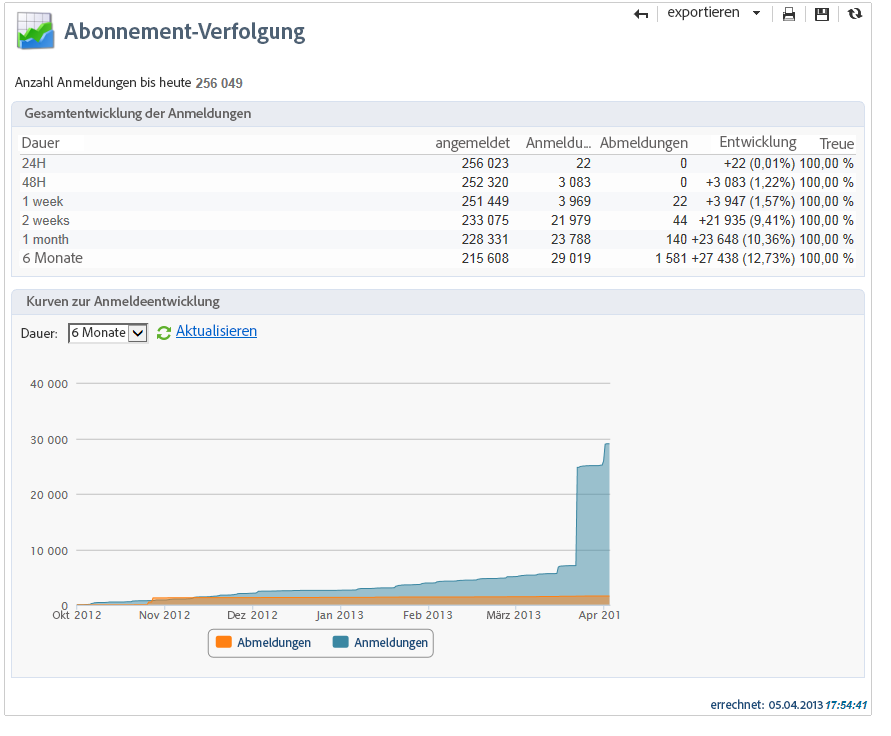

Er kann für ein Abonnement angezeigt werden, indem Sie auf den Knoten **[!UICONTROL Profile und Zielgruppen > Dienste und Abonnements]** der Homepage oder des Explorers klicken. Wählen Sie das gewünschte Abonnement aus und klicken Sie dann auf die Registerkarte **[!UICONTROL Berichte]**. Der Bericht **[!UICONTROL Abonnement-Tracking]** ist standardmäßig verfügbar. Sie können damit die An- und Abmelde-Trends und die Treuerate über einen Zeitraum hinweg sehen. Die Darstellung dieser Daten kann über die Dropdown-Liste konfiguriert werden. Klicken Sie auf **[!UICONTROL Aktualisieren]**, um die ausgewählte Konfiguration zu validieren.

Weiterführende Informationen dazu finden Sie auf [dieser Seite](../start/subscriptions.md).

Die Zeile **[!UICONTROL Anzahl Anmeldungen bis heute]** gibt die Gesamtzahl aller Abonnenten zum aktuellen Zeitpunkt an.

**[!UICONTROL Gesamtentwicklung der Anmeldungen]**

In der Tabelle werden folgende Indikatoren dargestellt:

* **[!UICONTROL Abonnenten]**: Anzahl der Abonnentinnen und Abonnenten insgesamt für den entsprechenden Zeitraum.
* **[!UICONTROL Abonnements]**: Anzahl der Anmeldungen für den entsprechenden Zeitraum.
* **[!UICONTROL Abmeldungen]**: Anzahl der Abmeldungen von Abonnements für den entsprechenden Zeitraum.
* **[!UICONTROL Entwicklung]**: Anzahl der Abmeldungen abzüglich der Anzahl der Anmeldungen. Die Rate wird basierend auf der Gesamtzahl der Abonnentinnen und Abonnenten berechnet.
* **[!UICONTROL Treue]**: Treuerate der Abonnentinnen und Abonnenten über den entsprechenden Zeitraum.

**[!UICONTROL Kurven zur Anmeldeentwicklung]**

Das Diagramm veranschaulicht die Abonnemententwicklung über den ausgewählten Zeitraum.

## Versandstatistiken {#delivery-statistics}

Dieser Bericht enthält die Anzahl verarbeiteter E-Mails sowie den prozentualen Anteil an zugestellten Nachrichten, Hard- und Softbounces, Öffnungen, Klicks und Abmeldungen nach Domains.

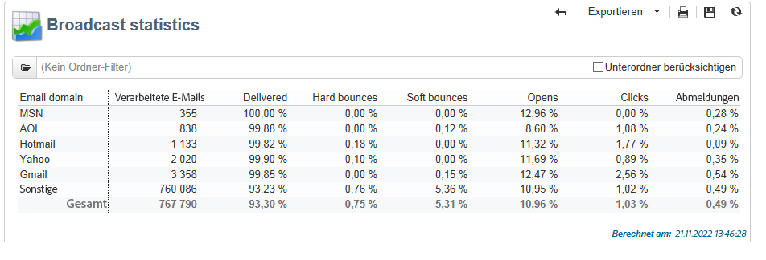

Folgende Indikatoren werden angezeigt:

* **[!UICONTROL Verarbeitete E-Mails]**: Gesamtzahl der Nachrichten, die vom Versand-Server verarbeitet wurden.
* **[!UICONTROL Zugestellt]**: Prozentualer Anteil der erfolgreich verarbeiteten Nachrichten im Vergleich zur Gesamtzahl der verarbeiteten Nachrichten.
* **[!UICONTROL Hardbounces]**: Prozentualer Anteil der Hardbounces im Vergleich zur Gesamtzahl der verarbeiteten Nachrichten.
* **[!UICONTROL Softbounces]**: Prozentualer Anteil der Softbounces im Vergleich zur Gesamtzahl der verarbeiteten Nachrichten.

  >[!NOTE]
  >
  >Weiterführende Informationen zu Hard- und Softbounces finden Sie auf [dieser Seite](../send/quarantines.md).

* **[!UICONTROL Öffnungen]**: Prozentualer Anteil der angesprochenen Empfängerinnen und Empfänger, die mindestens einmal eine Nachricht geöffnet haben, im Vergleich zur Gesamtzahl der erfolgreich verarbeiteten Nachrichten.
* **[!UICONTROL Klicks]**: Prozentualer Anteil der angesprochenen Empfängerinnen und Empfänger, die mindestens einmal in einem Versand geklickt haben, im Vergleich zur Anzahl der erfolgreich verarbeiteten Nachrichten.
* **[!UICONTROL Abmeldung]**: Prozentualer Anteil der Klicks auf einen Abmelde-Link im Vergleich zur Anzahl der erfolgreich verarbeiteten Nachrichten.

## Aufschlüsselung der Öffnungen {#breakdown-of-opens}

Dieser Bericht zeigt die Aufschlüsselung von Öffnungen nach Betriebssystem, Gerät und Browser für den entsprechenden Zeitraum an. Für jede Kategorie werden zwei Diagramme verwendet. Das erste zeigt Statistiken zu Öffnungen auf Computern und Mobilgeräten. Das zweite zeigt nur Statistiken zu Öffnungen auf Mobilgeräten an.

Die Anzahl der Öffnungen entspricht der Gesamtzahl der geöffneten Nachrichten. E-Mails im Textformat werden nicht gezählt. Weitere Informationen zum Tracking von Öffnungen finden Sie in [diesem Abschnitt](metrics-calculation.md#tracking-opens-).

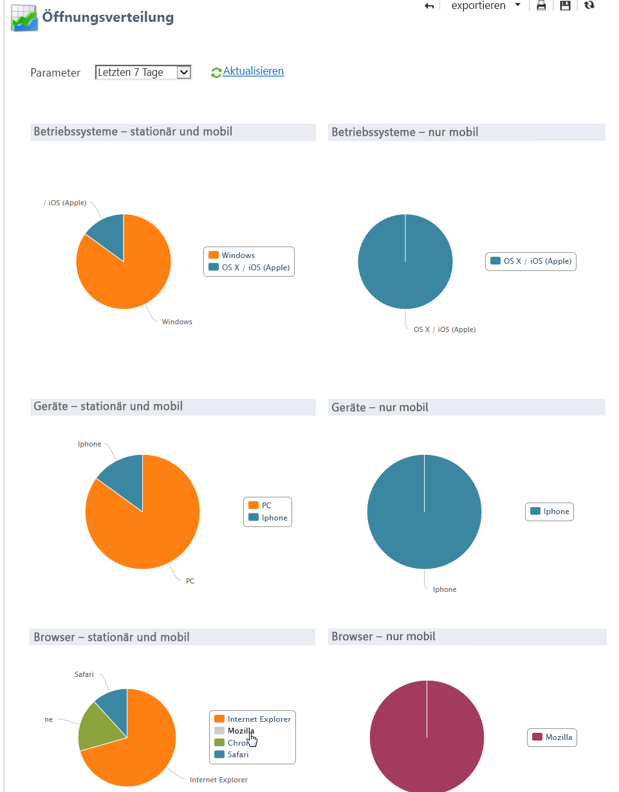

>[!NOTE]
>
>Browser- und Betriebssystemnamen stellen einen Teil der Informationen dar, die vom Benutzeragent des Browsers gesendet werden, für den die Nachricht geöffnet wurde. Adobe Campaign leitet den Gerätetyp anhand der Geräteinformationen ab.
