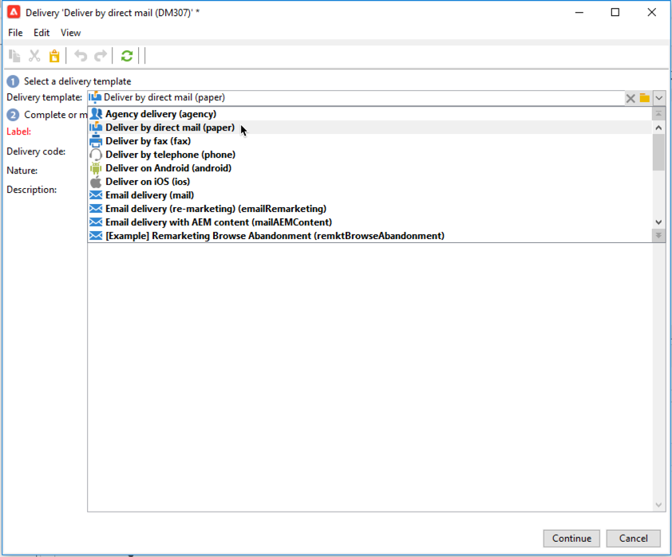
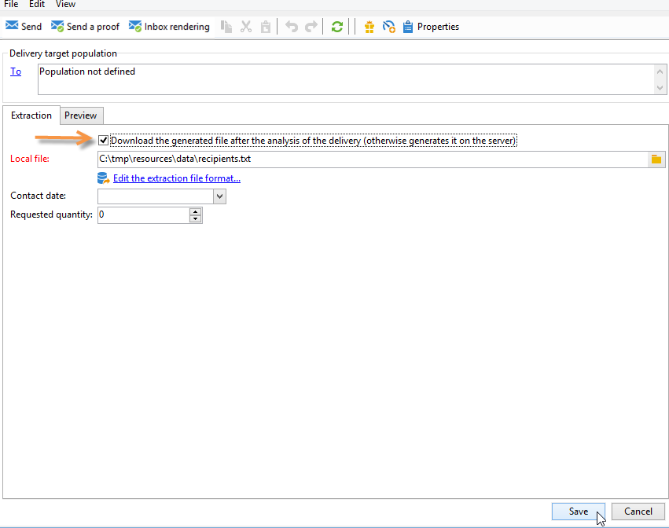
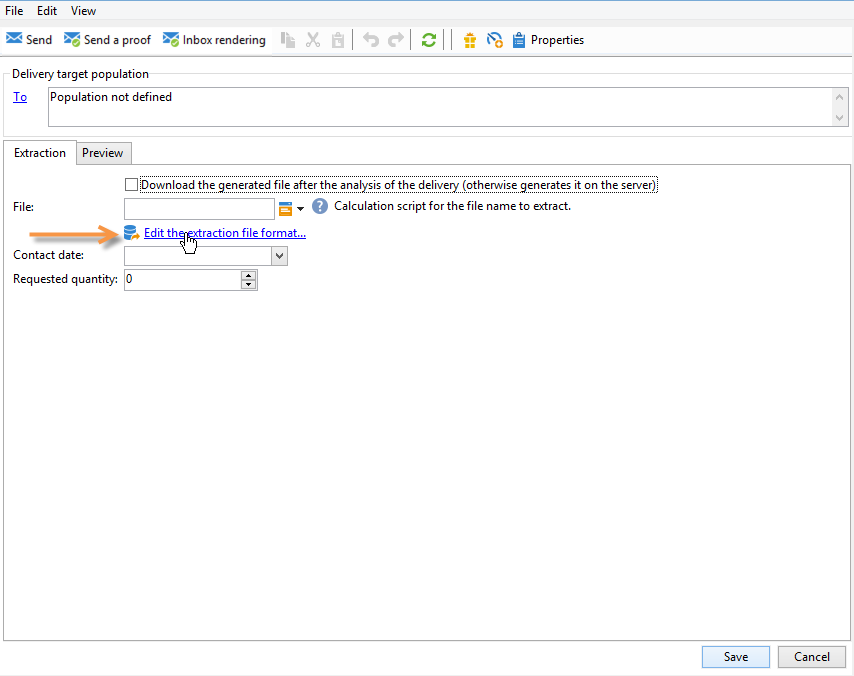
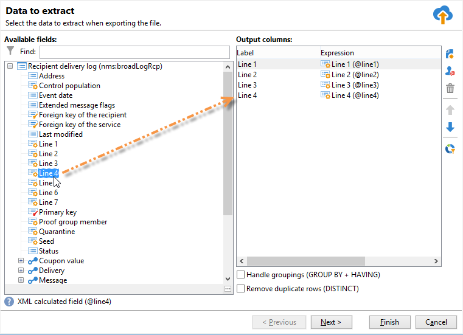
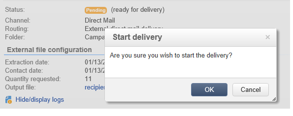

# Erstellen von Briefpost-Sendungen

Ein Briefpost-Versand erzeugt eine Extraktionsdatei, die die Daten der Zielpopulation enthält. Sie können diese Datei dann für den Provider freigeben, der Nachrichten an die Zielpopulationen sendet.

Die Schritte zum Generieren der Datei sind:

1. [Erstellen des Versands](#creating-a-direct-mail-delivery)
1. [Zielgruppe definieren](#defining-the-direct-mail-audience)
1. [Dateiinhalt festlegen](#defining-the-direct-mail-content)
1. [Versand validieren](#validating)
1. [Versand starten](#start-delivery)

## Erstellen des Versands{#creating-a-direct-mail-delivery}

Erstellen Sie anhand der Vorlage einen Briefpost-Versand. Sie können die integrierte Vorlage **[!UICONTROL Briefpost-Versand (Papier)]** duplizieren und konfigurieren.

Gehen Sie wie folgt vor, um einen neuen Briefpost-Versand zu erstellen:

>[!NOTE]
>
>Allgemeine Konzepte zur Versanderstellung finden Sie unter [Erstellen des ersten Versands](../start/create-message.md).

1. Erstellen Sie einen neuen Versand, beispielsweise im Versand-Dashboard.
1. Wählen Sie die Versandvorlage **Briefpost-Versand (Papier)** aus.

   

1. Geben Sie einen Titel, einen Code und eine Beschreibung für Ihren Versand ein. Weitere Informationen hierzu finden Sie unter [Versand erstellen](../start/create-message.md#create-the-delivery).
1. Klicken Sie auf **Fortfahren**, um die Eingaben zu bestätigen und in das Fenster zur Nachrichtenkonfiguration zu gelangen.

## Zielgruppe definieren{#defining-the-direct-mail-audience}

Die Empfängerprofile müssen mindestens ihren Namen und ihre Anschrift enthalten.

Postanschriften sind berechnete Felder. Standardmäßig kann eine Anschrift bis zu sechs Zeilen haben: Die erste enthält den Vor- und Nachnamen der Empfängerin bzw. des Empfängers, die folgenden Zeilen die für die Zustellung erforderlichen Informationen (z. B. Straße und Zusätze) und die letzte Zeile Postleitzahl und Ort. Die Definition des standardmäßig berechneten Felds „postAddress“ kann im nms::recipient-Schema überprüft werden.

Eine Anschrift gilt als vollständig angegeben, wenn die Felder Name, Postleitzahl und Ort nicht leer sind. Empfängerinnen und Empfänger mit unvollständigen Adressen werden von Direkt-Mail-Sendungen ausgeschlossen.

Weitere Informationen finden Sie unter [Definieren der Zielgruppe](../start/create-message.md#target-population).

## Dateiinhalt festlegen{#defining-the-direct-mail-content}

Definieren Sie mithilfe des Extraktionsassistenten die Informationen (Spalten), die in die Ausgabedatei exportiert werden sollen.

Im Feld **[!UICONTROL Datei]** wird der Name der die extrahierten Daten enthaltenden Datei definiert. Die Schaltfläche rechts daneben ermöglicht die Verwendung von Personalisierungsfeldern zur Erstellung des Dateinamens.

Standardmäßig wird die Extraktionsdatei erstellt und auf dem Server gespeichert. Sie können sie auf Ihrem Computer speichern. Um dies zu tun, aktivieren Sie die Option **[!UICONTROL Nach dem Export erzeugte Datei herunterladen]**. In diesem Fall sind der Pfad zum lokalen Speicherverzeichnis und der Dateiname anzugeben.

Bei einem Briefpost-Versand wird der Extraktionsinhalt über den Link **[!UICONTROL Extraktionsdateiformat bearbeiten...]** konfiguriert.

Über diesen Link gelangen Sie in den Extraktions-Assistenten, mit dessen Hilfe die zu exportierenden Daten (Spalten) festgelegt werden.

Sie können eine personalisierte URL in die Extraktionsdatei einfügen. Weitere Informationen hierzu finden Sie unter [Web-Formular veröffentlichen](../dev/web/publishing-a-web-form.md).

>[!NOTE]
>
>Dieser Assistent enthält die Schritte des Exportassistenten, die in der Adobe Campaign Classic-Dokumentation [&#x200B; werden](https://experienceleague.adobe.com/docs/campaign-classic/using/getting-started/importing-and-exporting-data/generic-imports-exports/executing-export-jobs.html){target="_blank"}.

## Versand validieren{#validating}

Überprüfen Sie das Ergebnis der Analyse und den Inhalt der Ausgabedatei.

Im Rahmen einer Marketing-Kampagne wird die Extraktionsdatei am Extraktionsdatum erstellt. Sie können den Inhalt der extrahierten Datei anzeigen, validieren oder das Format ändern und die Extraktion bei Bedarf neu starten. Nachdem die Datei validiert wurde, können Sie die Benachrichtigungs-E-Mail an den Router senden. Weitere Informationen finden Sie auf [dieser Seite](https://experienceleague.adobe.com/docs/campaign/automation/campaign-orchestration/marketing-campaign-approval.html?lang=de){target="_blank"}.

Allgemeine Konzepte zum Validieren eines Versands finden Sie unter [Vorbereiten und Validieren des Versands](../start/create-message.md#validate-the-delivery).

Die Ausgabedatei eines Briefpost-Versands wird während der Versandanalyse generiert. Der Inhalt der Datei hängt von den ausgewählten Ausgabespalten ab (siehe diesen [Datei](#defining-the-direct-mail-content)).

>[!NOTE]
>
>Die Analysephase wird in diesem [&#x200B; beschrieben](delivery-analysis.md).

Während der Analysephase wird die Datei generiert, es werden aber keine Empfängerinformationen (z. B. Versandlogs) aktualisiert. Sie können diesen Auftrag daher ohne Risiko abbrechen.

Prüfen Sie jetzt das Ergebnis der Analyse und den Inhalt der Ausgabedatei und klicken Sie dann auf **[!UICONTROL Absendung bestätigen]**. Über eine Bestätigungsnachricht kann der Versand gestartet werden.

Mit der Absendebestätigung wird die Extraktion der Daten in die angegebene Datei gestartet.

Nun können Sie den Assistenten schließen und die Versand-Logs auf der Registerkarte **[!UICONTROL Versand]** ansehen, auf die Sie über die Detailansicht des Versands zugreifen können.

Sie können den Abrufmodus der Versandlogs auf der Registerkarte **[!UICONTROL Analyse]** der Versandeigenschaften konfigurieren.

Dabei stehen zwei Modi zur Verfügung:

* **[!UICONTROL Nachrichten werden nach Validierung als gesendet betrachtet]** (Standardmodus): In diesem Funktionsmodus werden alle Versandlogs aktualisiert, sobald der Benutzer den Versand bestätigt (ihr Status wechselt von &#39;Versand ausstehend&#39; zu &#39;Gesendet&#39;). Der Versand wechselt dann automatisch in den Status **[!UICONTROL Abgeschlossen]**.
* **[!UICONTROL Eine Ergebnisdatei listet gesendete und fehlgeschlagene Nachrichten auf]**: Dieser Modus ermöglicht eine Aktualisierung der Broadlogs mittels einer externen Datei vom Dienstleister. In diesem Fall muss ein Workflow zur Verarbeitung dieser Informationen verwendet werden, um den Broadlog-Status zu aktualisieren.

  >[!NOTE]
  >
  >Nach der Aktualisierung der Versandlogs muss der Versandstatus vom Benutzer in **[!UICONTROL Abgeschlossen]** geändert werden.

## Versand starten{#start-delivery}

Nachdem Sie die Extraktionsdatei validiert haben, klicken Sie auf **Versand bestätigen**. Über eine Bestätigungsnachricht kann der Versand gestartet werden.

Mit der Bestätigung wird die Extraktion der Daten in die angegebene Datei gestartet.

Im Rahmen einer Marketing-Kampagne werden die Extraktionsdateien nach Erteilung aller Validierungen über einen speziellen Workflow erstellt, der in einer Standardkonfiguration automatisch gestartet wird, wenn bei einem Briefpostversand die Extraktion ausstehend ist. Weiterführende Informationen finden Sie in [diesem Abschnitt](https://experienceleague.adobe.com/docs/campaign/automation/campaign-orchestration/marketing-campaign-deliveries.html?lang=de){target="_blank"}.

>[!NOTE]
>
>Wenn Sie eine **[!UICONTROL Briefpost]**-Aktivität in einem Workflow verwenden, wird bei der ausgehenden Transition die Zielpopulation und nicht die generierte Extraktionsdatei verwendet. Um die Datei an einen Server zu senden, fügen Sie **[!UICONTROL Aktivität]** Datenextraktion“ nach der Aktivität **[!UICONTROL Briefpost]** und dann eine Aktivität **[!UICONTROL Dateiübertragung]** hinzu.
