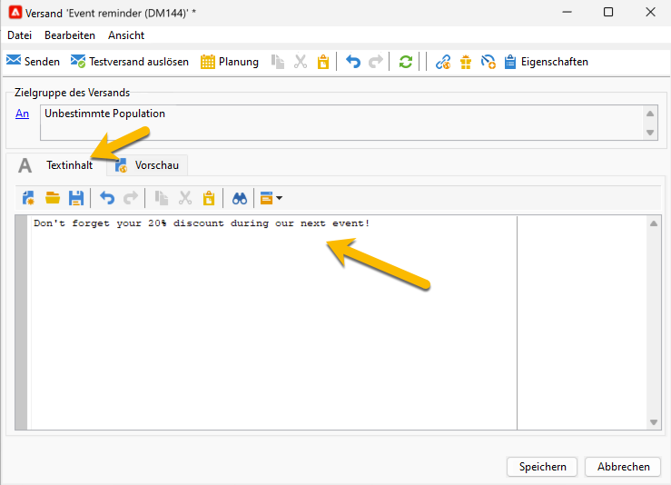
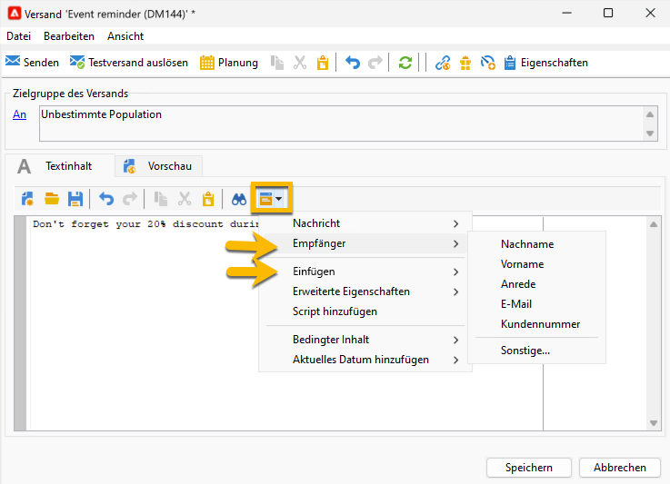
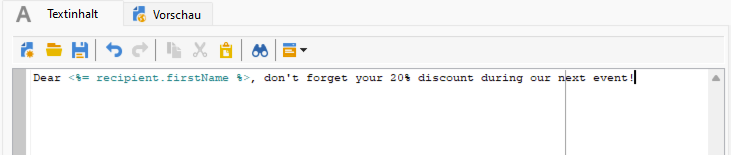
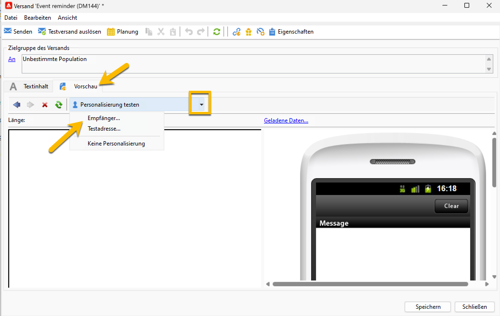
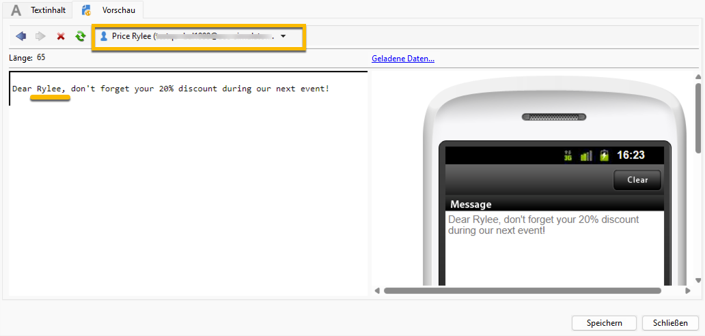

# SMS-Inhalt erstellen {#sms-content}

So konfigurieren Sie den Inhalt Ihres SMS-Versands:

1. Geben Sie den Inhalt Ihrer Nachricht auf der Registerkarte **[!UICONTROL Textinhalt]** ein.

   {zoomable="yes"}

1. Sie können Ihre Nachricht personalisieren, indem Sie Personalisierungsfelder einfügen (z. B. den Vornamen hinzufügen) oder vordefinierte Personalisierungsblöcke einfügen (z. B. die Grußformeln hinzufügen). Klicken Sie auf die Schaltfläche „Personalisierung“, um diese hinzuzufügen:

   {zoomable="yes"}

   Nachdem Sie beispielsweise auf **[!UICONTROL Empfänger]** > **[!UICONTROL Vorname]** geklickt haben, wird der SMS-Inhalt mit dem Feld „Personalisierung“ wie folgt personalisiert:

   {zoomable="yes"}

   Weitere Informationen zur Personalisierung in Adobe Campaign finden Sie unter [Erste Schritte mit der Personalisierung](../personalize.md).

1. Sie können eine Vorschau Ihres Versandinhalts über die Registerkarte **[!UICONTROL Vorschau]** anzeigen. Um Ihre Personalisierungseinstellungen zu überprüfen, klicken Sie auf die Dropdown-Liste **[!UICONTROL Personalisierung testen]** und wählen Sie eine Empfängerin oder einen Empfänger aus.

   {zoomable="yes"}

   Anschließend können Sie die Vorschau Ihrer SMS mit der Personalisierung überprüfen:

   {zoomable="yes"}

>[!NOTE]
>
>* SMS-Nachrichten sind auf eine Länge von 160 Zeichen beschränkt, wenn die Code-Seite Latin-1 (ISO-8859-1) verwendet wird. Wenn die Nachricht in Unicode geschrieben ist, darf sie 70 Zeichen nicht überschreiten. Bestimmte Sonderzeichen können sich auf die Nachrichtenlänge auswirken. Weitere Informationen zur Nachrichtenlänge finden Sie im Abschnitt [Transliteration von SMS-Zeichen](smpp-external-account.md#smpp-channel-settings).
>
>* Wenn die Nachricht Personalisierungsfelder oder Felder für bedingte Inhalte enthält, kann die Länge von einer empfangenden Person zur anderen variieren. Die Länge der Nachricht muss nach der Personalisierung ausgewertet werden.
>
>*Während der Analysephase wird die Nachrichtenlänge geprüft und im Falle eines Überschreitens ein Warnhinweis erzeugt.

Nachdem Sie den Inhalt Ihres Versands erstellt haben, können Sie [Ihre Zielgruppe auswählen](sms-audience.md).
